# A6 - Design for Strength and Stiffness II

Rick Bhattacharya · MEGR 2157 
Time spent: approximately **4 hours**

[Download all CAD files and drawings](files/A06-CAD-and-drawings.zip) · [Download the portfolio PDF](files/A06-submission.pdf)

## Objective

For this assignment, I turned my A5 bracket design into a SolidWorks model and engineering drawing. I also modeled the two-hole link for MEGR 2157. The main task was to carry the dimensions from the hand calculations into CAD and show how the mating parts should fit.

I used the final selected dimensions from [A5](../A05/index.md), where strength controlled the five bracket features. My selected material was 6061-T6 aluminum. The images below show my modeling process and the drawing exports supplied with this page.

## Bracket dimensions and parameters

The bracket uses a centered connector and pin beneath the T-shaped opening. I kept the body depth uniform at 1.000 in; the reduced sidewall depth in the earlier strength-only sketch was not used in this model.

| Feature | Selected nominal dimension (in) |
|---|---:|
| A - pin diameter | 0.750 |
| B - connector width in the front view | 0.250 |
| C - bottom thickness | 0.750 |
| D - body depth | 1.000 |
| E - upper-lip thickness | 0.750 |
| Body width × height | 4.500 × 3.000 |
| Pin length | 2.500 |
| Connector depth | 0.500 |
| Body bottom to pin center | 1.000 |

<figure class="a6-figure"><a href="images/bracket-equations.png">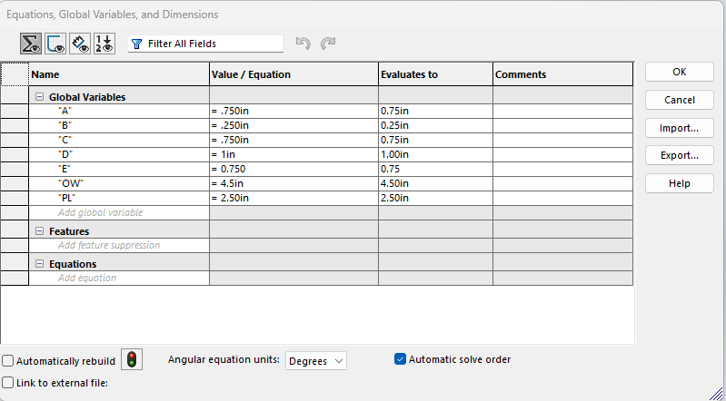</a><figcaption>My initial bracket variable table. These are nominal design sizes; the drawing specifies the finished fit limits. <a href="images/bracket-equations.png">Full size</a>.</figcaption></figure>

I started with a 4.500 × 3.000 in rectangle and used the central construction line to keep the layout symmetric. The next step was the pocket and top slot. The wide opening is 2.500 in across and 1.500 in high, with 0.750 in of material above and below it.

<figure class="a6-figure"><a href="images/bracket-base.png">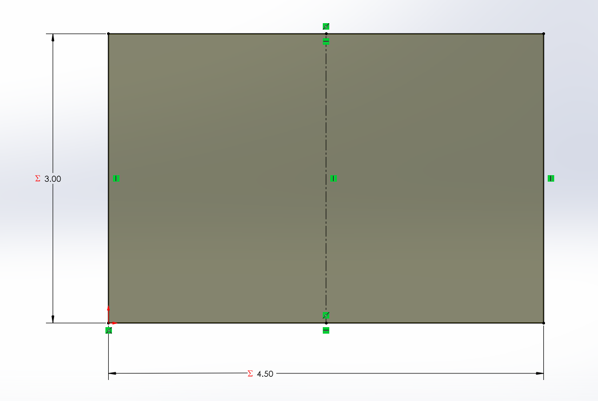</a><figcaption>The base sketch establishes the outside size. The equation symbols identify linked dimensions. <a href="images/bracket-base.png">Full size</a>.</figcaption></figure>

<figure class="a6-figure"><a href="images/bracket-pocket.png">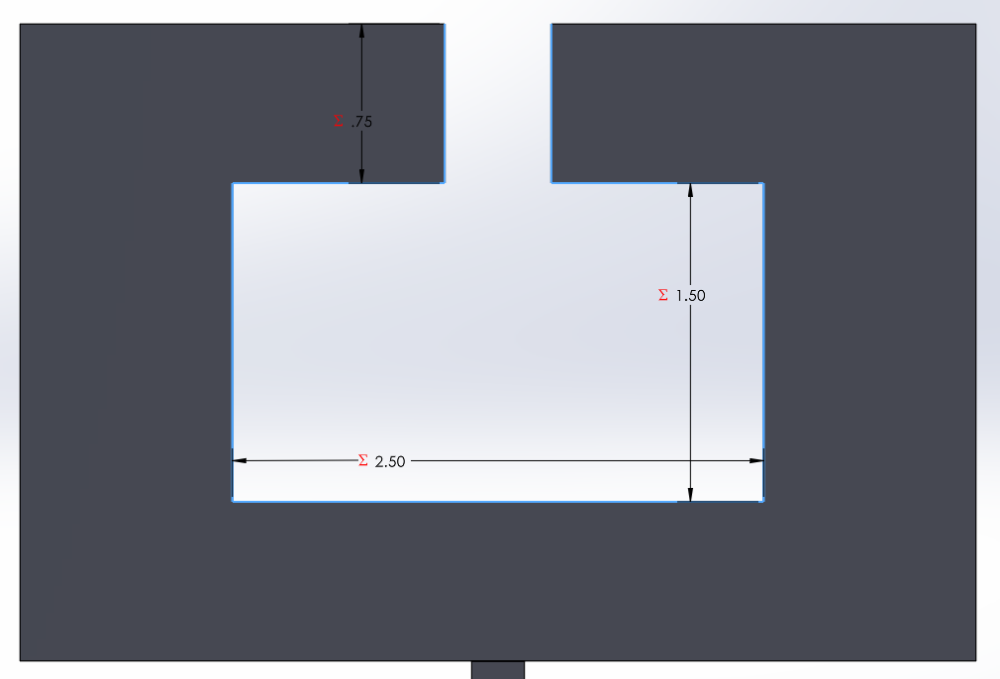</a><figcaption>The pocket and top opening leave the two upper lips and the bottom crossmember. <a href="images/bracket-pocket.png">Full size</a>.</figcaption></figure>

For the lower connection, I used a 0.250-in-wide connector and located the pin center 1.000 in below the body. The following sketches record the initial layout and the joined outline used later in the process.

<figure class="a6-figure a6-small"><a href="images/pin-initial.png">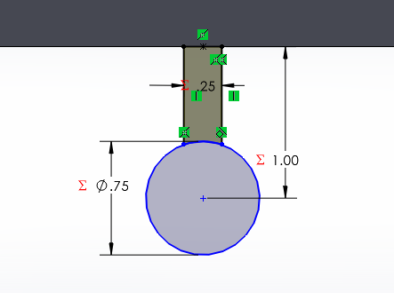</a><figcaption>Initial connector and pin layout. <a href="images/pin-initial.png">Full size</a>.</figcaption></figure>

<figure class="a6-figure a6-small"><a href="images/pin-profile.png">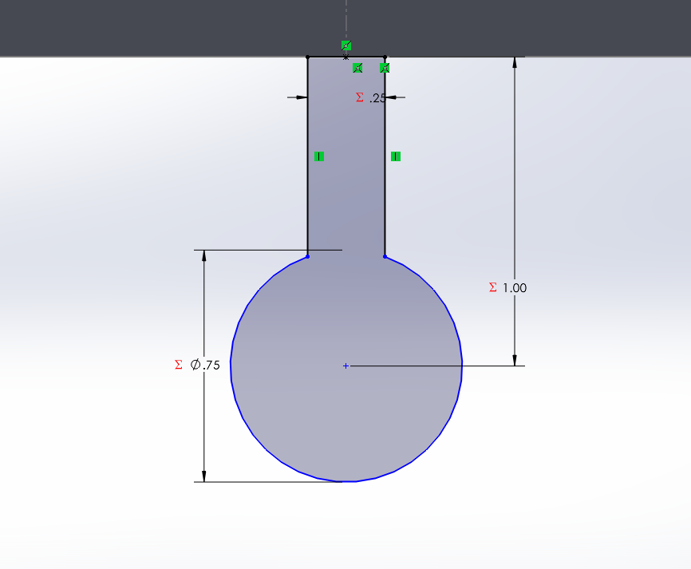</a><figcaption>The later profile shows the connector joining the pin outline. <a href="images/pin-profile.png">Full size</a>.</figcaption></figure>

<figure class="a6-figure"><a href="images/bracket-isometric.png">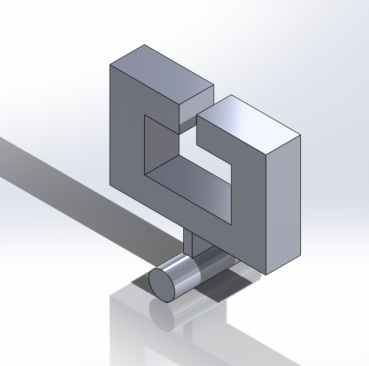</a><figcaption>The bracket model after creating the body, opening, connector, and pin. <a href="images/bracket-isometric.png">Full size</a>.</figcaption></figure>

## Bracket drawing and sliding fits

I used an ANSI A landscape sheet with front, top, and right-side views in third-angle arrangement, plus an isometric view. The bracket drawing is at 1:2 scale. The narrow slot, each horizontal recess, and pocket height use the fit limits selected in A5.

<figure class="a6-figure a6-small"><a href="images/sheet-format.png">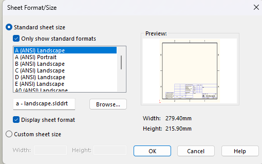</a><figcaption>Choosing the drawing sheet format. Sheet size and projection are separate settings. <a href="images/sheet-format.png">Full size</a>.</figcaption></figure>

| Mating feature | Limits on drawing (in) |
|---|---|
| Top slot | 0.5000 to 0.5016 |
| Each horizontal recess, from slot edge to pocket wall | 1.0000 to 1.0008 |
| Pocket height | 1.5000 to 1.5016 |
| Pin diameter | 0.7487 to 0.7492 |

One correction was moving the 2X 1.000 recess callout. I first dimensioned the outside wall thickness, which is also nominally 1.000 in. The fit applies to the inside ledge, so the final callout measures from the pocket wall to the narrow slot wall. I also used reference dimensions for the total pocket width and body height after showing their component dimensions.

<figure class="a6-figure"><a href="images/slot-tolerance.png">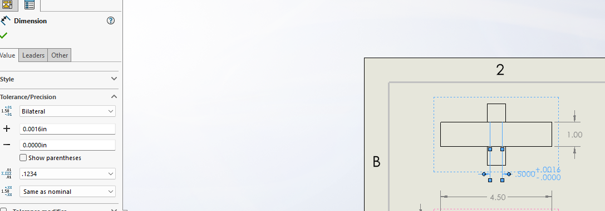</a><figcaption>Entering the top-slot tolerance. SolidWorks uses its Bilateral option here, with zero lower deviation to make a unilateral tolerance. <a href="images/slot-tolerance.png">Full size</a>.</figcaption></figure>

<figure class="a6-figure"><a href="files/A6%20bracket.pdf">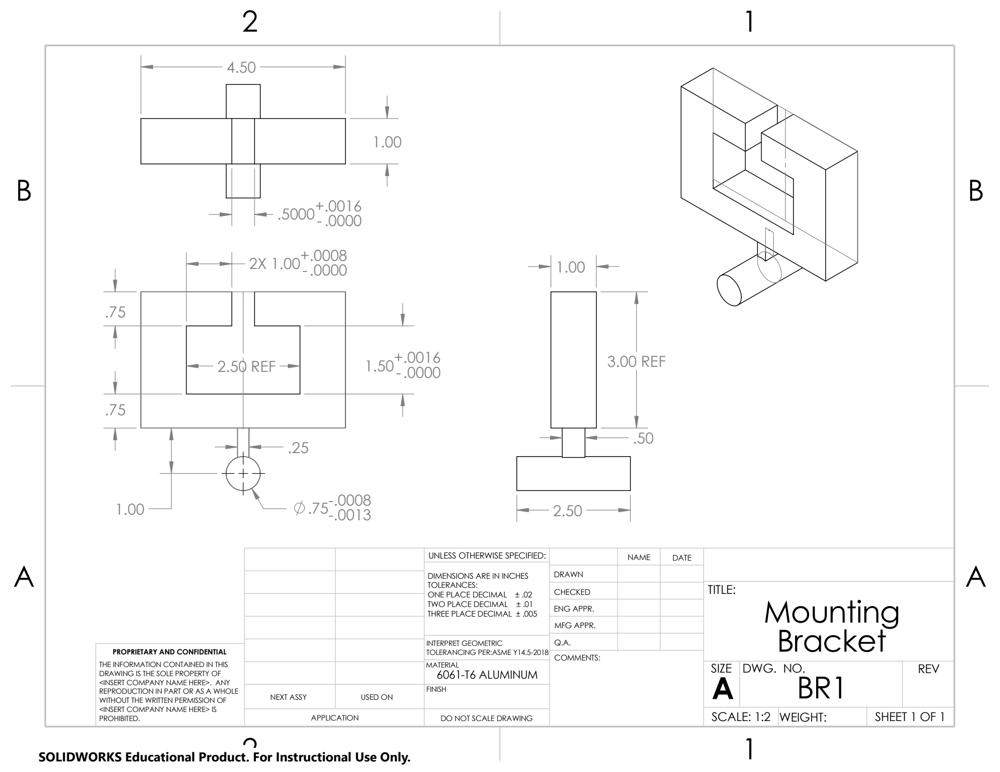</a><figcaption>Bracket drawing as exported from SolidWorks. <a href="files/A6%20bracket.pdf">Open the original PDF</a>.</figcaption></figure>

## MEGR 2157 link

The link is a 0.125-in-thick plate with rounded ends and two different holes. The 0.750-in nominal hole connects to the bracket pin; the 1.000-in nominal hole is the other shaft interface from A5. Both end arcs are centered on their respective holes.

| Parameter | Value or relationship |
|---|---|
| Width | 1.500 in |
| CenterSpacing | 3.000 in |
| T | 0.125 in |
| BracketHole | 0.750 in nominal |
| OtherHole | 1.000 in nominal |
| Length | CenterSpacing + Width = 4.500 in |
| EndOffset | Width / 2 = 0.750 in |

The length equation made the layout easier to follow: 3.000 in between hole centers plus 0.750 in at each end gives 4.500 in overall. In the equation screenshot, T is entered as 0.125 in; the displayed 0.13 is rounded to two decimal places.

<figure class="a6-figure"><a href="images/link-equations.png">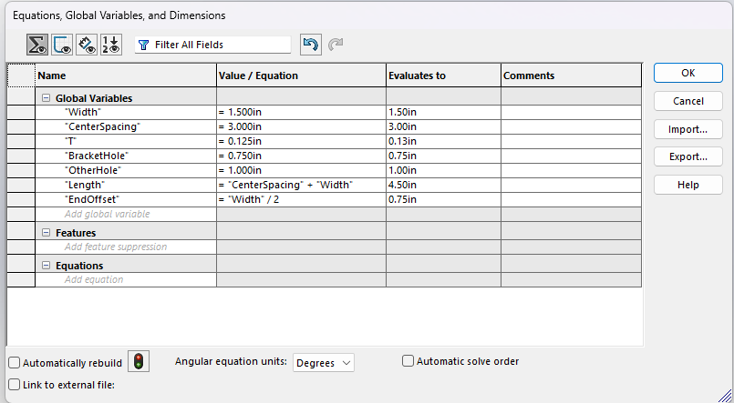</a><figcaption>My link equation table. Length and EndOffset are calculated relationships; thickness is still a fixed input in this screenshot. <a href="images/link-equations.png">Full size</a>.</figcaption></figure>

<figure class="a6-figure"><a href="images/link-sketch.png">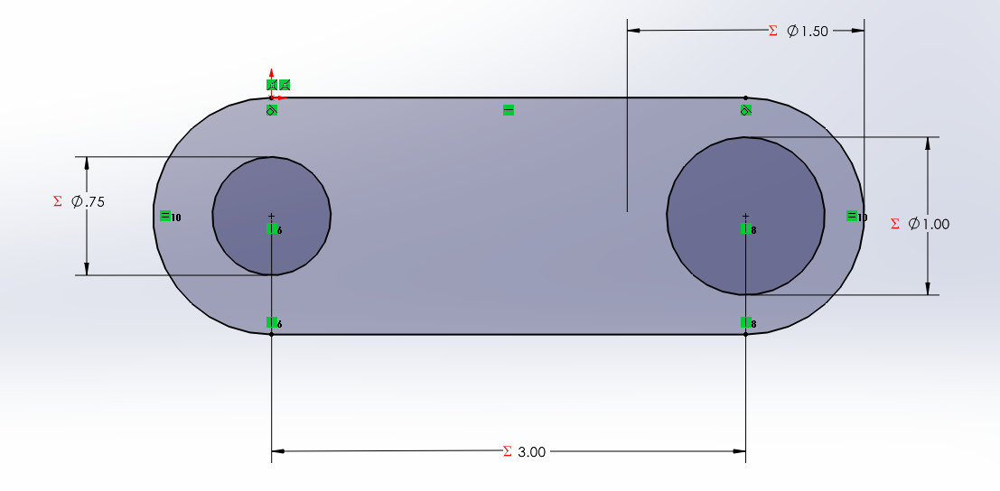</a><figcaption>The link sketch shows the hole sizes, center spacing, and rounded-end geometry. <a href="images/link-sketch.png">Full size</a>.</figcaption></figure>

<figure class="a6-figure"><a href="images/link-isometric.png">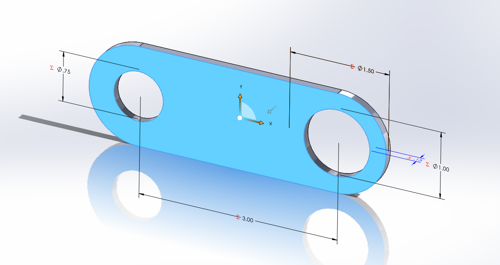</a><figcaption>The extruded link with its two through-holes. <a href="images/link-isometric.png">Full size</a>.</figcaption></figure>

The smaller hole has limits of 0.7500–0.7508 in. Combined with the bracket pin limits of 0.7487–0.7492 in, the diametral clearance is **0.0008–0.0021 in**. The other hole has limits of 1.0000–1.0005 in. Its A5 mating shaft limits, 1.0008–1.0012 in, give **0.0003–0.0012 in interference**. These two connections therefore need different manufacturing limits even though both start from a nominal diameter.

<figure class="a6-figure"><a href="files/A6%20link.pdf">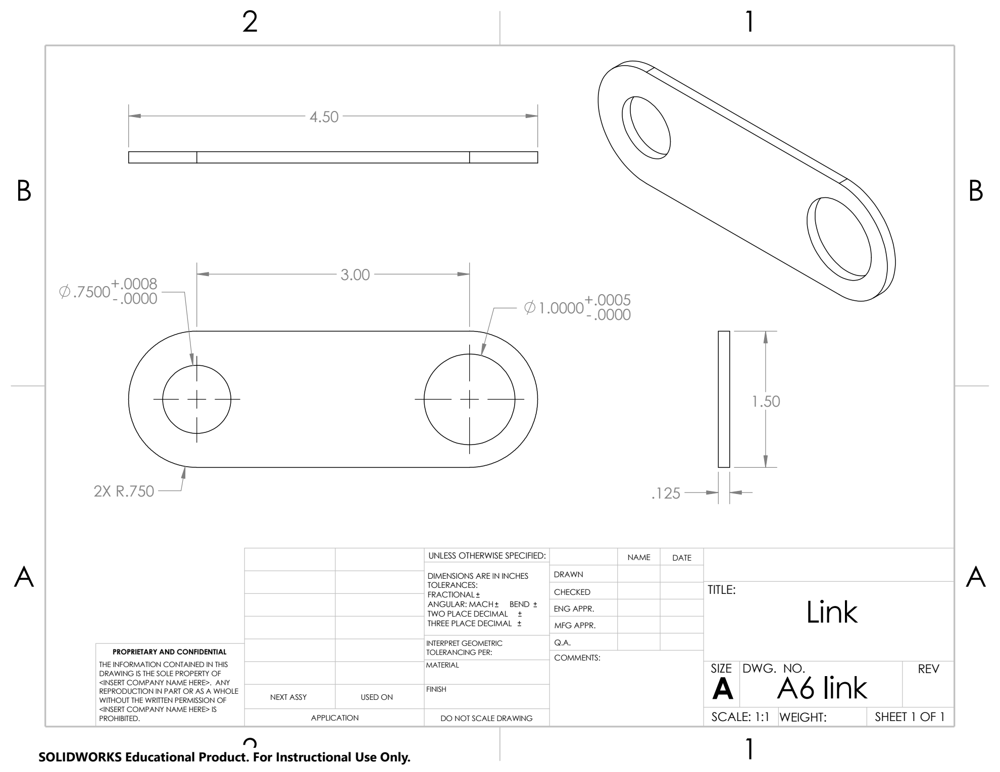</a><figcaption>Link drawing as supplied. Its two hole tolerances are present; the title-block and GD&T items listed below still need completion. <a href="files/A6%20link.pdf">Open the original PDF</a>.</figcaption></figure>

## Lessons learned

**Parameters and calculations.** Using variables helped keep the dimensions organized, but a geometric relationship is different from a strength equation. My current link table calculates overall length and end offset, while T remains a fixed value. The A5 strength relationship is t = Fn / [Sᵧ(w − dₘₐₓ)]. With F = 600 lbf, n = 4, Sᵧ = 40,000 psi, w = 1.500 in, and dₘₐₓ = 1.0005 in, it gives t = 0.12012 in before selecting 0.125 in. This equation still needs to be connected to a modeled dimension and documented in CAD. I have not recorded a rebuild test showing an analytical input changing that dimension.

**Choosing tolerances by function.** The bracket slot is a mating surface, so I specified 0.5000–0.5016 in directly. The 4.50-in overall bracket width is a less critical outside envelope and uses the drawing's two-decimal tolerance of ±0.01 in. Applying the slot's much tighter allowance to every outside dimension would add machining and inspection work without improving that fit. The individual fit callouts override the general tolerance block.

**Checking what a dimension measures.** The outside wall and inside ledge both measured 1.000 in, but only the ledge was the intended sliding-fit feature. Moving that callout taught me to check the extension lines rather than just the displayed number. I also corrected the link width from a diameter-style callout to a linear width and added the two end radii.

**Part-to-part compatibility.** A nominal 0.750-in hole and pin do not describe how the joint will assemble. Comparing their largest and smallest sizes showed the clearance available at the bracket connection. The larger link hole uses an interference fit instead. Size limits describe that difference; geometric tolerances are also needed to communicate the orientation of the holes and the plate faces.

The assignment took approximately **4 hours** in total, including modeling, dimensioning, drawing setup, and corrections.

## Remaining CAD documentation

The page and downloads record the files supplied so far. Before the final submission:

- Add and document a strength or stiffness equation that directly drives a model dimension. Show the bracket's final parameter table and the parameter-to-feature links, including the body depth and upper lip.
- Document the link's parameter connection to the bracket interface. Matching nominal values alone does not demonstrate an automatic relationship between the parts.
- Complete the link drawing's material field, general tolerance block, geometric-tolerancing standard, datum/geometric-tolerance callouts, and bracket-interface note. Change its redundant 4.50 overall length to REF if the end radii and center spacing remain controlling.
- Preserve the A5 minimum link width and thickness when assigning their tolerances, or recheck the minimum section. A symmetric ±0.005 tolerance on 0.125 thickness would allow 0.120 in, slightly below the calculated 0.12012-in requirement even before width variation.
- Finish the drawn-by/date fields and verify the T-beam dimensions against the instructor's current specification. The fit limits above carry forward the A5 values.

## Files

The ZIP keeps the original CAD filenames together so the drawing references can find their parts. Download and extract the complete ZIP before opening the drawings in SolidWorks.

| File | Download |
|---|---|
| Complete CAD package and drawing PDFs | [A06-CAD-and-drawings.zip](files/A06-CAD-and-drawings.zip) |
| Bracket part | [a6.SLDPRT](files/a6.SLDPRT) |
| Bracket drawing | [a6 Bracket.SLDDRW](files/a6%20Bracket.SLDDRW) |
| Link part | [A6 link.SLDPRT](files/A6%20link.SLDPRT) |
| Link drawing | [A6 link.SLDDRW](files/A6%20link.SLDDRW) |
| Bracket PDF | [A6 bracket.pdf](files/A6%20bracket.pdf) |
| Link PDF | [A6 link.pdf](files/A6%20link.pdf) |
| Portfolio report | [A06-submission.pdf](files/A06-submission.pdf) |

If a drawing is hard to read on the page, open its original PDF above. Full-page copies of both drawings are also included at the end of the portfolio PDF.

## References

- Course assignment: *Design for Strength and Stiffness II*, including the MEGR 2157 link requirements.
- [My A5 calculations and fit selections](../A05/index.md).
- *Machinery's Handbook*, 32nd edition, pp. 621–635, the drafting-practice reference assigned for this work.
