# A7 - Bracket and Link FEA

Rick Bhattacharya · MEGR 2157 
Total time spent: **6 hours**.

[Download the report and all screenshots](files/A07-submission.pdf) · [Download the CAD models](files/A07-CAD.zip) · [Download the original screenshots](files/A07-original-screenshots.zip)

## Objective

I used static FEA to test the bracket and link from [A5](../A05/index.md) and [A6](../A06/index.md). I worked through three geometries for each part. The first run showed where the original design needed reinforcement. The second added material around the highly stressed regions. For the third, I used topology results to guide material removal, then ran static studies on the edited CAD.

My goal was to balance strength, stiffness, and mass. I used mesh refinement to assess the results before changing geometry, then compared each revised design with the selected stress, displacement, and safety-factor limits.

## Bracket FEA

### Preprocessing - material, fixtures, and loading

I kept 6061-T6 aluminum throughout the work. SOLIDWORKS lists a yield strength of 39,885.38 psi. Carrying forward the A5 safety factor of 4 gives an allowable von Mises stress of approximately **9,971 psi**. I also retained the 0.005-in displacement target for this comparison.

| Check | Target used |
|---|---:|
| Maximum von Mises stress | At most 9,971 psi |
| Minimum yield-based safety factor | At least 4 |
| Maximum resultant displacement | At most 0.005 in |
| Change between successive meshes | At most 7% for stress, displacement, and FOS |

For the bracket, I restrained the selected interior mounting faces. This represents a fully fixed interface to the T-beam. It prevents movement on those faces and does not model sliding, clearance, or separation at the actual fit. The original bracket was modeled with separate solid bodies, making the connections between them part of the analysis setup.

I applied a downward force of **600 lbf per selected pin face**. I used Split Line to make the original pin overhangs independently selectable. The setup figures show the selected faces for the force definitions.

Bracket material, fixtures, and loads

<figure class="a7-figure" id="a7-shot-01" data-part="bracket"><a href="images/01-aluminum-material-add.webp" target="_blank" rel="noopener">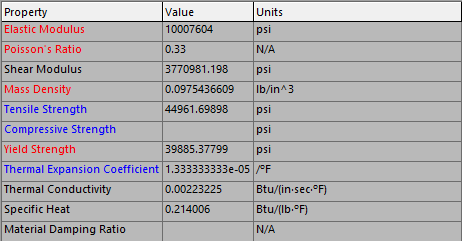</a><figcaption><strong>Figure 1.</strong> 6061-T6 material properties. The library yield strength is 39,885.38 psi. <a href="images/01-aluminum-material-add.webp">Full size</a>.</figcaption></figure><figure class="a7-figure" id="a7-shot-86" data-part="bracket"><a href="images/86-split-line.webp" target="_blank" rel="noopener">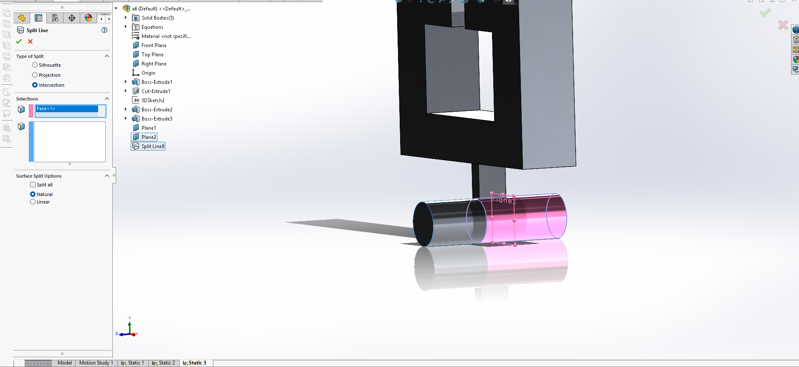</a><figcaption><strong>Figure 2.</strong> Split Line face division used to select the two original pin overhangs independently. <a href="images/86-split-line.webp">Full size</a>.</figcaption></figure><figure class="a7-figure" id="a7-shot-41" data-part="bracket"><a href="images/41-fixed-geometry.webp" target="_blank" rel="noopener">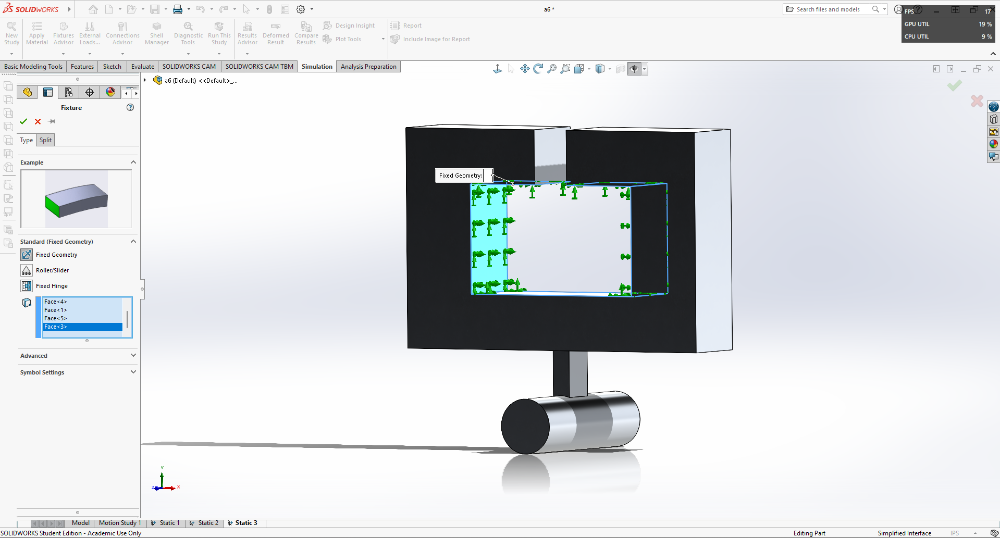</a><figcaption><strong>Figure 3.</strong> Baseline fixed geometry on the interior mounting surfaces. This approximates a fully restrained T-beam interface. <a href="images/41-fixed-geometry.webp">Full size</a>.</figcaption></figure><figure class="a7-figure a7-primary" id="a7-shot-42" data-part="bracket"><a href="images/42-force-selection.webp" target="_blank" rel="noopener">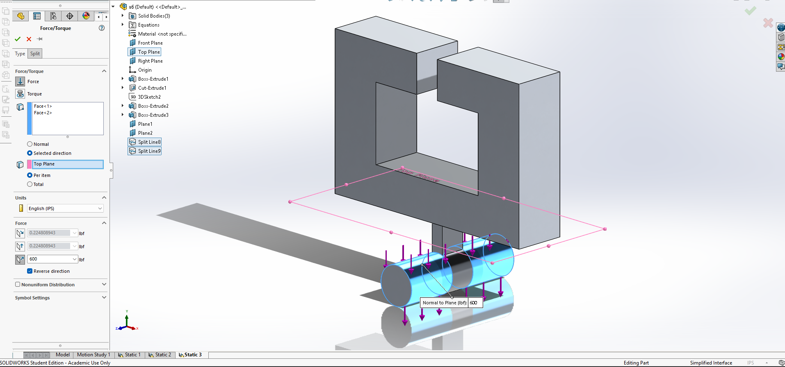</a><figcaption><strong>Figure 4.</strong> Baseline force selection: two split pin faces, 600 lbf per item. Two selected faces imply 1,200 lbf total. <a href="images/42-force-selection.webp">Full size</a>.</figcaption></figure>

### Mesh selection and validation method

I used high-quality solid meshes with the blended curvature-based mesher shown in the mesh-detail screenshots. Here, "coarse" and "medium" describe relative mesh density. They do not mean that the first run used draft-quality elements.

For each unchanged geometry, I compared a coarse and a refined mesh using:

**Change (%) = |medium result - coarse result| / |coarse result| × 100.**

The acceptance check uses maximum stress, maximum resultant displacement, and minimum FOS. The assignment allows proceeding with the finest mesh after three attempts if the results still do not converge. I recorded two mesh levels for each design. Mass does not change just because the mesh is refined. A stable mesh result also does not prove that the chosen loading or supports represent the physical part correctly.

Plot deformation is exaggerated for visibility. For example, several Design 2 plots use a scale near 982; the shape on the screen is not the actual deflection magnitude. I used the legend values for the tables.

### Design 1 - original connector

The first bracket retained the narrow connector between the body and pin. The medium stress plot reaches 15,580 psi at the connector-to-pin junction. The 0.002004-in displacement is below the comparison limit, but a minimum FOS of 2.561 does not meet the target of 4. That made the lower connector the first redesign target.

#### Coarse mesh - solve and results

The first recorded mesh has **1,261 elements**. Its maximum stress is 14,830 psi, maximum displacement is 0.00196 in, and minimum FOS is 2.567.

Bracket Design 1 - coarse mesh and result plots

<figure class="a7-figure" id="a7-shot-04" data-part="bracket"><a href="images/04-coarse-mesh-image.webp" target="_blank" rel="noopener">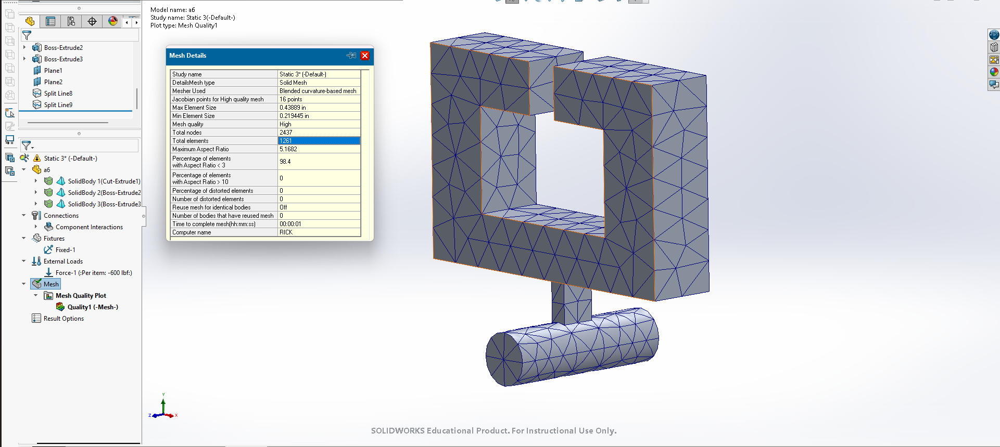</a><figcaption><strong>Figure 5.</strong> Bracket Design 1: Coarse mesh image. <a href="images/04-coarse-mesh-image.webp">Full size</a>.</figcaption></figure><figure class="a7-figure" id="a7-shot-05" data-part="bracket"><a href="images/05-coarse-stress.webp" target="_blank" rel="noopener">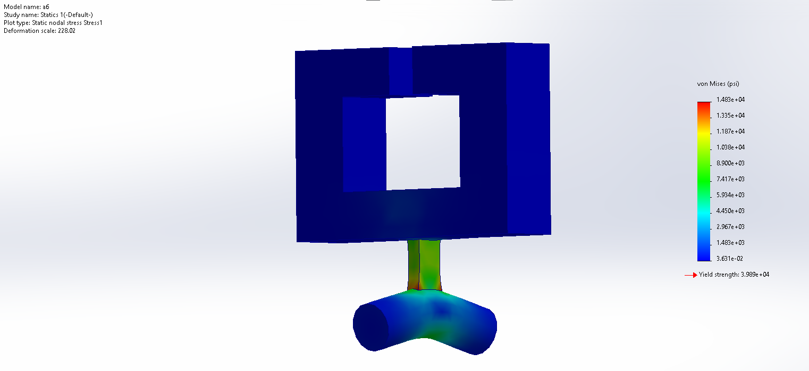</a><figcaption><strong>Figure 6.</strong> Bracket Design 1: Coarse stress. <a href="images/05-coarse-stress.webp">Full size</a>.</figcaption></figure><figure class="a7-figure" id="a7-shot-02" data-part="bracket"><a href="images/02-coarse-displacement.webp" target="_blank" rel="noopener">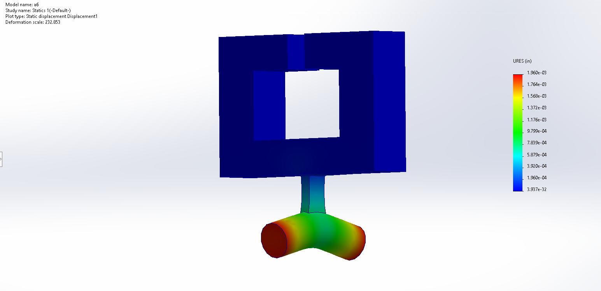</a><figcaption><strong>Figure 7.</strong> Bracket Design 1: Coarse Displacement. <a href="images/02-coarse-displacement.webp">Full size</a>.</figcaption></figure><figure class="a7-figure" id="a7-shot-03" data-part="bracket"><a href="images/03-coarse-fos.webp" target="_blank" rel="noopener">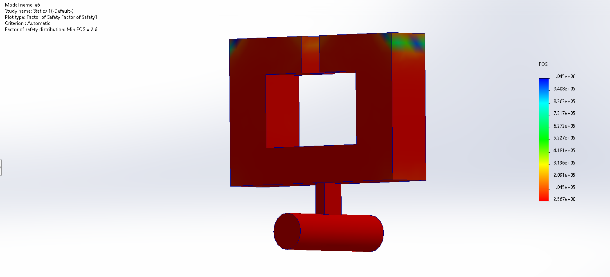</a><figcaption><strong>Figure 8.</strong> Bracket Design 1: Coarse FOS. <a href="images/03-coarse-fos.webp">Full size</a>.</figcaption></figure>

#### Medium mesh - solve and results

I refined the mesh to **7,173 elements** and solved the same design again. The recorded maximum stress is 15,580 psi, maximum displacement is 0.002004 in, and minimum FOS is 2.561.

Bracket Design 1 - medium mesh and result plots

<figure class="a7-figure" id="a7-shot-84" data-part="bracket"><a href="images/84-medium-mesh-elements.webp" target="_blank" rel="noopener">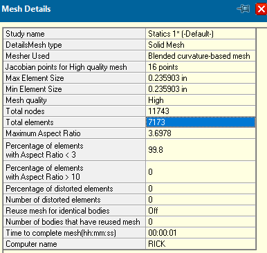</a><figcaption><strong>Figure 9.</strong> Bracket Design 1: medium mesh elements. <a href="images/84-medium-mesh-elements.webp">Full size</a>.</figcaption></figure><figure class="a7-figure a7-primary" id="a7-shot-85" data-part="bracket"><a href="images/85-medium-stress.webp" target="_blank" rel="noopener">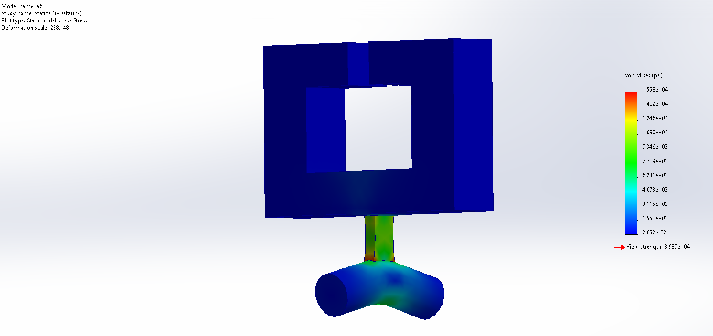</a><figcaption><strong>Figure 10.</strong> Bracket Design 1: medium stress. <a href="images/85-medium-stress.webp">Full size</a>.</figcaption></figure><figure class="a7-figure" id="a7-shot-82" data-part="bracket"><a href="images/82-medium-displacement.webp" target="_blank" rel="noopener">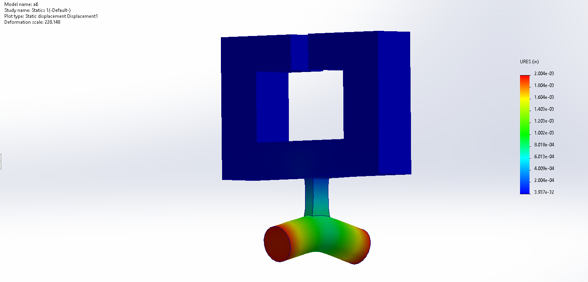</a><figcaption><strong>Figure 11.</strong> Bracket Design 1: medium displacement. <a href="images/82-medium-displacement.webp">Full size</a>.</figcaption></figure><figure class="a7-figure" id="a7-shot-83" data-part="bracket"><a href="images/83-medium-fos.webp" target="_blank" rel="noopener">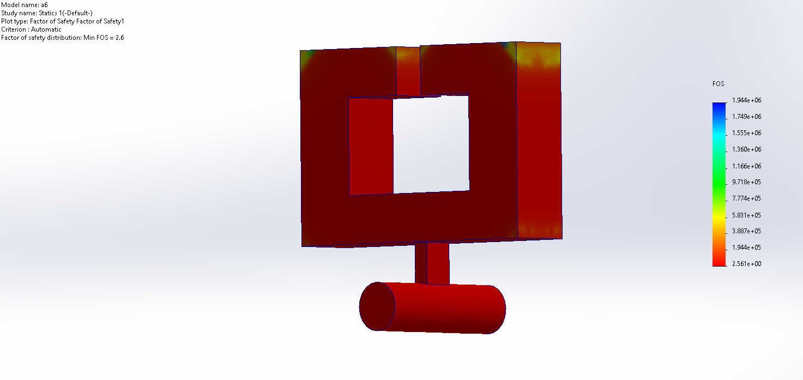</a><figcaption><strong>Figure 12.</strong> Bracket Design 1: medium FOS. <a href="images/83-medium-fos.webp">Full size</a>.</figcaption></figure>

#### Convergence and interpretation

| Result | Coarse | Medium | Change |
|---|---:|---:|---:|
| Max stress (psi) | 14,830 | 15,580 | 5.06% |
| Max displacement (in) | 0.00196 | 0.002004 | 2.24% |
| Min FOS | 2.567 | 2.561 | 0.23% |
| Elements | 1,261 | 7,173 | - |
| Mass (lb, rounded) | 1.03 | 1.03 | Unchanged geometry |

**Locations:** stress - connector-to-pin junction; displacement - outer pin ends.

The displayed mesh-to-mesh changes are below 7%. The medium result has a minimum FOS below 4, so I reinforced the lower connector for the next design.

Bracket Design 1 - mass

<figure class="a7-figure" id="a7-shot-81" data-part="bracket"><a href="images/81-mass.webp" target="_blank" rel="noopener">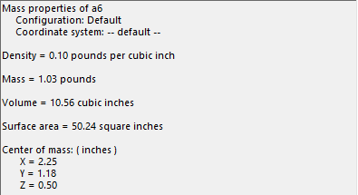</a><figcaption><strong>Figure 13.</strong> Bracket Design 1: mass. <a href="images/81-mass.webp">Full size</a>.</figcaption></figure>

### Design 2 - diagonal supports and fillets

I replaced the single narrow connection with two inclined supports and rounded their transitions. The intent was to distribute the load through a wider path rather than leave it concentrated at one neck. I used separate extrusion and fillet operations to develop this shape.

Support-modeling steps and Design 2 load selection

<figure class="a7-figure a7-primary" id="a7-shot-43" data-part="bracket"><a href="images/43-geometry-change.webp" target="_blank" rel="noopener">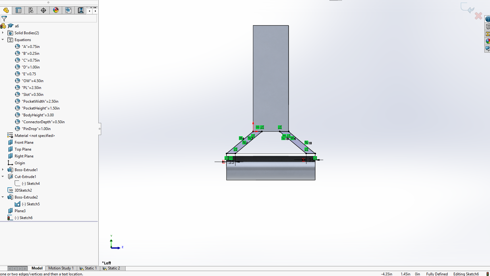</a><figcaption><strong>Figure 14.</strong> Diagonal support sketch used to replace the narrow baseline connector. <a href="images/43-geometry-change.webp">Full size</a>.</figcaption></figure><figure class="a7-figure" id="a7-shot-38" data-part="bracket"><a href="images/38-extrude.webp" target="_blank" rel="noopener">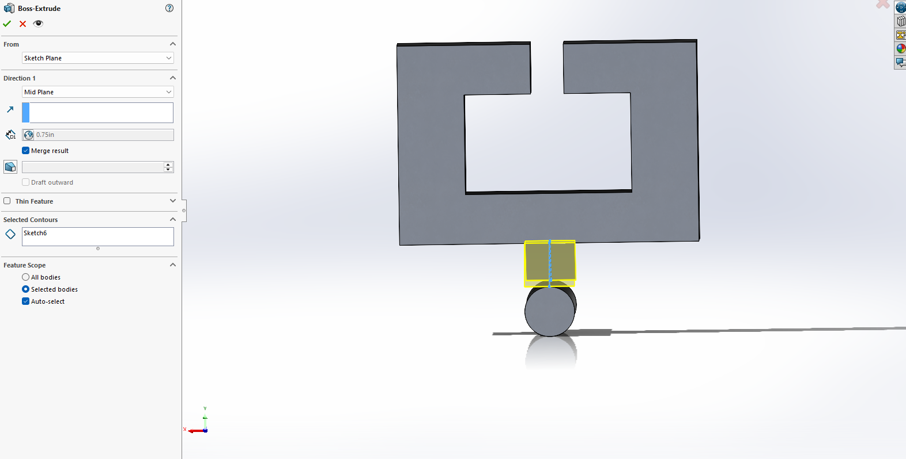</a><figcaption><strong>Figure 15.</strong> Extrusion used to develop the revised lower support. <a href="images/38-extrude.webp">Full size</a>.</figcaption></figure><figure class="a7-figure" id="a7-shot-06" data-part="bracket"><a href="images/06-connection-with-pin.webp" target="_blank" rel="noopener">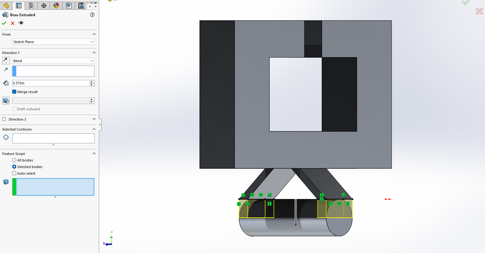</a><figcaption><strong>Figure 16.</strong> Joining the new diagonal supports to the pin region. <a href="images/06-connection-with-pin.webp">Full size</a>.</figcaption></figure><figure class="a7-figure" id="a7-shot-40" data-part="bracket"><a href="images/40-fillets.webp" target="_blank" rel="noopener">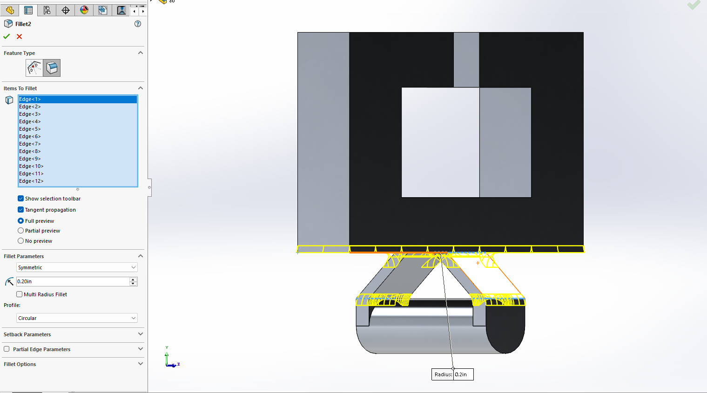</a><figcaption><strong>Figure 17.</strong> Fillet preview at the support and pin transitions. <a href="images/40-fillets.webp">Full size</a>.</figcaption></figure><figure class="a7-figure" id="a7-shot-39" data-part="bracket"><a href="images/39-fillets-2.webp" target="_blank" rel="noopener">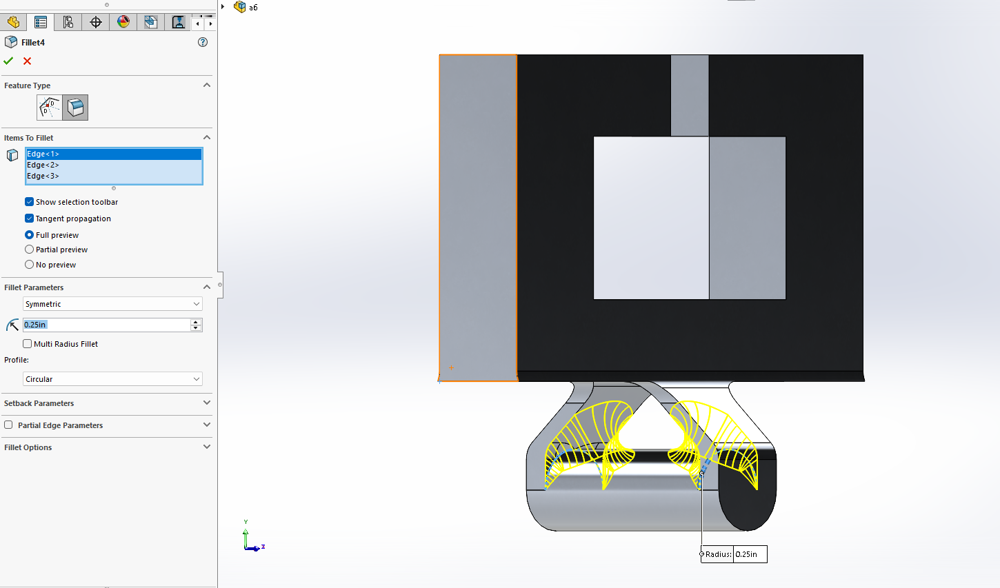</a><figcaption><strong>Figure 18.</strong> Second fillet operation on the revised support transitions. <a href="images/39-fillets-2.webp">Full size</a>.</figcaption></figure><figure class="a7-figure" id="a7-shot-12" data-part="bracket"><a href="images/12-design-2-force.webp" target="_blank" rel="noopener">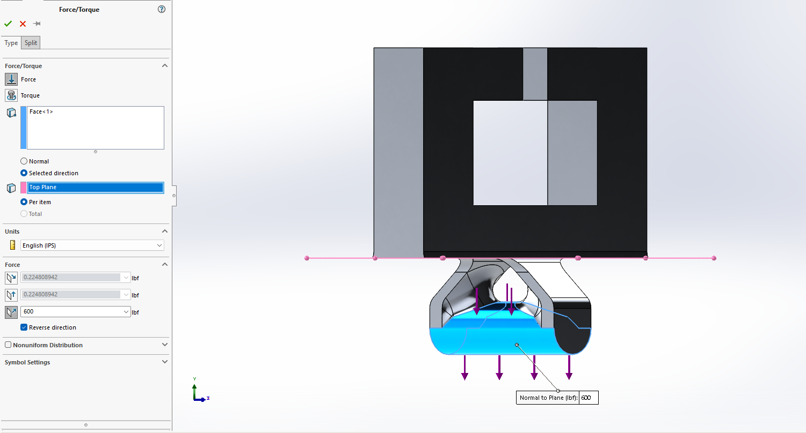</a><figcaption><strong>Figure 19.</strong> Design 2 force definition: 600 lbf per item on the selected pin face. <a href="images/12-design-2-force.webp">Full size</a>.</figcaption></figure>

The medium run gives 6,640 psi, 0.0004583 in, and a minimum FOS of 6.007 for this load setup. Its mesh changes are below 7%. The mass is **1.06 lb**, slightly higher than Design 1's 1.03 lb because of the added support material.

#### Coarse mesh - solve and results

The first recorded mesh has **6,466 elements**. Its maximum stress is 6,299 psi, maximum displacement is 0.0004575 in, and minimum FOS is 6.332.

Bracket Design 2 - coarse mesh and result plots

<figure class="a7-figure" id="a7-shot-07" data-part="bracket"><a href="images/07-coarse-design-2-mesh.webp" target="_blank" rel="noopener">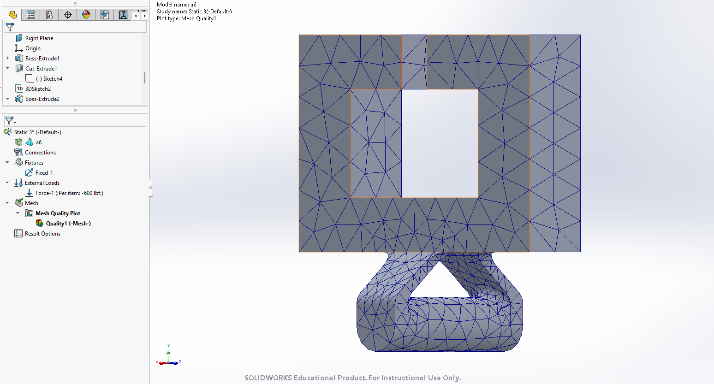</a><figcaption><strong>Figure 20.</strong> Bracket Design 2: coarse Design 2 mesh. <a href="images/07-coarse-design-2-mesh.webp">Full size</a>.</figcaption></figure><figure class="a7-figure" id="a7-shot-08" data-part="bracket"><a href="images/08-coarse-mesh-details-2.webp" target="_blank" rel="noopener">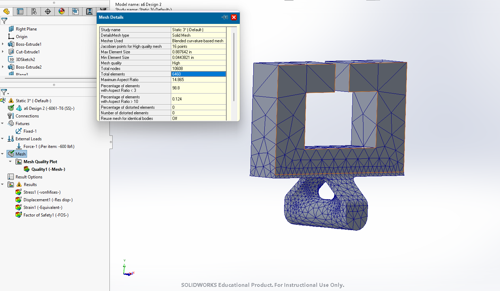</a><figcaption><strong>Figure 21.</strong> Bracket Design 2: coarse mesh details 2. <a href="images/08-coarse-mesh-details-2.webp">Full size</a>.</figcaption></figure><figure class="a7-figure" id="a7-shot-11" data-part="bracket"><a href="images/11-design-2-coarse-stress.webp" target="_blank" rel="noopener">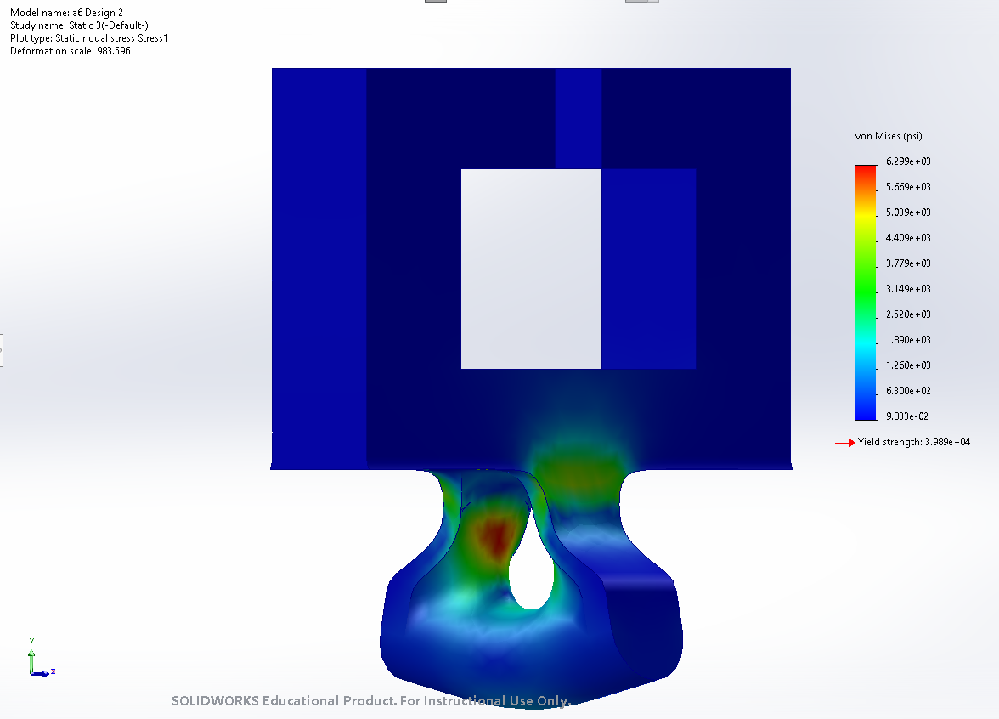</a><figcaption><strong>Figure 22.</strong> Bracket Design 2: design 2 Coarse Stress. <a href="images/11-design-2-coarse-stress.webp">Full size</a>.</figcaption></figure><figure class="a7-figure" id="a7-shot-09" data-part="bracket"><a href="images/09-design-2-coarse-displacement.webp" target="_blank" rel="noopener">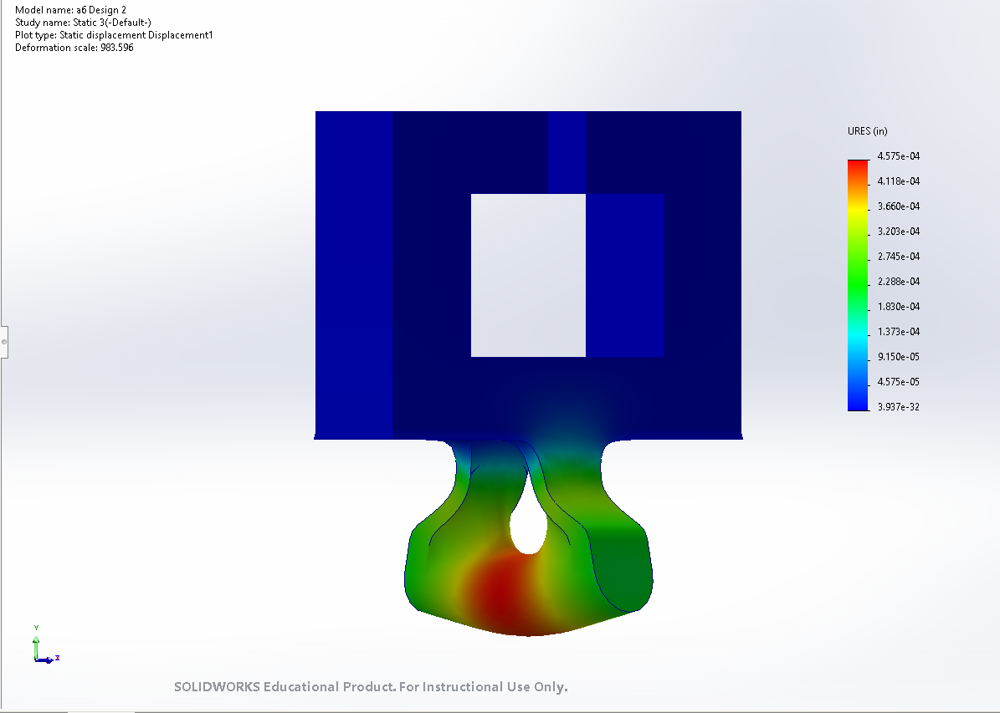</a><figcaption><strong>Figure 23.</strong> Bracket Design 2: Design 2 Coarse Displacement. <a href="images/09-design-2-coarse-displacement.webp">Full size</a>.</figcaption></figure><figure class="a7-figure" id="a7-shot-10" data-part="bracket"><a href="images/10-design-2-coarse-fos.webp" target="_blank" rel="noopener">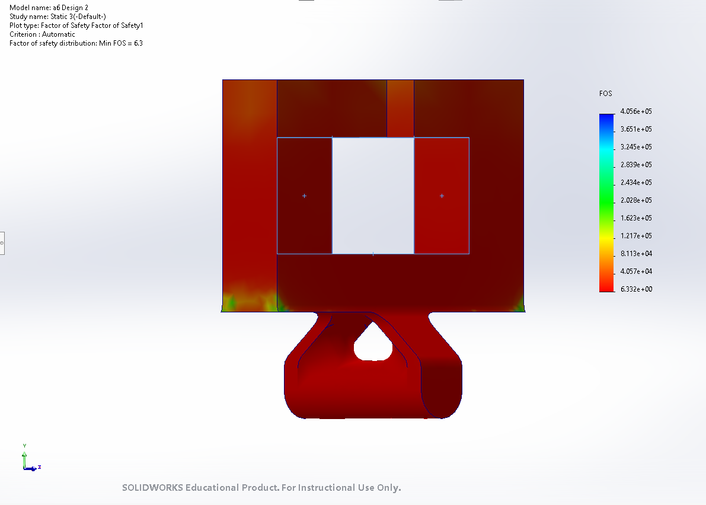</a><figcaption><strong>Figure 24.</strong> Bracket Design 2: Design 2 Coarse FOS. <a href="images/10-design-2-coarse-fos.webp">Full size</a>.</figcaption></figure>

#### Medium mesh - solve and results

I refined the mesh to **9,966 elements** and solved the same design again. The recorded maximum stress is 6,640 psi, maximum displacement is 0.0004583 in, and minimum FOS is 6.007.

Bracket Design 2 - medium mesh and result plots

<figure class="a7-figure" id="a7-shot-16" data-part="bracket"><a href="images/16-design-2-medium-mesh.webp" target="_blank" rel="noopener">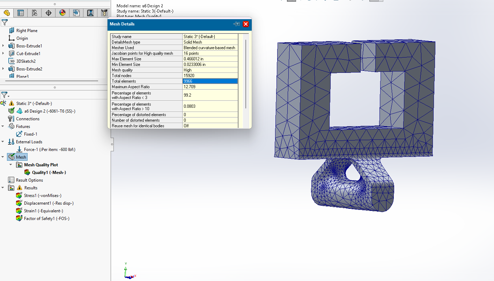</a><figcaption><strong>Figure 25.</strong> Bracket Design 2: Design 2 Medium mesh. <a href="images/16-design-2-medium-mesh.webp">Full size</a>.</figcaption></figure><figure class="a7-figure a7-primary" id="a7-shot-17" data-part="bracket"><a href="images/17-design-2-medium-stress.webp" target="_blank" rel="noopener">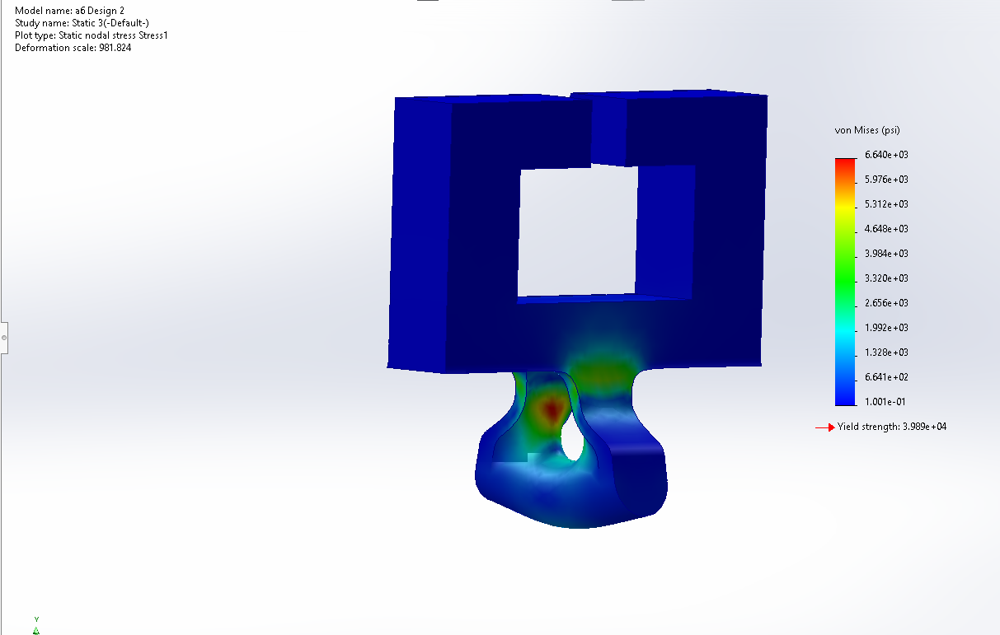</a><figcaption><strong>Figure 26.</strong> Bracket Design 2: Design 2 Medium Stress. <a href="images/17-design-2-medium-stress.webp">Full size</a>.</figcaption></figure><figure class="a7-figure" id="a7-shot-14" data-part="bracket"><a href="images/14-design-2-medium-displacement.webp" target="_blank" rel="noopener">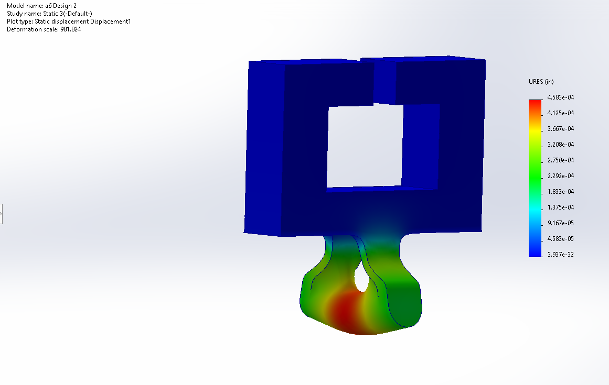</a><figcaption><strong>Figure 27.</strong> Bracket Design 2: Design 2 Medium Displacement. <a href="images/14-design-2-medium-displacement.webp">Full size</a>.</figcaption></figure><figure class="a7-figure" id="a7-shot-15" data-part="bracket"><a href="images/15-design-2-medium-fos.webp" target="_blank" rel="noopener">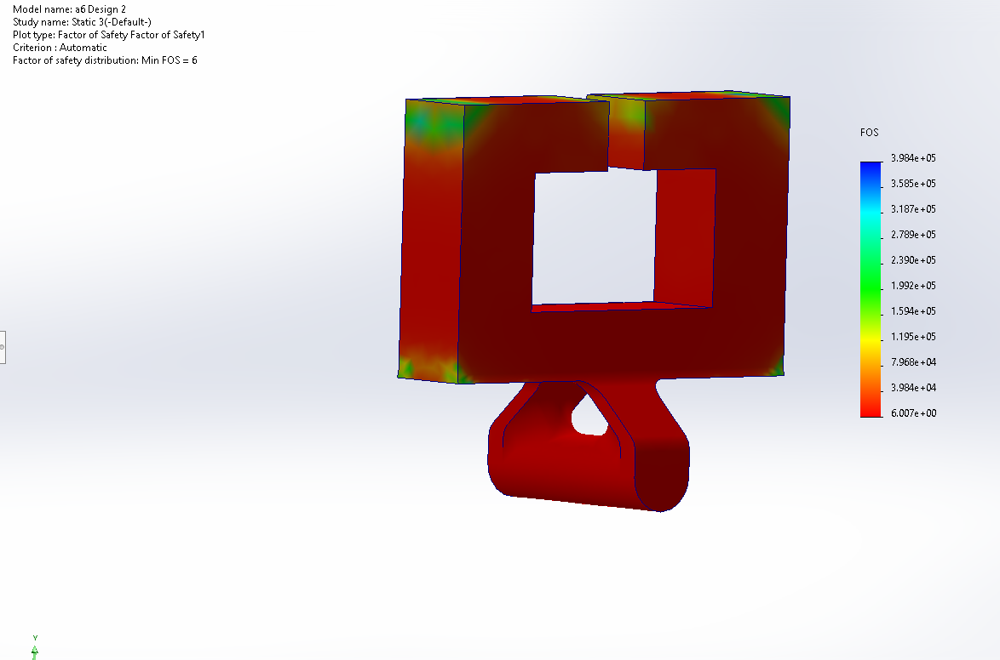</a><figcaption><strong>Figure 28.</strong> Bracket Design 2: Design 2 Medium FOS. <a href="images/15-design-2-medium-fos.webp">Full size</a>.</figcaption></figure>

#### Convergence and interpretation

| Result | Coarse | Medium | Change |
|---|---:|---:|---:|
| Max stress (psi) | 6,299 | 6,640 | 5.41% |
| Max displacement (in) | 0.0004575 | 0.0004583 | 0.17% |
| Min FOS | 6.332 | 6.007 | 5.13% |
| Elements | 6,466 | 9,966 | - |
| Mass (lb, rounded) | 1.06 | 1.06 | Unchanged geometry |

**Locations:** stress - inner curved support beside the central opening; displacement - loaded lower pin span.

All three changes are within 7%. The medium results satisfy the strength and displacement targets for this load setup.

Bracket Design 2 - mass

<figure class="a7-figure" id="a7-shot-13" data-part="bracket"><a href="images/13-design-2-mass.webp" target="_blank" rel="noopener">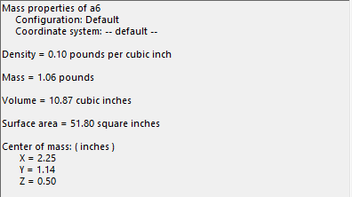</a><figcaption><strong>Figure 29.</strong> Bracket Design 2: Design 2 mass. <a href="images/13-design-2-mass.webp">Full size</a>.</figcaption></figure>

### Design 3 - topology-guided material removal

I started with the reinforced bracket and used a topology study to look for material that could be removed. My settings were Best Stiffness to Weight Ratio, a 30% mass-reduction target, a displacement limit of 0.005 in, and FOS 4. I added half symmetry, a 0.25-in minimum member-thickness control, and preserved the mounting and pin interfaces.

The first material-mass plot had jagged boundaries. I used the smoothed result as a reference, sketched a cleaner outer profile, and cut material from the upper bracket envelope. The topology target and the later manual CAD mass reduction are separate results; the 30% setting does not mean the final CAD removed exactly 30%.

Bracket topology setup, smoothing, and remodeling

<figure class="a7-figure" id="a7-shot-34" data-part="bracket"><a href="images/34-topology-study-design-3.webp" target="_blank" rel="noopener">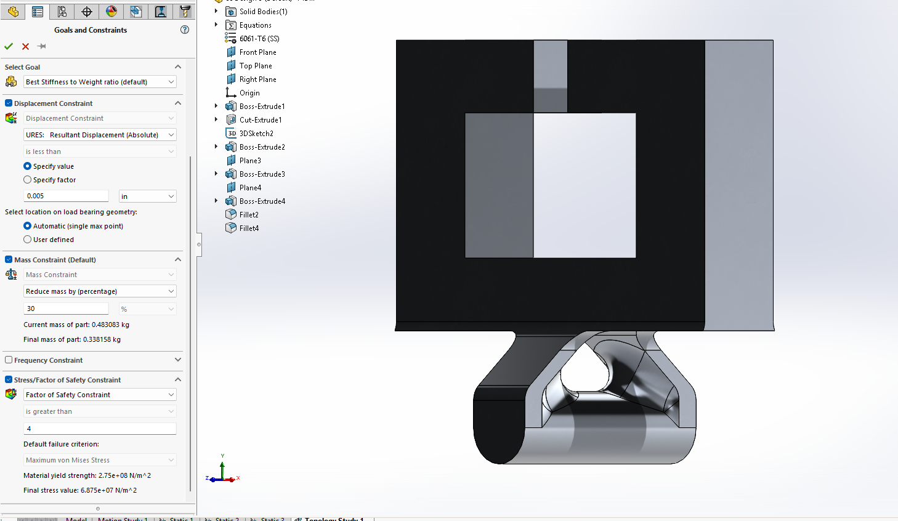</a><figcaption><strong>Figure 30.</strong> Bracket topology goals: stiffness-to-weight, 30% mass reduction, 0.005-in displacement limit, and FOS 4. <a href="images/34-topology-study-design-3.webp">Full size</a>.</figcaption></figure><figure class="a7-figure" id="a7-shot-30" data-part="bracket"><a href="images/30-symmetry-plane.webp" target="_blank" rel="noopener">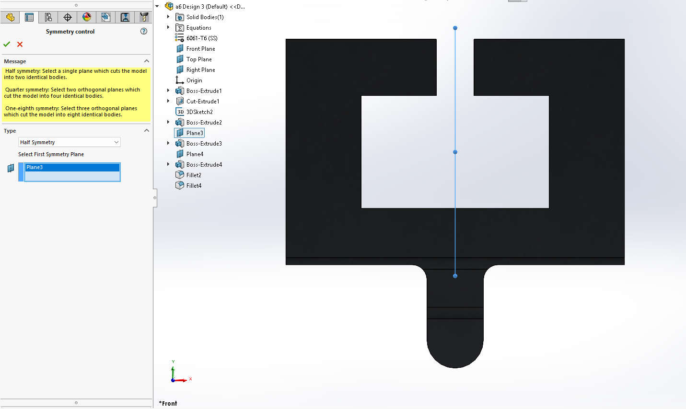</a><figcaption><strong>Figure 31.</strong> Half-symmetry plane through the bracket center. <a href="images/30-symmetry-plane.webp">Full size</a>.</figcaption></figure><figure class="a7-figure" id="a7-shot-31" data-part="bracket"><a href="images/31-thickness.webp" target="_blank" rel="noopener">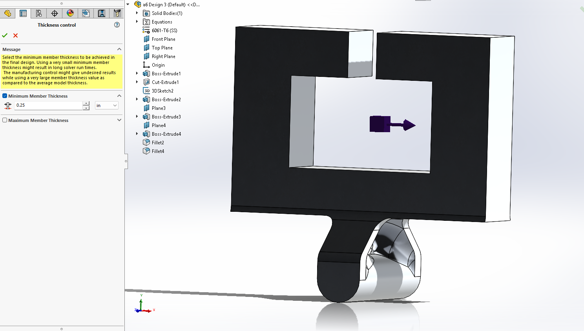</a><figcaption><strong>Figure 32.</strong> Bracket topology minimum member-thickness setting: 0.25 in. <a href="images/31-thickness.webp">Full size</a>.</figcaption></figure><figure class="a7-figure" id="a7-shot-29" data-part="bracket"><a href="images/29-preserved-surfaces.webp" target="_blank" rel="noopener">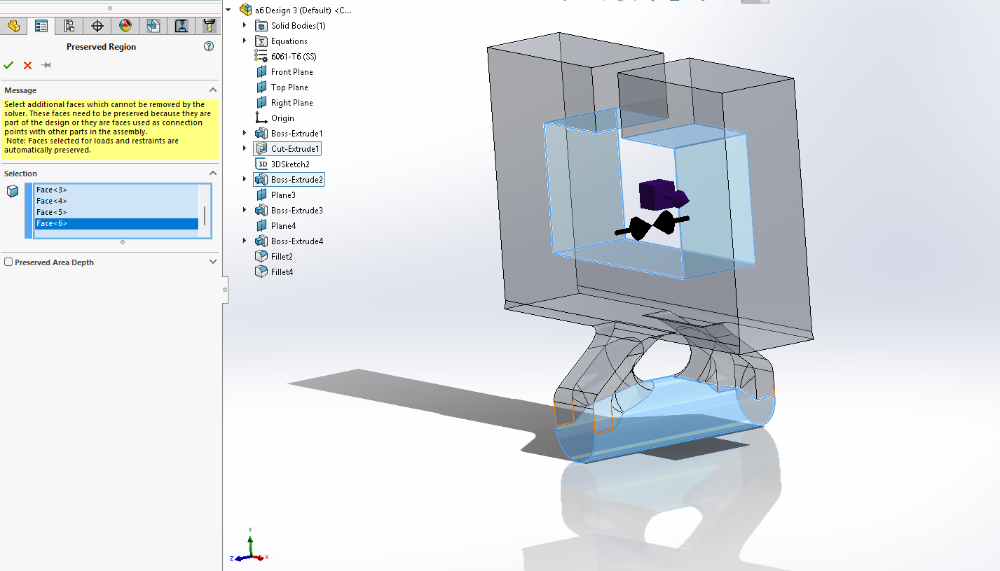</a><figcaption><strong>Figure 33.</strong> Preserved mounting and pin regions in the bracket topology study. <a href="images/29-preserved-surfaces.webp">Full size</a>.</figcaption></figure><figure class="a7-figure" id="a7-shot-32" data-part="bracket"><a href="images/32-topology-coarse-mesh.webp" target="_blank" rel="noopener">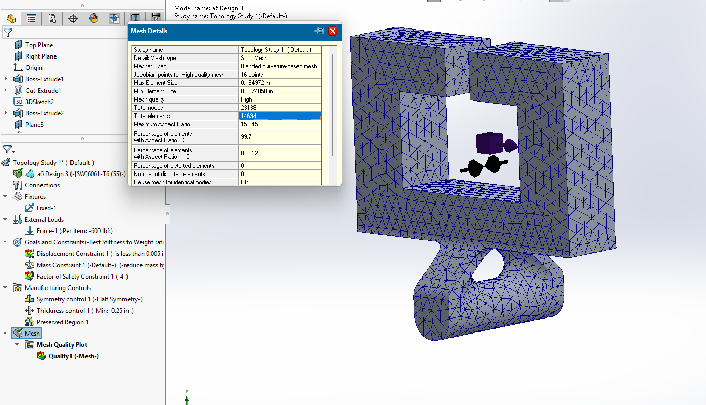</a><figcaption><strong>Figure 34.</strong> Topology mesh details; this is separate from the final static-study meshes. <a href="images/32-topology-coarse-mesh.webp">Full size</a>.</figcaption></figure><figure class="a7-figure" id="a7-shot-35" data-part="bracket"><a href="images/35-topology.webp" target="_blank" rel="noopener">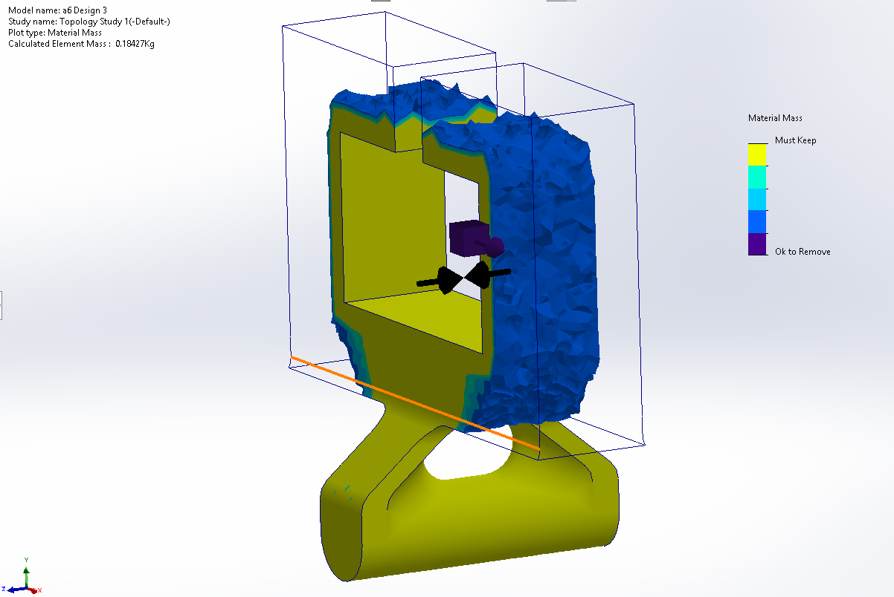</a><figcaption><strong>Figure 35.</strong> Raw bracket material-mass plot. Its jagged surface prompted the smoothing step. <a href="images/35-topology.webp">Full size</a>.</figcaption></figure><figure class="a7-figure" id="a7-shot-33" data-part="bracket"><a href="images/33-topology-smoothining.webp" target="_blank" rel="noopener">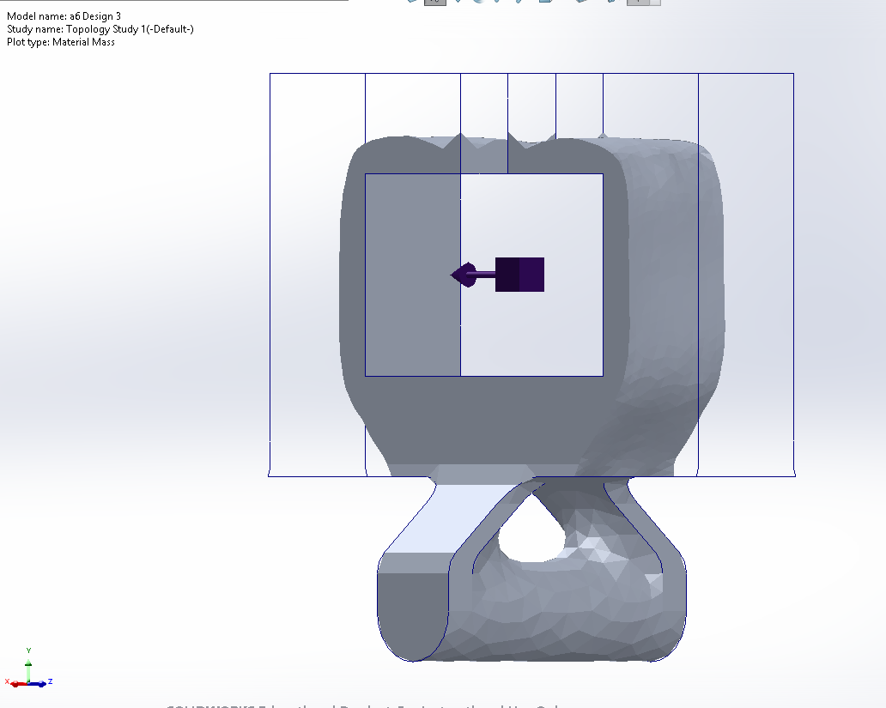</a><figcaption><strong>Figure 36.</strong> Smoothed bracket topology result used as a visual modeling guide. <a href="images/33-topology-smoothining.webp">Full size</a>.</figcaption></figure><figure class="a7-figure" id="a7-shot-36" data-part="bracket"><a href="images/36-weight-optimization.webp" target="_blank" rel="noopener">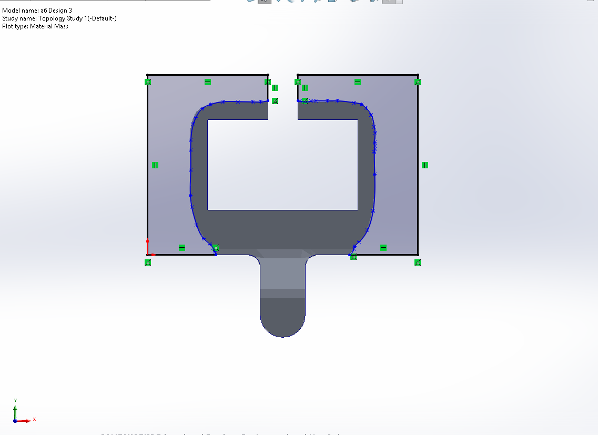</a><figcaption><strong>Figure 37.</strong> Sketching a smoother outer profile from the topology result. <a href="images/36-weight-optimization.webp">Full size</a>.</figcaption></figure><figure class="a7-figure" id="a7-shot-19" data-part="bracket"><a href="images/19-cut.webp" target="_blank" rel="noopener">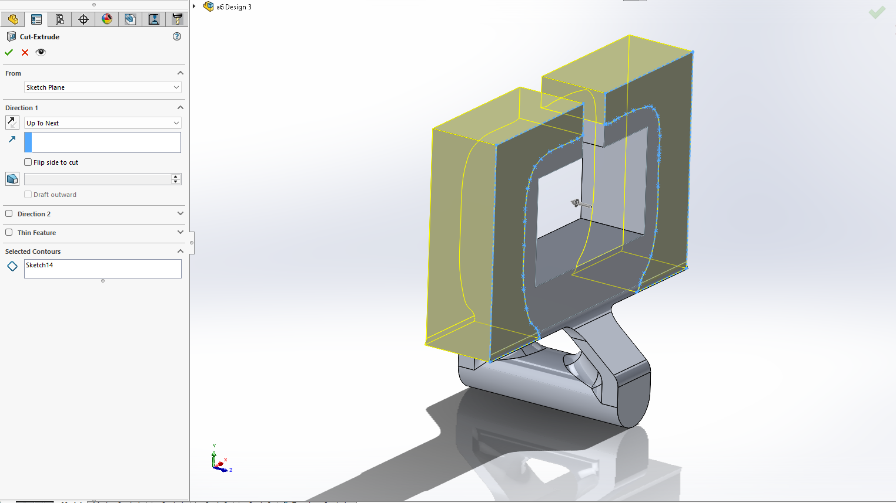</a><figcaption><strong>Figure 38.</strong> Cut feature used to remove material from the outer bracket envelope. <a href="images/19-cut.webp">Full size</a>.</figcaption></figure><figure class="a7-figure a7-primary" id="a7-shot-37" data-part="bracket"><a href="images/37-weight-optimized-part.webp" target="_blank" rel="noopener">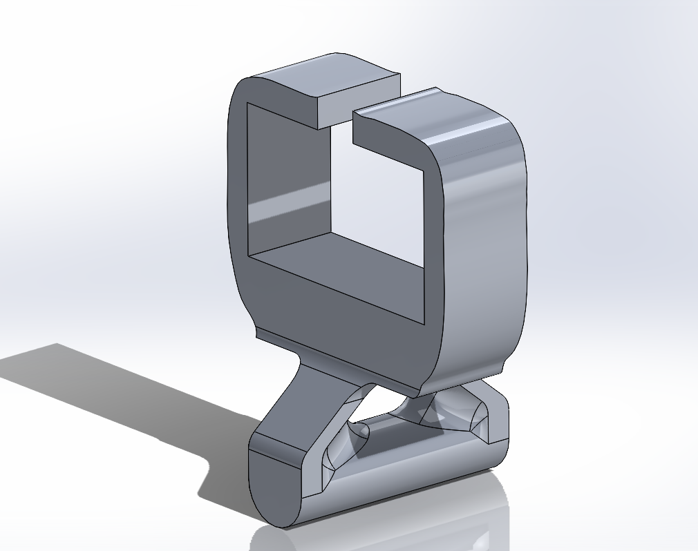</a><figcaption><strong>Figure 39.</strong> Remodeled bracket after the outer material-removal cut. <a href="images/37-weight-optimized-part.webp">Full size</a>.</figcaption></figure><figure class="a7-figure" id="a7-shot-23" data-part="bracket"><a href="images/23-design-3-fixtures.webp" target="_blank" rel="noopener">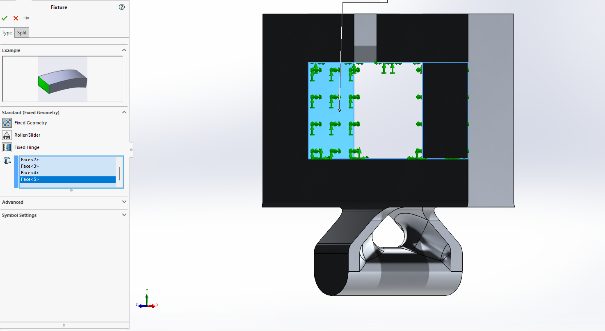</a><figcaption><strong>Figure 40.</strong> Design 3 fixed-geometry selection on the internal mounting faces. <a href="images/23-design-3-fixtures.webp">Full size</a>.</figcaption></figure>

The remodeled bracket has a medium static result of 6,613 psi, 0.0004591 in, and FOS 6.032 for its applied loading. Its mass is 0.50 lb, approximately **52.8% below Design 2**, using the rounded mass readings.

#### Coarse mesh - solve and results

The first recorded mesh has **7,246 elements**. Its maximum stress is 6,377 psi, maximum displacement is 0.0004576 in, and minimum FOS is 6.254.

Bracket Design 3 - coarse mesh and result plots

<figure class="a7-figure" id="a7-shot-18" data-part="bracket"><a href="images/18-coarse-mesh-design-3.webp" target="_blank" rel="noopener">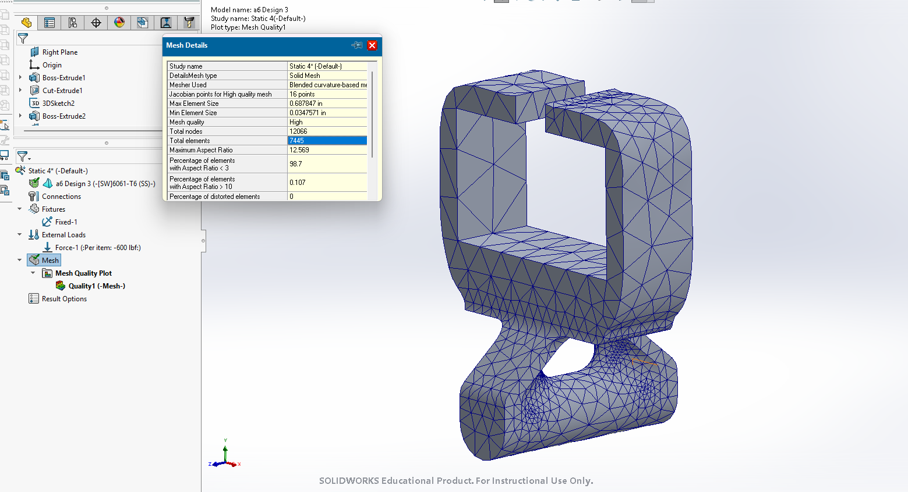</a><figcaption><strong>Figure 41.</strong> Bracket Design 3: Coarse Mesh Design 3. <a href="images/18-coarse-mesh-design-3.webp">Full size</a>.</figcaption></figure><figure class="a7-figure" id="a7-shot-22" data-part="bracket"><a href="images/22-design-3-coarse-stress.webp" target="_blank" rel="noopener">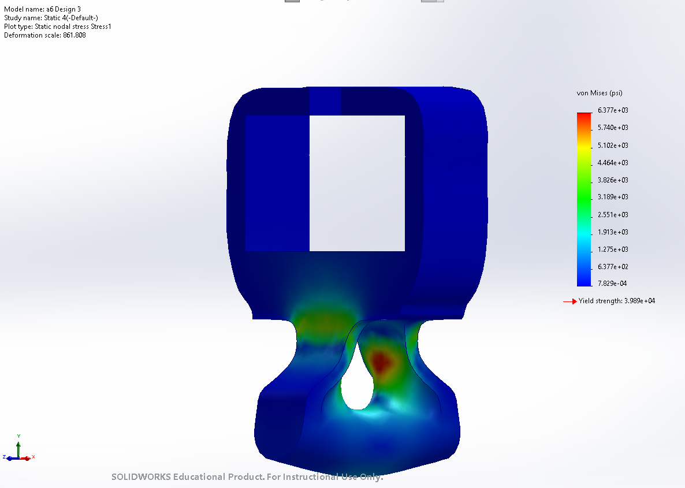</a><figcaption><strong>Figure 42.</strong> Bracket Design 3: Design 3 Coarse Stress. <a href="images/22-design-3-coarse-stress.webp">Full size</a>.</figcaption></figure><figure class="a7-figure" id="a7-shot-20" data-part="bracket"><a href="images/20-design-3-coarse-displacement.webp" target="_blank" rel="noopener">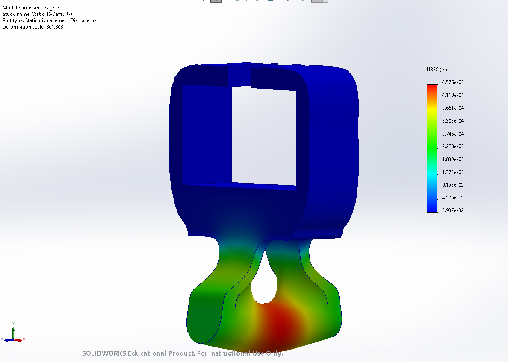</a><figcaption><strong>Figure 43.</strong> Bracket Design 3: Design 3 Coarse Displacement. <a href="images/20-design-3-coarse-displacement.webp">Full size</a>.</figcaption></figure><figure class="a7-figure" id="a7-shot-21" data-part="bracket"><a href="images/21-design-3-coarse-fos.webp" target="_blank" rel="noopener">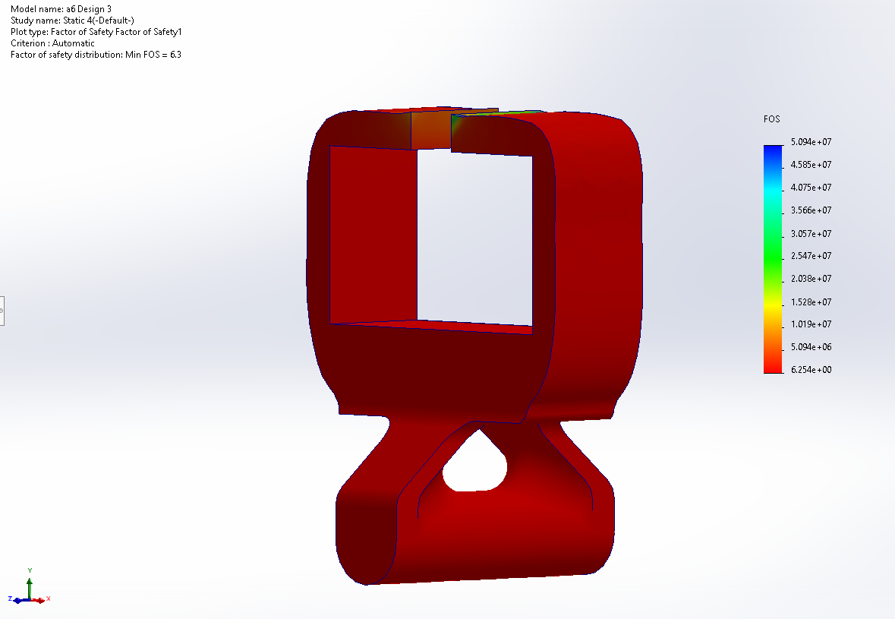</a><figcaption><strong>Figure 44.</strong> Bracket Design 3: Design 3 Coarse FOS. <a href="images/21-design-3-coarse-fos.webp">Full size</a>.</figcaption></figure>

#### Medium mesh - solve and results

I refined the mesh to **10,375 elements** and solved the same design again. The recorded maximum stress is 6,613 psi, maximum displacement is 0.0004591 in, and minimum FOS is 6.032.

Bracket Design 3 - medium mesh and result plots

<figure class="a7-figure" id="a7-shot-26" data-part="bracket"><a href="images/26-design-3-medium-mesh.webp" target="_blank" rel="noopener">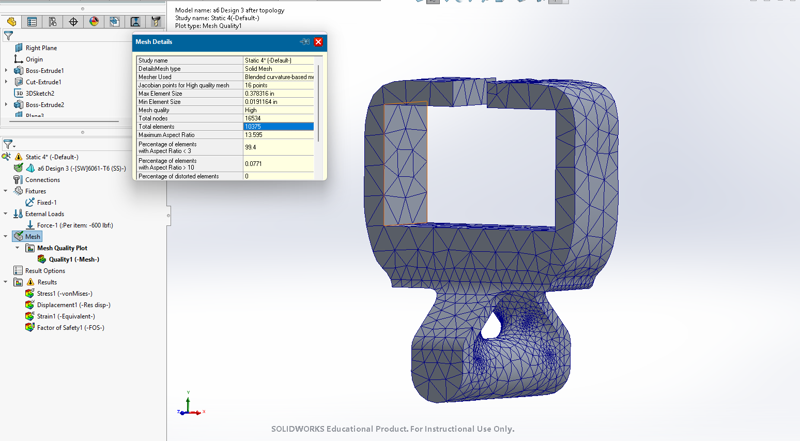</a><figcaption><strong>Figure 45.</strong> Bracket Design 3: Design 3 Medium mesh. <a href="images/26-design-3-medium-mesh.webp">Full size</a>.</figcaption></figure><figure class="a7-figure a7-primary" id="a7-shot-27" data-part="bracket"><a href="images/27-design-3-medium-stress.webp" target="_blank" rel="noopener">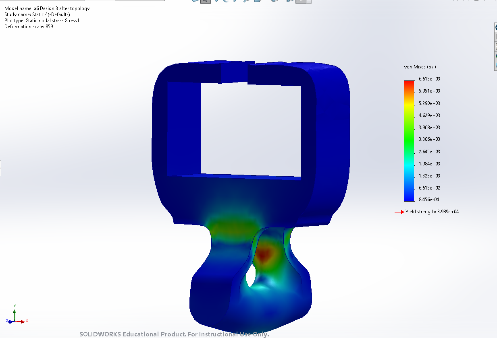</a><figcaption><strong>Figure 46.</strong> Bracket Design 3: Design 3 Medium Stress. <a href="images/27-design-3-medium-stress.webp">Full size</a>.</figcaption></figure><figure class="a7-figure" id="a7-shot-24" data-part="bracket"><a href="images/24-design-3-medium-displacement.webp" target="_blank" rel="noopener">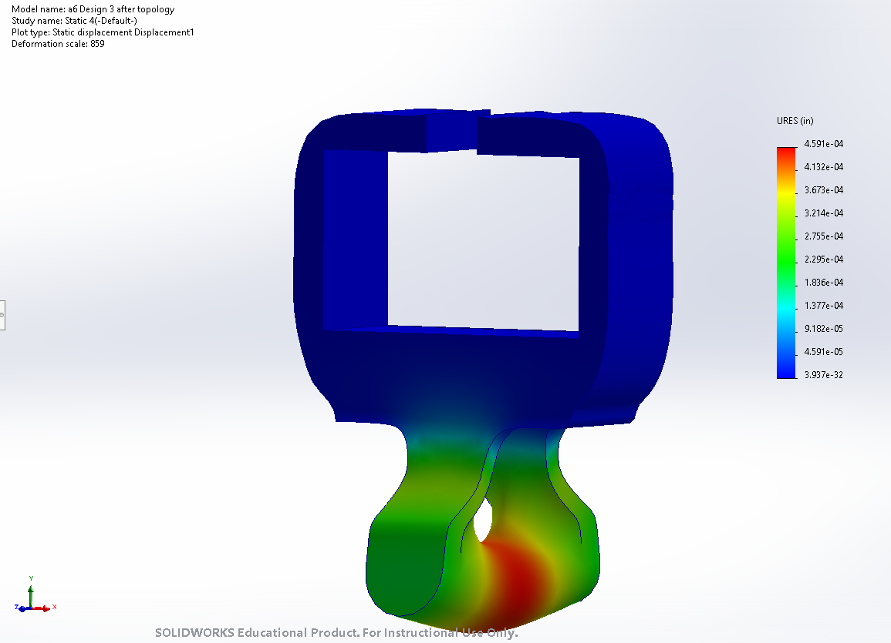</a><figcaption><strong>Figure 47.</strong> Bracket Design 3: Design 3 Medium Displacement. <a href="images/24-design-3-medium-displacement.webp">Full size</a>.</figcaption></figure><figure class="a7-figure" id="a7-shot-25" data-part="bracket"><a href="images/25-design-3-medium-fos.webp" target="_blank" rel="noopener">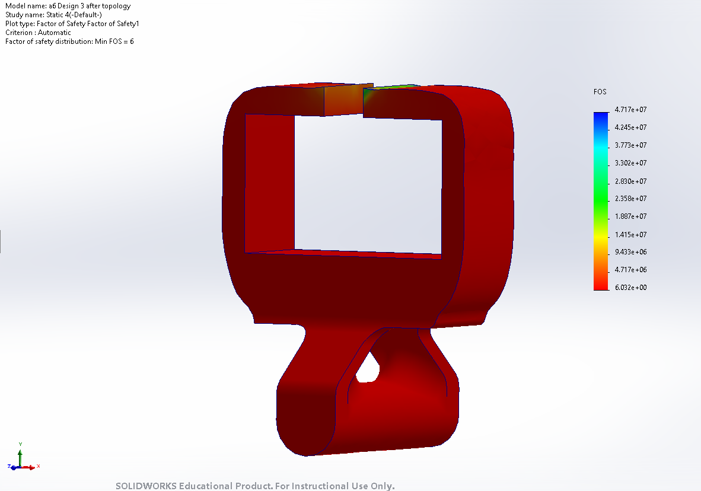</a><figcaption><strong>Figure 48.</strong> Bracket Design 3: Design 3 Medium FOS. <a href="images/25-design-3-medium-fos.webp">Full size</a>.</figcaption></figure>

#### Convergence and interpretation

| Result | Coarse | Medium | Change |
|---|---:|---:|---:|
| Max stress (psi) | 6,377 | 6,613 | 3.70% |
| Max displacement (in) | 0.0004576 | 0.0004591 | 0.33% |
| Min FOS | 6.254 | 6.032 | 3.55% |
| Elements | 7,246 | 10,375 | - |
| Mass (lb, rounded) | 0.50 | 0.50 | Unchanged geometry |

**Locations:** stress - inner support transition beside the central opening; displacement - loaded lower pin span.

All three changes are within 7%. The medium stress, displacement, and FOS meet the selected limits for this load setup. Removing material from the upper envelope reduced the mass to 0.50 lb.

Bracket Design 3 - mass

<figure class="a7-figure" id="a7-shot-28" data-part="bracket"><a href="images/28-mass-after-optimization.webp" target="_blank" rel="noopener">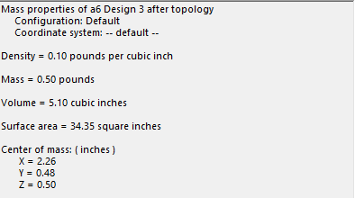</a><figcaption><strong>Figure 49.</strong> Bracket Design 3: Mass after optimization. <a href="images/28-mass-after-optimization.webp">Full size</a>.</figcaption></figure>

### Finalized bracket results

| Refined result | Design 1 | Design 2 | Design 3 |
|---|---|---|---|
| Maximum stress and location | 15,580 psi Connector-to-pin junction | 6,640 psi Inner curved support beside the central opening | 6,613 psi Inner support transition beside the central opening |
| Maximum deflection and location | 0.002004 in Outer pin ends | 0.0004583 in Loaded lower pin span | 0.0004591 in Loaded lower pin span |
| Mass (lb, rounded) | 1.03 | 1.06 | 0.50 |
| Minimum safety factor | 2.561 | 6.007 | 6.032 |
| Number of elements | 7,173 | 9,966 | 10,375 |
| Target comparison | FOS below 4 | Within selected limits | Within selected limits |

Removing material from the upper envelope reduced mass while retaining the reinforced lower supports. I kept those supports because the stress plots placed the largest stresses near the inner curved transitions beside the central opening.

## Link FEA - MEGR 2157

### Preprocessing - material, fixtures, and loading

I kept 6061-T6 aluminum for the link. I fixed the inner cylindrical surface of the 0.750-in hole and applied **600 lbf** to the 1.000-in hole, along the line between the hole centers. The fixed-hole model approximates the attachment; I did not model a separate shaft or press-fit contact.

I used the same targets as the bracket: maximum von Mises stress of approximately 9,971 psi, a minimum FOS of 4, and maximum resultant displacement of 0.005 in. Each link geometry was solved with a coarse and a medium high-quality solid mesh. I compared stress, displacement, and FOS with the same 7% change criterion before moving to the next design.

Link fixture and applied force

<figure class="a7-figure" id="a7-shot-52" data-part="link"><a href="images/52-fixed-geometry-for-smaller-hole.webp" target="_blank" rel="noopener">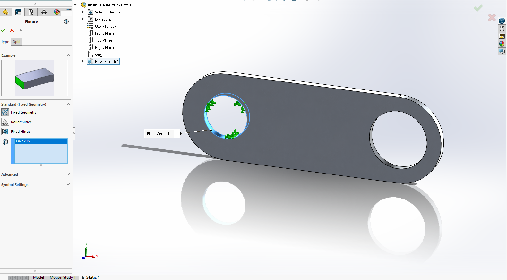</a><figcaption><strong>Figure 50.</strong> Link fixture on the inner cylindrical face of the smaller hole. <a href="images/52-fixed-geometry-for-smaller-hole.webp">Full size</a>.</figcaption></figure><figure class="a7-figure a7-primary" id="a7-shot-53" data-part="link"><figcaption><strong>Figure 51.</strong> Link force definition: 600 lbf applied to the larger-hole face along the link centerline. <a href="images/53-force-on-larger-hole.webp">Full size</a>.</figcaption></figure>

### Design 1 - original plate

The original link was 1.50 in wide and 0.125 in thick, with 3.00 in between hole centers. The medium run reaches 14,870 psi around the larger loaded hole. Displacement is below 0.005 in, but FOS 2.681 falls short of 4. The local stress at the hole was more demanding than the nominal net-section calculation alone suggested.

#### Coarse mesh - solve and results

The first recorded mesh has **1,305 elements**. Its maximum stress is 14,710 psi, maximum displacement is 0.002331 in, and minimum FOS is 2.711.

Link Design 1 - coarse mesh and result plots

<figure class="a7-figure" id="a7-shot-44" data-part="link"><figcaption><strong>Figure 52.</strong> Link Design 1: Coarse Mesh Design 1. <a href="images/44-coarse-mesh-design-1.webp">Full size</a>.</figcaption></figure><figure class="a7-figure" id="a7-shot-47" data-part="link"><figcaption><strong>Figure 53.</strong> Link Design 1: Design 1 Coarse Stress. <a href="images/47-design-1-coarse-stress.webp">Full size</a>.</figcaption></figure><figure class="a7-figure" id="a7-shot-45" data-part="link"><figcaption><strong>Figure 54.</strong> Link Design 1: Design 1 Coarse Displacement. <a href="images/45-design-1-coarse-displacement.webp">Full size</a>.</figcaption></figure><figure class="a7-figure" id="a7-shot-46" data-part="link"><figcaption><strong>Figure 55.</strong> Link Design 1: Design 1 Coarse FOS. <a href="images/46-design-1-coarse-fos.webp">Full size</a>.</figcaption></figure>

#### Medium mesh - solve and results

I refined the mesh to **7,886 elements** and solved the same design again. The recorded maximum stress is 14,870 psi, maximum displacement is 0.002339 in, and minimum FOS is 2.681.

Link Design 1 - medium mesh and result plots

<figure class="a7-figure" id="a7-shot-50" data-part="link"><figcaption><strong>Figure 56.</strong> Link Design 1: Design 1 Medium mesh. <a href="images/50-design-1-medium-mesh.webp">Full size</a>.</figcaption></figure><figure class="a7-figure a7-primary" id="a7-shot-51" data-part="link"><figcaption><strong>Figure 57.</strong> Link Design 1: Design 1 Medium Stress. <a href="images/51-design-1-medium-stress.webp">Full size</a>.</figcaption></figure><figure class="a7-figure" id="a7-shot-48" data-part="link"><figcaption><strong>Figure 58.</strong> Link Design 1: Design 1 Medium Displacement. <a href="images/48-design-1-medium-displacement.webp">Full size</a>.</figcaption></figure><figure class="a7-figure" id="a7-shot-49" data-part="link"><figcaption><strong>Figure 59.</strong> Link Design 1: Design 1 Medium FOS. <a href="images/49-design-1-medium-fos.webp">Full size</a>.</figcaption></figure>

#### Convergence and interpretation

| Result | Coarse | Medium | Change |
|---|---:|---:|---:|
| Max stress (psi) | 14,710 | 14,870 | 1.09% |
| Max displacement (in) | 0.002331 | 0.002339 | 0.34% |
| Min FOS | 2.711 | 2.681 | 1.11% |
| Elements | 1,305 | 7,886 | - |
| Mass (lb, rounded) | 0.06 | 0.06 | Unchanged geometry |

**Locations:** stress - side ligaments around the loaded 1-in hole; displacement - far end of the loaded large-hole region.

All three changes are below 7%. Displacement meets the target, but the minimum FOS of 2.681 is below 4. The baseline therefore needed a strength change.

Link Design 1 - mass

<figure class="a7-figure" id="a7-shot-54" data-part="link"><figcaption><strong>Figure 60.</strong> Link Design 1: Mass Design 1. <a href="images/54-mass-design-1.webp">Full size</a>.</figcaption></figure>

### Design 2 - wider plate

I increased the link width to **2.00 in**, keeping the 0.125-in thickness and 3.00-in hole-center spacing. This added material around the holes and increased the minimum ligament area.

Link width change

<figure class="a7-figure a7-primary" id="a7-shot-63" data-part="link"><figcaption><strong>Figure 61.</strong> Link width increased from 1.50 to 2.00 in; thickness remains 0.125 in and hole-center spacing remains 3.00 in. <a href="images/63-design-2-width-change.webp">Full size</a>.</figcaption></figure>

The medium results are 7,403 psi, 0.001278 in, and FOS 5.388. All three mesh changes are below 7%. The mass rose from 0.06 to 0.10 lb, so the wider plate solved the recorded strength issue at a weight cost.

#### Coarse mesh - solve and results

The first recorded mesh has **1,470 elements**. Its maximum stress is 7,489 psi, maximum displacement is 0.001277 in, and minimum FOS is 5.326.

Link Design 2 - coarse mesh and result plots

<figure class="a7-figure" id="a7-shot-57" data-part="link"><figcaption><strong>Figure 62.</strong> Link Design 2: Design 2 Coarse Mesh. <a href="images/57-design-2-coarse-mesh.webp">Full size</a>.</figcaption></figure><figure class="a7-figure" id="a7-shot-58" data-part="link"><figcaption><strong>Figure 63.</strong> Link Design 2: Design 2 Coarse Stress. <a href="images/58-design-2-coarse-stress.webp">Full size</a>.</figcaption></figure><figure class="a7-figure" id="a7-shot-55" data-part="link"><figcaption><strong>Figure 64.</strong> Link Design 2: Design 2 Coarse Displacement. <a href="images/55-design-2-coarse-displacement.webp">Full size</a>.</figcaption></figure><figure class="a7-figure" id="a7-shot-56" data-part="link"><figcaption><strong>Figure 65.</strong> Link Design 2: Design 2 Coarse FOS. <a href="images/56-design-2-coarse-fos.webp">Full size</a>.</figcaption></figure>

#### Medium mesh - solve and results

I refined the mesh to **10,097 elements** and solved the same design again. The recorded maximum stress is 7,403 psi, maximum displacement is 0.001278 in, and minimum FOS is 5.388.

Link Design 2 - medium mesh and result plots

<figure class="a7-figure" id="a7-shot-61" data-part="link"><figcaption><strong>Figure 66.</strong> Link Design 2: Design 2 Medium Mesh. <a href="images/61-design-2-medium-mesh.webp">Full size</a>.</figcaption></figure><figure class="a7-figure a7-primary" id="a7-shot-62" data-part="link"><figcaption><strong>Figure 67.</strong> Link Design 2: Design 2 Medium Stress. <a href="images/62-design-2-medium-stress.webp">Full size</a>.</figcaption></figure><figure class="a7-figure" id="a7-shot-59" data-part="link"><figcaption><strong>Figure 68.</strong> Link Design 2: Design 2 Medium Displacement. <a href="images/59-design-2-medium-displacement.webp">Full size</a>.</figcaption></figure><figure class="a7-figure" id="a7-shot-60" data-part="link"><figcaption><strong>Figure 69.</strong> Link Design 2: Design 2 Medium FOS. <a href="images/60-design-2-medium-fos.webp">Full size</a>.</figcaption></figure>

#### Convergence and interpretation

| Result | Coarse | Medium | Change |
|---|---:|---:|---:|
| Max stress (psi) | 7,489 | 7,403 | 1.15% |
| Max displacement (in) | 0.001277 | 0.001278 | 0.08% |
| Min FOS | 5.326 | 5.388 | 1.16% |
| Elements | 1,470 | 10,097 | - |
| Mass (lb, rounded) | 0.10 | 0.10 | Unchanged geometry |

**Locations:** stress - ligaments around the loaded large hole; displacement - far end of the loaded large-hole region.

All three changes are below 7%. The wider link satisfies both strength and displacement limits, with a mass increase over Design 1.

Link Design 2 - mass

<figure class="a7-figure" id="a7-shot-64" data-part="link"><figcaption><strong>Figure 70.</strong> Link Design 2: mass. <a href="images/64-mass.webp">Full size</a>.</figcaption></figure>

### Design 3 - topology-guided cut

I used another topology study to guide trimming the wider link. The setup retained the two hole interfaces and used a 30% mass-reduction target, 0.005-in displacement constraint, FOS 4, and a 0.125-in minimum member-thickness control. I smoothed the topology display before drawing the manual cut.

Link topology setup and manual cut

<figure class="a7-figure" id="a7-shot-79" data-part="link"><figcaption><strong>Figure 71.</strong> Link topology goals and constraints, including 30% mass reduction and FOS 4. <a href="images/79-topology-goals-and-conts.webp">Full size</a>.</figcaption></figure><figure class="a7-figure" id="a7-shot-78" data-part="link"><figcaption><strong>Figure 72.</strong> Link topology minimum member-thickness control set to 0.125 in. <a href="images/78-thickness.webp">Full size</a>.</figcaption></figure><figure class="a7-figure" id="a7-shot-77" data-part="link"><figcaption><strong>Figure 73.</strong> Preserved regions around the two link-hole interfaces. <a href="images/77-preserved-regions.webp">Full size</a>.</figcaption></figure><figure class="a7-figure" id="a7-shot-70" data-part="link"><figcaption><strong>Figure 74.</strong> Raw link topology result before smoothing. <a href="images/70-coarse-topology-before-smoothining.webp">Full size</a>.</figcaption></figure><figure class="a7-figure" id="a7-shot-65" data-part="link"><figcaption><strong>Figure 75.</strong> Smoothed link topology result displayed against the original outline. <a href="images/65-after-smoothining.webp">Full size</a>.</figcaption></figure><figure class="a7-figure" id="a7-shot-71" data-part="link"><figcaption><strong>Figure 76.</strong> Manual cut following the topology-inspired link outline, with a 0.10-in blind-cut depth. <a href="images/71-manual-optmization-cut.webp">Full size</a>.</figcaption></figure><figure class="a7-figure a7-primary" id="a7-shot-80" data-part="link"><figcaption><strong>Figure 77.</strong> Link after the manual material-removal operation. <a href="images/80-topology-optimized-part.webp">Full size</a>.</figcaption></figure>

The resulting link has a recorded mass of 0.07 lb. Its medium static result is 8,093 psi, 0.001355 in, and FOS 4.928. The coarse-to-medium changes are below 7%. It is approximately **30% lighter than Design 2**, using the rounded readings, but remains heavier than the original 0.06-lb link. That is a useful tradeoff: the original link was lighter but did not meet the FOS target.

I used a **0.10-in blind cut** for the manual material-removal operation. I then meshed and solved the edited part rather than using the topology result alone as the final strength assessment.

#### Coarse mesh - solve and results

The first recorded mesh has **609 elements**. Its maximum stress is 7,751 psi, maximum displacement is 0.00135 in, and minimum FOS is 5.146.

Link Design 3 - coarse mesh and result plots

<figure class="a7-figure" id="a7-shot-68" data-part="link"><figcaption><strong>Figure 78.</strong> Link Design 3: Coarse mesh. <a href="images/68-coarse-mesh.webp">Full size</a>.</figcaption></figure><figure class="a7-figure" id="a7-shot-69" data-part="link"><figcaption><strong>Figure 79.</strong> Link Design 3: Coarse stress. <a href="images/69-coarse-stress.webp">Full size</a>.</figcaption></figure><figure class="a7-figure" id="a7-shot-66" data-part="link"><figcaption><strong>Figure 80.</strong> Link Design 3: Coarse Displacement. <a href="images/66-coarse-displacement.webp">Full size</a>.</figcaption></figure><figure class="a7-figure" id="a7-shot-67" data-part="link"><figcaption><strong>Figure 81.</strong> Link Design 3: Coarse FOS. <a href="images/67-coarse-fos.webp">Full size</a>.</figcaption></figure>

#### Medium mesh - solve and results

I refined the mesh to **1,338 elements** and solved the same design again. The recorded maximum stress is 8,093 psi, maximum displacement is 0.001355 in, and minimum FOS is 4.928.

Link Design 3 - medium mesh and result plots

<figure class="a7-figure" id="a7-shot-75" data-part="link"><figcaption><strong>Figure 82.</strong> Link Design 3: Medium Mesh. <a href="images/75-medium-mesh.webp">Full size</a>.</figcaption></figure><figure class="a7-figure a7-primary" id="a7-shot-76" data-part="link"><figcaption><strong>Figure 83.</strong> Link Design 3: Medium Stress. <a href="images/76-medium-stress.webp">Full size</a>.</figcaption></figure><figure class="a7-figure" id="a7-shot-73" data-part="link"><figcaption><strong>Figure 84.</strong> Link Design 3: Medium Displacement. <a href="images/73-medium-displacement.webp">Full size</a>.</figcaption></figure><figure class="a7-figure" id="a7-shot-74" data-part="link"><figcaption><strong>Figure 85.</strong> Link Design 3: Medium FOS. <a href="images/74-medium-fos.webp">Full size</a>.</figcaption></figure>

#### Convergence and interpretation

| Result | Coarse | Medium | Change |
|---|---:|---:|---:|
| Max stress (psi) | 7,751 | 8,093 | 4.41% |
| Max displacement (in) | 0.00135 | 0.001355 | 0.37% |
| Min FOS | 5.146 | 4.928 | 4.24% |
| Elements | 609 | 1,338 | - |
| Mass (lb, rounded) | 0.07 | 0.07 | Unchanged geometry |

**Locations:** stress - trimmed ligament beside the loaded large hole; displacement - far end of the loaded large-hole region.

All three changes are below 7%. The medium FOS is 4.928 and the displacement is 0.001355 in. Mass is approximately 30% below Design 2, using the rounded mass readings.

Link Design 3 - mass

<figure class="a7-figure" id="a7-shot-72" data-part="link"><figcaption><strong>Figure 86.</strong> Link Design 3: mass. <a href="images/72-mass.webp">Full size</a>.</figcaption></figure>

### Finalized link results

| Refined result | Design 1 | Design 2 | Design 3 |
|---|---|---|---|
| Maximum stress and location | 14,870 psi Side ligaments around the loaded 1-in hole | 7,403 psi Ligaments around the loaded large hole | 8,093 psi Trimmed ligament beside the loaded large hole |
| Maximum deflection and location | 0.002339 in Far end of the loaded large-hole region | 0.001278 in Far end of the loaded large-hole region | 0.001355 in Far end of the loaded large-hole region |
| Mass (lb, rounded) | 0.06 | 0.10 | 0.07 |
| Minimum safety factor | 2.681 | 5.388 | 4.928 |
| Number of elements | 7,886 | 10,097 | 1,338 |
| Target comparison | FOS below 4 | Within selected limits | Within selected limits |

The final recorded link study meets the selected stress, displacement, and FOS targets. The stress maximum remains near the larger loaded hole, so that interface needs enough material even when the outer profile is trimmed.

## Lessons learned and mistakes

**Convergence and strength answer different questions.** My original bracket and link could give relatively stable mesh results while still missing the required FOS. Refining the mesh improves confidence in a numerical result; it does not reinforce the part. I used the stress location to decide where to change geometry after the mesh comparison.

**A color plot needs its legend.** The FOS plots were largely red even when the minimum was above 4 because the automatically scaled maximum was very large. I read the minimum number rather than using red as a pass/fail signal. I also compared stress in psi consistently after initially viewing some results in N/m².

**Load definitions depend on face selection.** Split Line let me select the original pin overhangs independently. Rebuilding the connection changed the available faces. I learned that a force entered "per item" applies to each selected face, so both the magnitude and the face count matter when setting up a study.

**Topology output needed interpretation.** I went beyond the required geometry iterations by trying topology optimization on both parts. The raw result looked rough because it followed the analysis mesh. Smoothing made the suggested boundary easier to follow, but it did not by itself produce a finished parametric model. I used sketches, cuts, and fillets to create the revised shapes, then ran static studies on the edited CAD. This took more work than simply increasing the fillets, but it helped me decide where to remove material.

**Lower mass involved a tradeoff.** The wider link increased FOS but also added mass. Trimming it brought the mass back down while reducing the strength margin. I compared the final FOS with 4 rather than trying to maximize FOS without considering weight.

**The support assumption matters.** Fixing the interior mounting faces prevents sliding and separation. The low stress in much of that restrained region does not prove that it would carry little stress with a more realistic contact model. I kept this simplification explicit when interpreting the topology result.

**File history matters too.** Saving later work into the same part file made the design history harder to organize. Separate saves or named configurations would make it easier to return to each geometry and compare its studies. The screenshots helped me keep track of the sequence.

## Actual time

**Total time spent: 6 hours.** This included the bracket and link studies, mesh comparisons, geometry changes, topology setup, screenshots, and corrections.

## CAD and source downloads

| Download | Contents |
|---|---|
| [Complete report PDF](files/A07-submission.pdf) | Written results, convergence tables, and all 86 screenshots |
| [CAD models ZIP](files/A07-CAD.zip) | Native parts, baseline folder, and file manifest |
| [Saved static results](files/A07-static-results.zip) | Saved static-study CWR files |
| [Saved topology results](files/A07-topology-results.zip) | Available topology-study CWR files |
| [Original screenshot ZIP](files/A07-original-screenshots.zip) | Original names and folders, unchanged |
| [Recorded results CSV](files/A07-recorded-results.csv) | Both mesh results for all six designs |
| [a6 Design 2.SLDPRT](files/cad/a6%20Design%202.SLDPRT) | Bracket Design 2 - saved model |
| [a6 Design 3 after topology.SLDPRT](files/cad/a6%20Design%203%20after%20topology.SLDPRT) | Bracket Design 3 - final named model |
| [a6 Design 3.SLDPRT](files/cad/a6%20Design%203.SLDPRT) | Bracket Design 3 - earlier working file |
| [A6 link.SLDPRT](files/cad/A6%20link.SLDPRT) | Link - final saved model |
| [a6.SLDPRT](files/cad/a6.SLDPRT) | Bracket - working model |

The model ZIP contains the native SOLIDWORKS parts. The static and topology result ZIPs contain the saved CWR files; extract them beside the matching parts when opening the studies in SOLIDWORKS. The original A6 models are in the baseline folder.

## References

- Course assignment: *Bracket FEA*, including the additional MEGR 2157 link process, the three design iterations, and the 7% mesh-change criterion.
- [My A5 calculations](../A05/index.md) and [A6 CAD work](../A06/index.md).
- SOLIDWORKS Simulation results, material properties, and topology settings recorded in my screenshots.

