# A8 - Gearbox Design

Rick Bhattacharya · MEGR 2157 
Total time spent: **5 hours**.

[Download the submission PDF](files/A08-submission.pdf) · [Download the assembly export](files/Gearbox-assembly.3mf) · [Download the CAD source files](files/A08-CAD-source.zip)

## Objective

For this assignment, I worked from the required gear ratio and output conditions to size the shafts and journal bearings, then built a gearbox layout in SOLIDWORKS. I used the calculations to establish the shaft diameters and bearing requirements before arranging the gears inside a rectangular housing.

The gearbox uses an 18-tooth input pinion and a 48-tooth output gear. The larger gear increases torque while reducing speed. My final assembly view shows the gears and shafts inside the open housing so their arrangement is visible.

<figure class="a8-figure cad" id="a8-figure-1"><a href="images/01-assembly.webp" target="_blank" rel="noopener">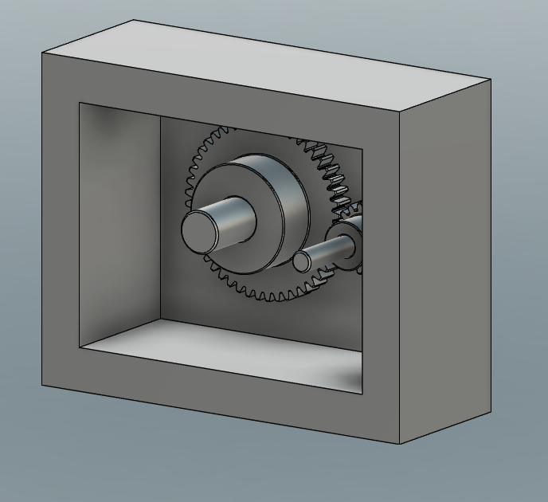</a><figcaption><strong>Figure 1.</strong> Open housing assembly showing the 48-tooth gear, 18-tooth pinion, and protruding shafts. <a href="images/01-assembly.webp">Full size</a>.</figcaption></figure>

## Design inputs and assumptions

| Parameter | Input / pinion shaft | Output / gear shaft |
|---|---:|---:|
| Number of gear teeth, z | 18 | 48 |
| Pitch diameter, Dp | 0.375 in | 1.000 in |
| Shaft diameter, d | 0.125 in | 0.250 in |
| Shaft length, L | 1.000 in | 1.000 in |
| Speed, N | Calculated | 1,100 rpm |
| Torque, T | Calculated | 1.250 in·lbf |
| Allowable shear stress used | 4,000 psi | 8,500 psi |

Both gears have a 20° pressure angle. The tooth ratio is 48:18, which simplifies to the required **24:9**. I treated the gear train as ideal, so transmitted power is the same at the input and output. Following the assignment, I ignored shaft bending from the gear forces for the shaft strength calculation and checked torsional shear stress.

For the bearing calculations, I used two supports per shaft and placed the gear load midway between them. This gives equal reactions at the two bearings. It is an analytical support model; the bearing reactions depend on the actual support and gear positions in a finished assembly.

The gear-to-shaft connection is intended to be a press fit. The shaft-to-bearing interface requires a running/sliding fit. These interfaces have different purposes: the gear must transmit torque with the shaft, while the bearing must allow the shaft to rotate.

## Speed, torque, and power

The input speed follows from the gear ratio. With an ideal train, torque changes inversely with speed.

Nizi = Nozo 
Ni = 1,100(48/18) = <strong>2,933.3 rpm</strong>  
TiNi = ToNo 
Ti = 1.250(18/48) = <strong>0.46875 in·lbf</strong>  
H = TN / 63,025 
Hi = (0.46875)(2,933.3) / 63,025 = <strong>0.02182 hp</strong> 
Ho = (1.250)(1,100) / 63,025 = <strong>0.02182 hp</strong>

The power check agrees at both ends. The input rotates faster and carries less torque than the output.

<figure class="a8-figure handwork" id="a8-figure-2"><a href="images/02-work1.webp" target="_blank" rel="noopener">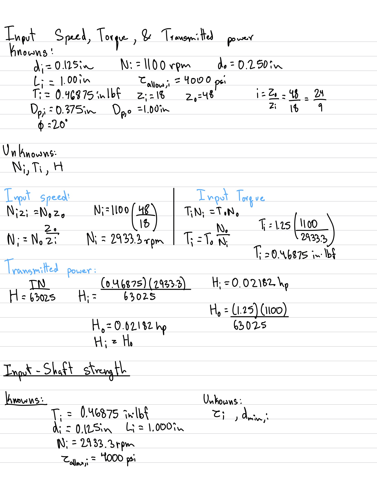</a><figcaption><strong>Figure 2.</strong> Handwritten input-speed, torque, power, and shaft-design setup. <a href="images/02-work1.webp">Full size</a>.</figcaption></figure>

## Input shaft design

### Knowns, unknowns, and free-body diagram

The input shaft is 1.000 in long and 0.125 in in diameter. Its transmitted torque is 0.46875 in·lbf, and I used 4,000 psi as the allowable torsional shear stress. The unknowns are maximum shear stress and minimum required diameter.

For steady rotation, the shaft has equal and opposite end torques. Its torque balance is Tdrive - Tgear = 0. The internal torque magnitude for this calculation is 0.46875 in·lbf. The shaft and support free-body diagrams are included in the handwritten work below.

### Equations and result

For a solid circular shaft, c = d/2 and J = πd⁴/32. Substituting into τ = Tc/J gives:

τmax = 16T / (πd³) 
τallow ≥ 16T / (πd³) 
dmin = [16T / (πτallow)]1/3  
τi = 16(0.46875) / [π(0.125)³] = <strong>1,222.3 psi</strong> 
dmin,i = [16(0.46875) / (π × 4,000)]1/3 = <strong>0.0842 in</strong>

The 0.125-in input shaft exceeds the calculated minimum diameter and its shear stress is below 4,000 psi. **I retained the specified 0.125-in diameter.** This conclusion applies to the torsion model and allowable stress used here.

## Output shaft design

### Knowns, unknowns, and free-body diagram

The output shaft is 1.000 in long and 0.250 in in diameter, with 1.250 in·lbf of torque at 1,100 rpm. I used 8,500 psi as its allowable shear stress. The unknowns are maximum shear stress and minimum diameter. The output shaft FBD has equal and opposite 1.250-in·lbf torques at its ends.

### Equations and result

Tgear - Tload = 0 
τo = 16(1.250) / [π(0.250)³] = <strong>407.4 psi</strong> 
dmin,o = [16(1.250) / (π × 8,500)]1/3 = <strong>0.0908 in</strong>

The output diameter is greater than the calculated minimum, and the computed shear stress is below 8,500 psi. **I retained the specified 0.250-in diameter.**

<figure class="a8-figure handwork" id="a8-figure-3"><a href="images/03-work2.webp" target="_blank" rel="noopener">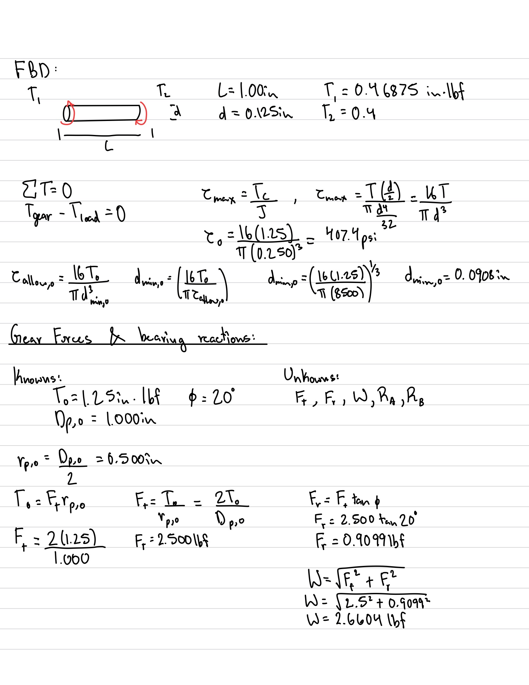</a><figcaption><strong>Figure 3.</strong> Handwritten torsion equations, shaft FBD, and gear-force calculations. The typed shaft sections separate the input and output results. <a href="images/03-work2.webp">Full size</a>.</figcaption></figure>

## Gear forces and bearing reactions

### Force model

The known output torque is 1.250 in·lbf, the output pitch diameter is 1.000 in, and the pressure angle is 20°. I solved for tangential force Ft, radial force Fr, resultant gear load W, and bearing reactions RA and RB.

To = Ft(Dp,o/2) 
Ft = 2To/Dp,o = 2(1.250)/1.000 = <strong>2.500 lbf</strong> 
Fr = Fttan φ = 2.500 tan 20° = <strong>0.9099 lbf</strong> 
W = √(Ft² + Fr²) = <strong>2.6604 lbf</strong>

The meshing gears exert equal and opposite forces on each other. I used the magnitude of the resultant load for each shaft's bearing sizing calculation.

### Support equilibrium

For a centered load over bearing span S, the moment equation about support A gives RBS = W(S/2). Force equilibrium then gives the other reaction.

ΣMA = 0: RBS - W(S/2) = 0 
RB = W/2 
ΣF = 0: RA + RB - W = 0 
RA = RB = W/2 = <strong>1.3302 lbf</strong> 
Wb = <strong>1.3302 lbf per bearing</strong>

The isolated bearing FBD balances the shaft load with the reaction from the housing. The load directions reverse between the input and output shaft diagrams, but the reaction magnitudes are equal in this centered-load model.

<figure class="a8-figure handwork" id="a8-figure-4"><a href="images/04-work3.webp" target="_blank" rel="noopener">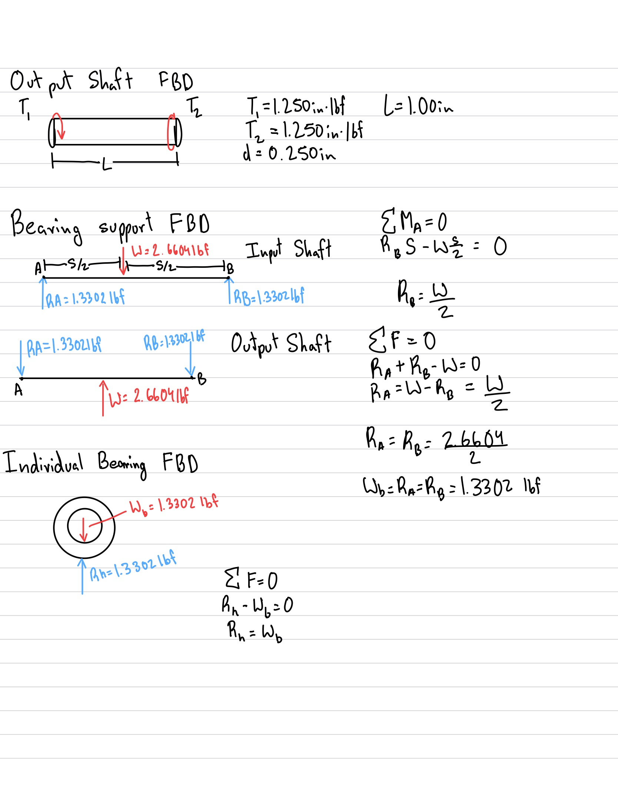</a><figcaption><strong>Figure 4.</strong> Output shaft torque FBD, centered bearing-support diagrams, and individual bearing equilibrium. <a href="images/04-work3.webp">Full size</a>.</figcaption></figure>

## Journal bearing design

### Material and reference limits

I used oil-impregnated sintered bronze as the bearing material for the calculations. The reference limits used in my work are shown below. These are material reference values, rather than a claim that every bronze sleeve bearing has the same rating. [PIC Design material reference](https://www.pic-designcatalog.com/b10-14.html).

| Property | Value used |
|---|---:|
| Allowable projected pressure, Pallow | 2,000 psi |
| Allowable sliding velocity, Vallow | 1,200 ft/min |
| Allowable PV | 50,000 psi·ft/min |
| Ultimate tensile strength, Sut | 14,000 psi |
| Ultimate-strength design factor, nu | 4 |
| Allowable hoop stress, Sut/nu | 3,500 psi |

### Length, pressure, velocity, and PV

The unknowns are the minimum bearing length, operating pressure, sliding velocity, and PV. I used projected area dL for the pressure calculation. The minimum length must satisfy both the pressure and PV limits; the velocity limit is checked separately.

Aprojected = dL 
P = Wb/(dL) 
V = πdN/12 &nbsp; [d in inches; V in ft/min] 
PV = WbV/(dL)  
LP ≥ Wb/(dPallow) 
LPV ≥ WbV/[d(PV)allow] 
L ≥ max(LP, LPV)

For the input bearing:

Vi = π(0.125)(2,933.3)/12 = <strong>95.99 ft/min</strong> 
LP,i ≥ 1.3302/[(0.125)(2,000)] = <strong>0.00532 in</strong> 
LPV,i ≥ (1.3302)(95.99)/[(0.125)(50,000)] = <strong>0.02043 in</strong>

For the output bearing:

Vo = π(0.250)(1,100)/12 = <strong>71.99 ft/min</strong> 
LP,o ≥ 1.3302/[(0.250)(2,000)] = <strong>0.00266 in</strong> 
LPV,o ≥ (1.3302)(71.99)/[(0.250)(50,000)] = <strong>0.00766 in</strong>

I used **0.250 in as the nominal bearing length** for both shaft sizes. At that length, the operating values are:

| Check | Input bearing | Output bearing | Reference limit |
|---|---:|---:|---:|
| Journal diameter | 0.125 in | 0.250 in | Shaft size |
| Nominal length | 0.250 in | 0.250 in | Above calculated minima |
| Projected pressure | 42.57 psi | 21.28 psi | 2,000 psi |
| Sliding velocity | 95.99 ft/min | 71.99 ft/min | 1,200 ft/min |
| PV | 4,086 psi·ft/min | 1,532 psi·ft/min | 50,000 psi·ft/min |

All three operating checks are below the reference limits. The input bearing controls the length calculation because its smaller journal and higher speed produce the larger PV requirement.

<figure class="a8-figure handwork" id="a8-figure-5"><a href="images/05-work4.webp" target="_blank" rel="noopener">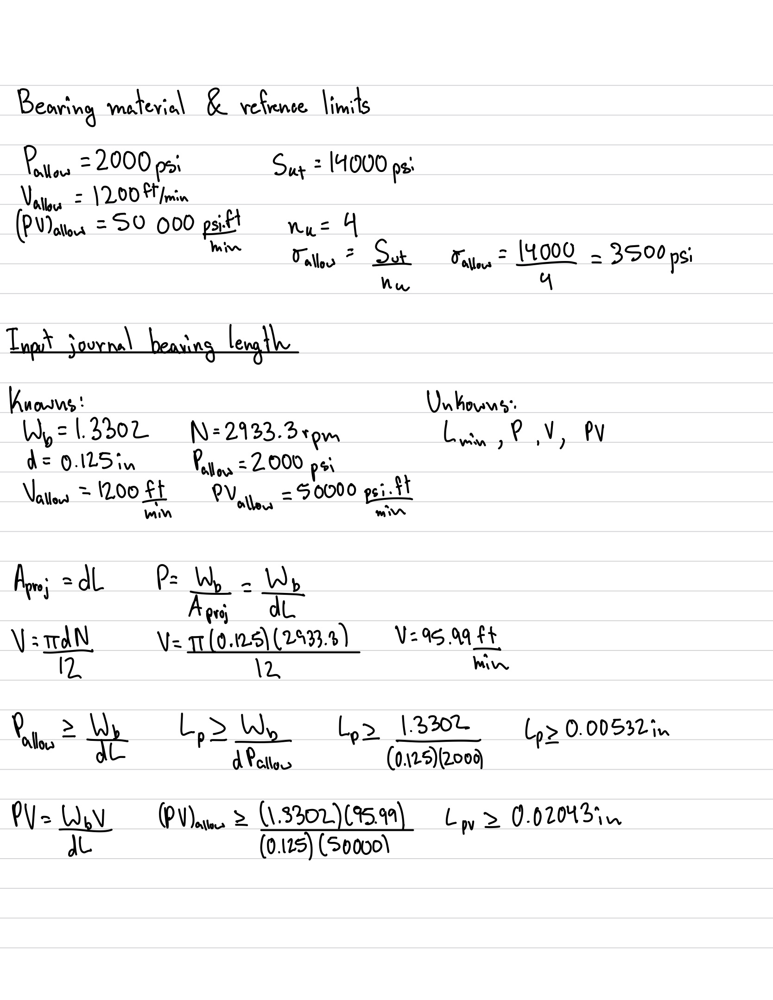</a><figcaption><strong>Figure 5.</strong> Bronze reference limits and input bearing length from pressure and PV. <a href="images/05-work4.webp">Full size</a>.</figcaption></figure>

<figure class="a8-figure handwork" id="a8-figure-6"><a href="images/06-work5.webp" target="_blank" rel="noopener">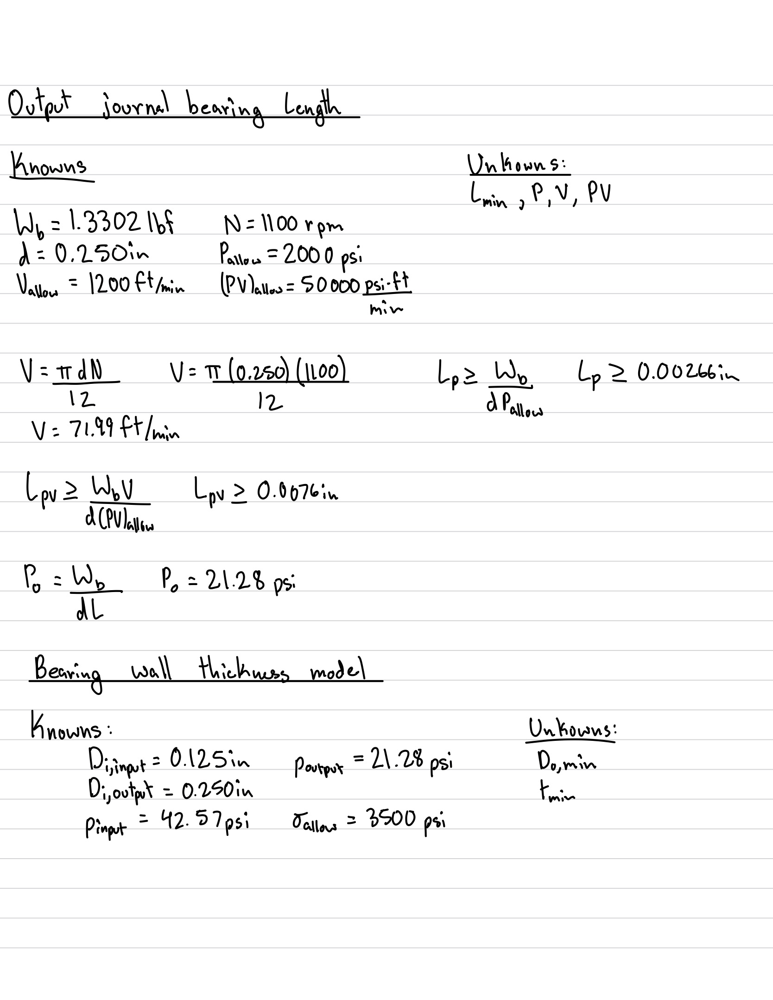</a><figcaption><strong>Figure 6.</strong> Output bearing length and setup for the sleeve wall-thickness model. <a href="images/06-work5.webp">Full size</a>.</figcaption></figure>

### Bearing wall thickness

I modeled the sleeve as a thick cylinder with a uniform equivalent internal pressure p and zero external pressure. I used the projected bearing pressures above for p. This is a simplified wall-stress calculation; it does not include the actual contact-pressure distribution, interference with the housing, or thermal effects.

The knowns are journal diameter Di, pressure p, and allowable hoop stress σallow = 3,500 psi. The unknowns are minimum outside diameter Do,min and minimum radial wall thickness tmin.

σθ,max = p(Do² + Di²)/(Do² - Di²) 
(σallow - p)Do² = (σallow + p)Di² 
Do,min = Di√[(σallow + p)/(σallow - p)] 
tmin = (Do,min - Di)/2  
tmin,i = (0.125/2){√[(3,500 + 42.57)/(3,500 - 42.57)] - 1} 
tmin,i = <strong>0.000765 in</strong>  
tmin,o = (0.250/2){√[(3,500 + 21.28)/(3,500 - 21.28)] - 1} 
tmin,o = <strong>0.000762 in</strong>

These small values are theoretical stress minima. They are not practical wall thicknesses to manufacture. A catalog sleeve needs enough material for handling, installation, and its specified housing fit as well as the calculated load.

For component selection, the bearing types are **oil-embedded bronze sleeve bearings for a 1/8-in shaft** and **oil-embedded bronze sleeve bearings for a 1/4-in shaft**, with a nominal 1/4-in length for this calculation. The supplier's outside diameter and installed-bore requirements determine the corresponding housing seat. [McMaster-Carr sleeve bearings](https://www.mcmaster.com/products/journal-bearings/sleeve-bearings-3~/).

<figure class="a8-figure handwork" id="a8-figure-7"><a href="images/07-work6.webp" target="_blank" rel="noopener">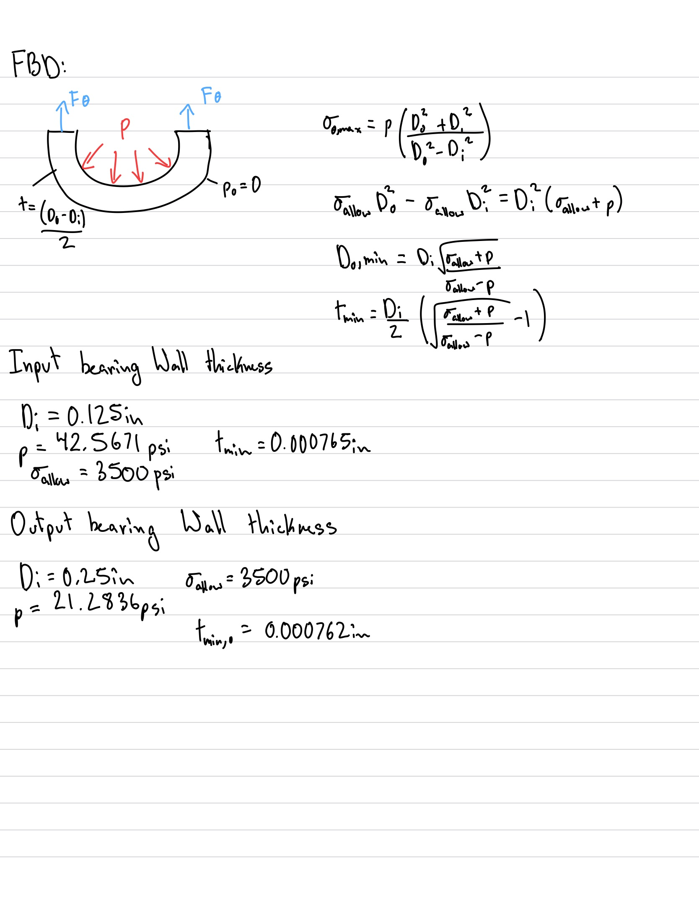</a><figcaption><strong>Figure 7.</strong> Sleeve wall-stress FBD, thick-cylinder model, and input/output thickness calculations. <a href="images/07-work6.webp">Full size</a>.</figcaption></figure>

## Housing sketch and assembly concept

My sketch uses a rectangular housing body with a removable front component. The two attachment locations shown above and below the opening establish the intended screw-fastened connection. A removable front gives access to the gears and shafts during assembly and disassembly.

I considered making the housing follow the gear outlines more closely, but kept the rectangular layout for this model. It gives a simple starting shape for the cavity and leaves a rim around the front opening. The sketch records the enclosure concept; the open CAD view below shows the internal arrangement.

<figure class="a8-figure handwork" id="a8-figure-8"><a href="images/08-work7.webp" target="_blank" rel="noopener">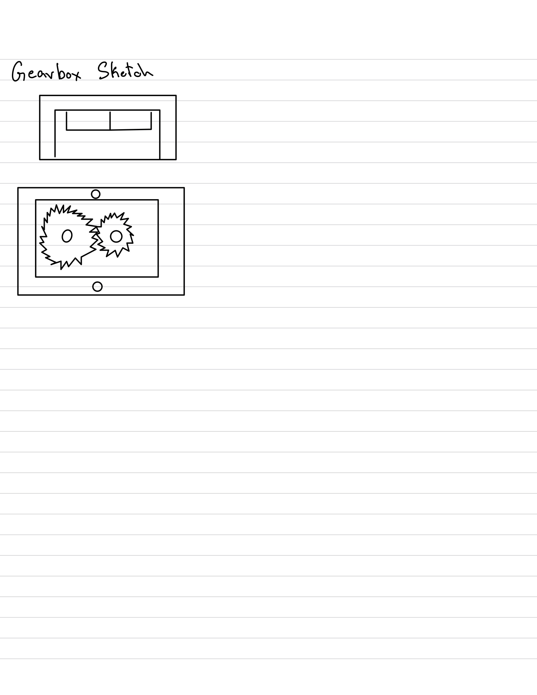</a><figcaption><strong>Figure 8.</strong> Housing sketch showing the gear pair, enclosure, and two front attachment locations. <a href="images/08-work7.webp">Full size</a>.</figcaption></figure>

## Parametric CAD modeling

### Shafts and gear placement

I modeled the shafts as dimensioned circular profiles extruded to 1.000 in. The input diameter is 0.125 in and the output diameter is 0.250 in. The shaft drawings include 0.010-in × 45° end chamfers. The input screenshot rounds the displayed diameter to 0.13 in; the detailed drawing records the intended 0.125-in dimension.

<figure class="a8-figure cad" id="a8-figure-9"><a href="images/09-inputshaft.webp" target="_blank" rel="noopener">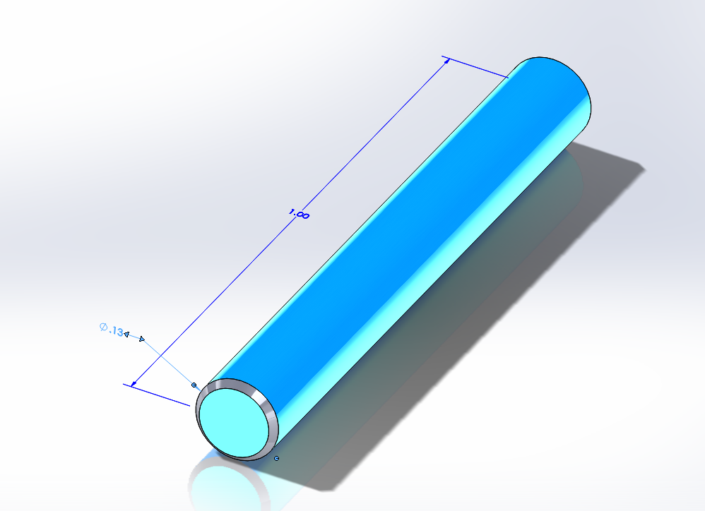</a><figcaption><strong>Figure 9.</strong> Input shaft CAD: 1.000-in length. The diameter display is rounded; the drawing specifies 0.125 in. <a href="images/09-inputshaft.webp">Full size</a>.</figcaption></figure>

<figure class="a8-figure cad" id="a8-figure-10"><a href="images/10-outputshaft.webp" target="_blank" rel="noopener">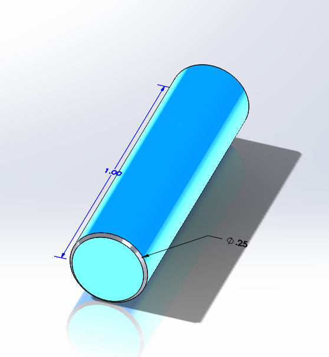</a><figcaption><strong>Figure 10.</strong> Output shaft CAD: 1.000-in length and 0.250-in diameter, with chamfered ends. <a href="images/10-outputshaft.webp">Full size</a>.</figcaption></figure>

I used the McMaster-Carr models for the 18-tooth pinion, **7880K19**, and 48-tooth gear, **7880K24**. Their pitch diameters establish the shaft center distance:

C = (Dp,i + Dp,o)/2 
C = (0.375 + 1.000)/2 = <strong>0.6875 in</strong>

I placed the shaft axes 0.6875 in apart. Using the outside diameters for this distance would space the gears incorrectly because the pitch circles establish the nominal mesh. The screenshot records the center-distance dimension used in the layout.

<figure class="a8-figure cad" id="a8-figure-11"><a href="images/11-mesh.webp" target="_blank" rel="noopener">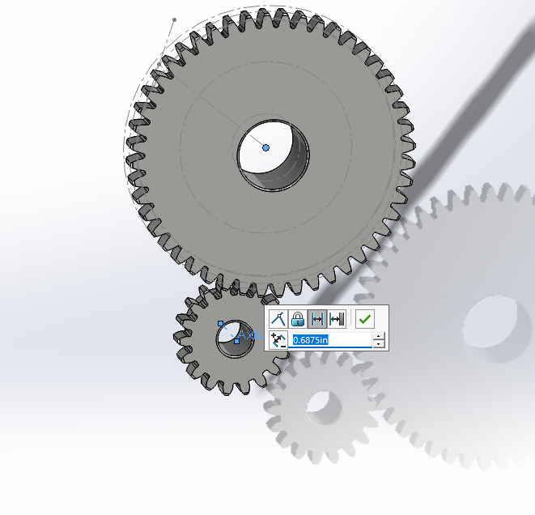</a><figcaption><strong>Figure 11.</strong> Gear layout with the 0.6875-in center-distance dimension. <a href="images/11-mesh.webp">Full size</a>.</figcaption></figure>

### Housing dimensions and design intent

The housing drawing records a **2.400-in width, 1.900-in height, and 0.900-in overall depth**. The front opening is surrounded by a 0.250-in rim, and the back-wall callout is 0.100 in. I used the gear arrangement to establish the cavity position and placed the shaft openings in the rear wall.

The important relationships are the fixed shaft center distance, the shaft diameters, the cavity around the gear teeth and hubs, and the bearing seats. A clearance around the tooth tips is separate from the fit at the rotating journals. The final view communicates the component arrangement; it is not a physical rotation or interference test.

### CAD drawings

The drawings document the two shafts and the housing body. Each preview opens the original PDF so the dimensions can be read at full size. They are also reproduced in the submission report's drawing appendix.

<figure class="a8-figure drawing" id="a8-figure-12"><a href="files/input-shaft.pdf" target="_blank" rel="noopener">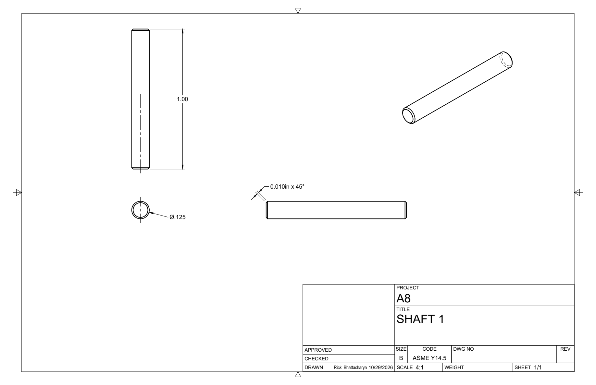</a><figcaption><strong>Figure 12.</strong> Input shaft drawing: diameter, length, end chamfer, and multiple views. <a href="files/input-shaft.pdf">Open original drawing PDF</a>.</figcaption></figure>

<figure class="a8-figure drawing" id="a8-figure-13"><a href="files/output-shaft.pdf" target="_blank" rel="noopener">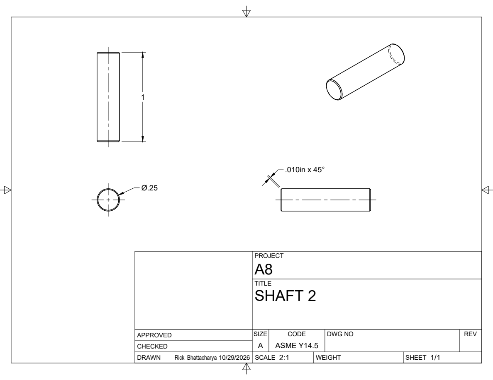</a><figcaption><strong>Figure 13.</strong> Output shaft drawing: diameter, length, end chamfer, and multiple views. <a href="files/output-shaft.pdf">Open original drawing PDF</a>.</figcaption></figure>

<figure class="a8-figure drawing" id="a8-figure-14"><a href="files/housing-body.pdf" target="_blank" rel="noopener">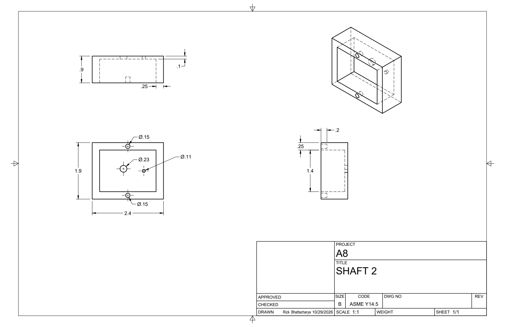</a><figcaption><strong>Figure 14.</strong> Housing body drawing with overall dimensions, cavity, and hole callouts. <a href="files/housing-body.pdf">Open original drawing PDF</a>.</figcaption></figure>

## Results

| Design quantity | Input side | Output side |
|---|---:|---:|
| Speed | 2,933.3 rpm | 1,100 rpm |
| Torque | 0.46875 in·lbf | 1.250 in·lbf |
| Transmitted power | 0.02182 hp | 0.02182 hp |
| Calculated torsional shear stress | 1,222.3 psi | 407.4 psi |
| Minimum shaft diameter | 0.0842 in | 0.0908 in |
| Retained shaft diameter | 0.125 in | 0.250 in |
| Load per bearing, centered-support model | 1.3302 lbf | 1.3302 lbf |
| Minimum length from pressure and PV | 0.02043 in | 0.00766 in |
| Nominal length used | 0.250 in | 0.250 in |
| Theoretical minimum sleeve wall | 0.000765 in | 0.000762 in |

Both shafts meet the torsional strength checks with the specified diameters. A 0.250-in bearing length satisfies the pressure, speed, and PV checks for the bronze reference data and assumed bearing loads. The CAD layout uses the calculated 0.6875-in gear center distance and shows how the shafts and gears fit within the open rectangular housing.

## Lessons learned and mistakes

**Pitch diameter controls gear spacing.** I had to distinguish the pitch circles from the outside tooth diameters when positioning the gears. Adding the pitch radii gave a clear center-distance dimension to use in CAD.

**A diameter display can hide useful precision.** The input-shaft screenshot shows 0.13 in after rounding, while the intended dimension is 0.125 in. I used the detailed drawing to communicate the shaft size rather than relying on the rounded screenshot alone.

**Strength and fit answer different questions.** A shaft can pass a torsion calculation while still requiring a properly specified fit at each interface. The gear hub needs to transmit torque, and the bearing bore needs clearance for rotation. Treating every hole as the same nominal shaft diameter would miss that distinction.

**Bearing pressure uses projected area.** I used dL rather than the full curved surface area. The input bearing also showed why pressure alone is insufficient: its higher speed makes the PV check more restrictive than the pressure-only length check.

**A theoretical minimum is not a manufacturing dimension.** The wall-stress calculation produced thicknesses below one thousandth of an inch because the load is small relative to the assumed material strength. A usable sleeve still needs a practical wall and an appropriate installed fit.

**Assembly details need their own dimensions.** Working through the housing made the relationship between shaft position, gear hubs, bearing support, and the removable front more apparent. The equations establish the operating loads, while the component layout determines where those loads enter the housing.

Total time spent on calculations, sketching, CAD, and documentation: **5 hours**.

## CAD and source downloads

| File | Contents |
|---|---|
| [Assembly export](files/Gearbox-assembly.3mf) | Final exported mesh geometry for viewing the assembly |
| [CAD source package](files/A08-CAD-source.zip) | Two shaft parts, two gear parts, gear STEP files, the working assembly saves, and the 3MF export |
| [Input shaft drawing](files/input-shaft.pdf) | Original 0.125-in shaft drawing |
| [Output shaft drawing](files/output-shaft.pdf) | Original 0.250-in shaft drawing |
| [Housing body drawing](files/housing-body.pdf) | Original housing drawing |
| [Original work and screenshots](files/A08-original-work.zip) | All seven handwritten pages and four CAD screenshots |
| [Submission report](files/A08-submission.pdf) | Report with full-page handwritten work and original drawing appendices |

The 3MF is a mesh export. The source package retains the original native SOLIDWORKS component and working assembly filenames so their references can be kept together.

## References

- Course assignment: *A8: Gear Box Design*, MEGR 2157. Required output conditions, shaft dimensions, assumptions, and drawing requirements.
- *Machinery's Handbook*: shaft torsion, gearing, and plain-bearing methods referenced by the assignment.
- [McMaster-Carr 7880K19 pinion](https://www.mcmaster.com/7880K19/) and [7880K24 gear](https://www.mcmaster.com/7880K24/): gear component models and nominal geometry.
- [PIC Design bronze bearing reference](https://www.pic-designcatalog.com/b10-14.html): material data used for the bearing pressure, velocity, PV, and strength assumptions.
- [McMaster-Carr journal sleeve bearings](https://www.mcmaster.com/products/journal-bearings/sleeve-bearings-3~/): sleeve-bearing component selection.

