# A9 - Pulley System

Rick Bhattacharya · MEGR 2157 
Total time spent: **3 hours**.

[Download the submission report](files/A09-submission.pdf) · [Original handwritten work](files/A09-original-work.zip) · [Analysis diagrams](files/A09-analysis-diagrams.pdf)

## Objective

I designed an open-belt drive to transfer power between two parallel shafts. The assignment requires two 3-in pulleys, a center distance between 4 and 6 in, an operating speed between 1,000 and 2,000 rpm, stationary belt tension between 4 and 6 lbf, and a minimum safety factor of 3.

I selected a 5-in nominal center distance, 1,500 rpm, and 5 lbf of stationary tension in each span. I worked through the belt forces first, then used the resulting torque and pulley load to size the shafts, choose journal bearings, and check the supporting frame.

<figure class="a9-figure initial" id="a9-figure-1"><figcaption><strong>Figure 1.</strong> Initial two-pulley schematic used to establish the open-belt layout. <a href="images/initial-schematic.png">Full size</a>.</figcaption></figure>

## Design inputs and assumptions

| Parameter | Value used |
|---|---:|
| Pulley outside diameter | 3.000 in each |
| Nominal center distance, C | 5.000 in |
| Operating speed, N | 1,500 rpm |
| Stationary tension, T₀ | 5.00 lbf per span |
| Minimum required safety factor | 3 |
| Pulley and frame material | 6061-T6 aluminum |
| Shaft material | Hardened 1060 steel |
| Belt material and assigned yield strength | Polyurethane, 471 psi |
| Assumed effective dry friction coefficient, μ | 0.30 |
| Assumed belt density | 1,220 kg/m³ |
| Shaft yield strength required for this calculation | At least 60,000 psi |
| Aluminum yield strength / elastic modulus used | 35,000 psi / 10 × 10⁶ psi |

The friction coefficient and steel yield strength are stated design assumptions. The strength of hardened steel depends on its heat treatment; the shaft calculations require stock meeting the 60,000-psi minimum used here. I assumed steady operation, aligned pulleys, and a basic constant-mean-tension belt model. I did not take credit for extra grip from V-groove wedging.

I selected a 5/16-in round belt and a 2.500-in groove-root diameter. The belt centerline runs above the groove root, so its pitch diameter is smaller than the pulley outside diameter:

Dp = Droot + db 
Dp = 2.500 + 0.3125 = <strong>2.8125 in</strong> 
θ = π rad = <strong>180°</strong> on each equal pulley 
Nout = Nin = <strong>1,500 rpm</strong>

Equal pulleys give a 1:1 speed ratio. I kept the pulley outside diameter separate from the belt pitch diameter when calculating belt speed and torque.

## Belt selection

### Knowns, unknowns, and free-body diagram

The knowns are T₀ = 5 lbf, μ = 0.30, θ = π, Dp = 2.8125 in, and N = 1,500 rpm. I solved for the tight- and loose-side tensions, transmitted torque and power, required belt area, belt diameter, and installed circumference.

The belt pulls each pulley toward the other shaft. Its tight-side tension creates a larger moment than its loose-side tension. The shaft reactions balance the resulting pulley forces.

<figure class="a9-figure diagram" id="a9-figure-2"><a href="images/belt-fbd.svg" target="_blank" rel="noopener">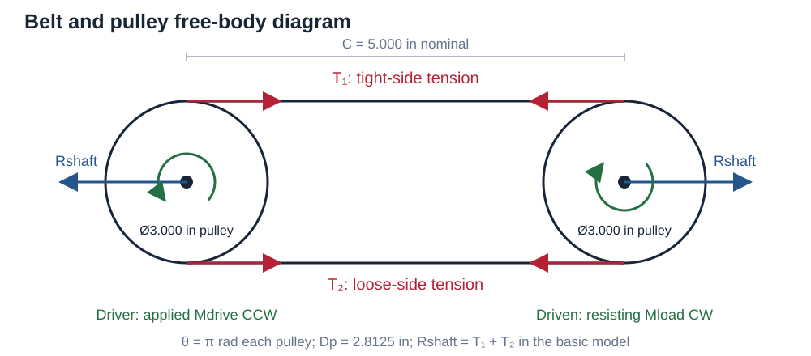</a><figcaption><strong>Figure 2.</strong> Belt and pulley FBD. Red arrows show the individual span forces; shaft reactions balance the forces. Applied driver and resisting load torques act in opposite senses. <a href="images/belt-fbd.svg">Full size</a>.</figcaption></figure>

### Symbolic tension solution

For the basic constant-mean-tension approximation, the two span tensions add to twice the stationary tension. The capstan relation gives the limiting tension ratio at impending slip.

T₁ + T₂ = 2T₀ 
T₁/T₂ ≤ eμθ 
k = eμθ; at impending slip, T1,lim = kT2,lim 
(k + 1)T2,lim = 2T₀ 
T2,lim = 2T₀/(k + 1) 
T1,lim = 2T₀k/(k + 1)

Substituting the chosen friction coefficient and wrap angle:

k = e0.30π = <strong>2.5663</strong> 
T2,lim = 10/(2.5663 + 1) = <strong>2.8040 lbf</strong> 
T1,lim = 10(2.5663)/(2.5663 + 1) = <strong>7.1960 lbf</strong>

<figure class="a9-figure handwork" id="a9-figure-3"><a href="images/handwritten-01.webp" target="_blank" rel="noopener">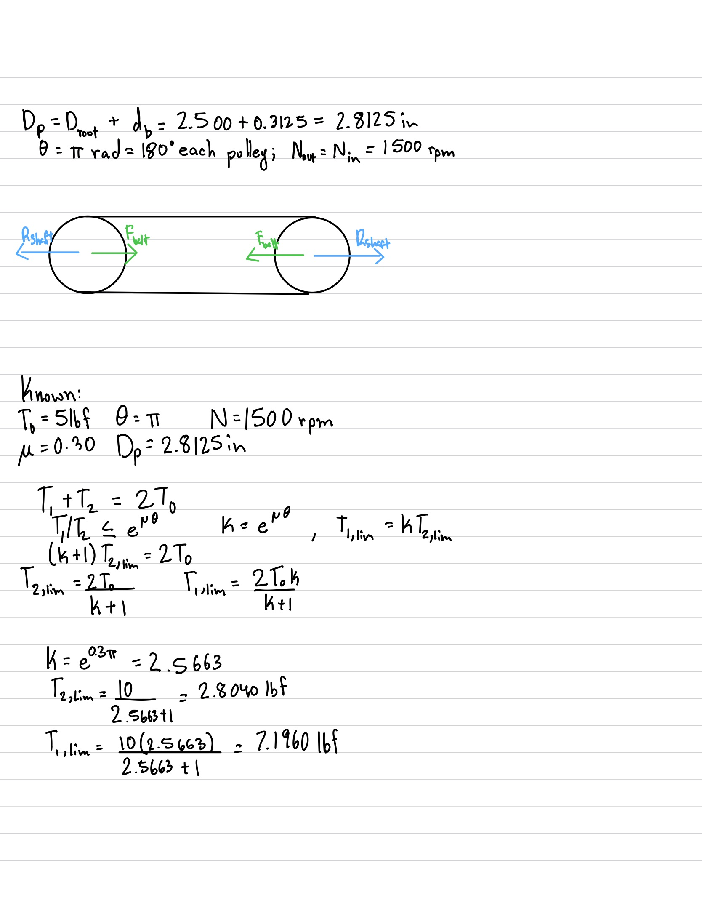</a><figcaption><strong>Figure 3.</strong> Handwritten geometry, system FBD, and symbolic and numerical limiting belt-tension calculations. <a href="images/handwritten-01.webp">Full size</a>.</figcaption></figure>

### Operating load and no-slip check

I selected operating tensions of **6.50 lbf on the tight side** and **3.50 lbf on the loose side**. Their mean is 5 lbf, and their ratio is below the calculated slip threshold:

(6.50 + 3.50)/2 = <strong>5.00 lbf</strong> 
T1,op/T2,op = 6.50/3.50 = <strong>1.8571 &lt; 2.5663</strong> 
μrequired = ln(1.8571)/π = <strong>0.1970 &lt; 0.30 assumed</strong>

This operating point satisfies the no-slip inequality under the assumed friction coefficient. I used the higher limiting torque for shaft sizing.

### Belt speed, torque, and power

v = πDpN/12 
v = π(2.8125)(1,500)/12 = <strong>1,104.47 ft/min</strong>  
M = (T₁ − T₂)Dp/2 
Mop = (6.50 − 3.50)(2.8125)/2 = <strong>4.21875 in·lbf</strong> 
Hop = MopN/63,025 = <strong>0.10041 hp</strong>  
Mlim = (7.1960 − 2.8040)(2.8125)/2 = <strong>6.17625 in·lbf</strong> 
Hlim = MlimN/63,025 = <strong>0.14700 hp</strong>

The tension difference controls transmitted torque. The sum of the tensions controls the principal horizontal load on the shafts.

<figure class="a9-figure handwork" id="a9-figure-4"><a href="images/handwritten-02.webp" target="_blank" rel="noopener">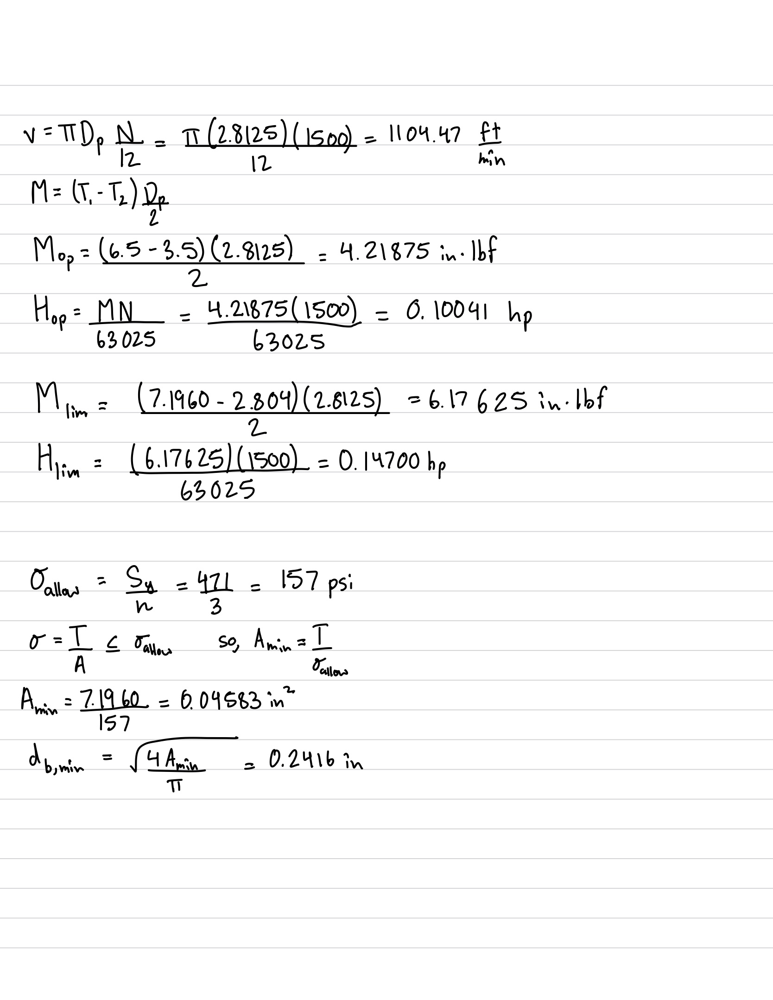</a><figcaption><strong>Figure 4.</strong> Handwritten belt speed, operating and limiting torque and power, and initial belt-area calculation. <a href="images/handwritten-02.webp">Full size</a>.</figcaption></figure>

### Required belt area and diameter

Using the assignment's polyurethane yield strength and a safety factor of 3 gives:

σallow = Sy/n = 471/3 = <strong>157 psi</strong> 
σ = T/A ≤ σallow 
Amin = T/σallow = 7.1960/157 = <strong>0.04583 in²</strong> 
db,min = √(4Amin/π) = <strong>0.2416 in</strong>

I also added a centrifugal-tension allowance for belt strength and support loading. I retained the basic-model tensions and added Tc to each span as a conservative sizing check. This is an allowance rather than an exact solution for the belt's stretch and tension compatibility.

v = (1,104.47)(0.3048)/60 = <strong>5.61069 m/s</strong> 
σc = ρv² = (1,220)(5.61069²) = <strong>38,406 Pa = 5.570 psi</strong> 
T/A + σc ≤ 157 
Amin = T/(157 − σc) 
Amin = 7.1960/(157 − 5.570) = <strong>0.04752 in²</strong> 
db,min = √[4(0.04752)/π] = <strong>0.2460 in</strong>

I selected **5/16 in, or 0.3125 in**, to provide additional area above the calculated minimum.

A = π(0.3125)²/4 = <strong>0.07670 in²</strong> 
Tc = Aσc = (0.07670)(5.570) = <strong>0.4272 lbf</strong> 
σmax,lim ≤ 7.1960/0.07670 + 5.570 = <strong>99.39 psi</strong> 
nbelt,lim ≥ 471/99.39 = <strong>4.74</strong> 
σmax,op ≤ 6.50/0.07670 + 5.570 = <strong>90.32 psi</strong> 
nbelt,op ≥ 471/90.32 = <strong>5.21</strong>

### Belt circumference and component choice

For equal pulleys, the two straight spans total 2C and the two half-wraps total one pitch circumference.

Lcenterline = 2C + πDp 
Lcenterline = 2(5) + π(2.8125) = <strong>18.8357 in</strong> 
Louter,installed = Lcenterline + πdb 
Louter,installed = 18.8357 + π(0.3125) = <strong>19.8175 in</strong>

My selected belt family is **McMaster-Carr 9462T58**, an unreinforced polyurethane round belt with a 5/16-in cross section and a custom outer circumference. The catalog lists a 2.5-in minimum pulley diameter for this family. [McMaster-Carr round-belt specifications](https://www.mcmaster.com/products/conveyor-roller-bands/).

The 19.8175-in result is the installed outer circumference at the nominal 5-in center distance. I used an adjustable mount because the purchased belt's free circumference must account for stretch. A 19.25-in free outer circumference is a candidate; its exact pretension requires supplier load-extension data or measurement. The single 20%-strain strength value does not define the complete force-extension curve.

<figure class="a9-figure handwork" id="a9-figure-5"><a href="images/handwritten-03.webp" target="_blank" rel="noopener">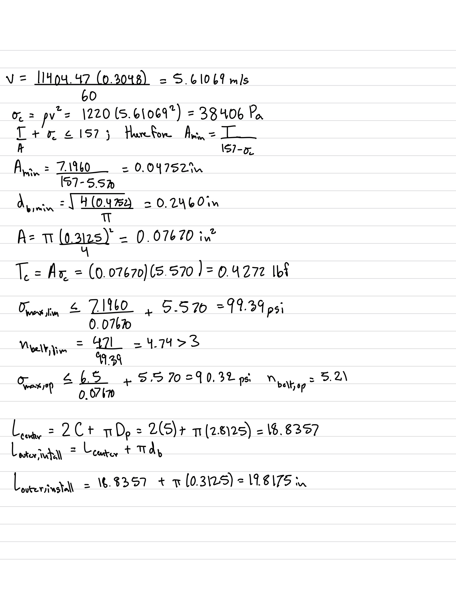</a><figcaption><strong>Figure 5.</strong> Handwritten centrifugal allowance, selected belt area, belt safety factors, and installed circumference. <a href="images/handwritten-03.webp">Full size</a>.</figcaption></figure>

## Shaft design

### Knowns, unknowns, and load model

The shaft design uses a limiting torque of 6.17625 in·lbf, a steel yield-strength requirement of at least 60,000 psi, and a minimum safety factor of 3. I selected a **1.500-in bearing span**, with the pulley centered between the bearings. The unknowns are the minimum shaft diameter and the safety factor of the selected shaft.

The belt-pull allowance is 10 + 2Tc = 10.8545 lbf. Bounding the pulley by a solid 3-in-diameter, 0.625-in-wide aluminum disk gives approximately 0.442 lbf of weight. A 4-in-long, 0.250-in-diameter steel shaft adds approximately 0.056 lbf. Their scalar sum is 11.352 lbf, which I rounded up to a **12-lbf radial design load**. Using a scalar sum conservatively covers the different load directions in this sizing model.

<figure class="a9-figure diagram" id="a9-figure-6"><a href="images/shaft-fbd.svg" target="_blank" rel="noopener">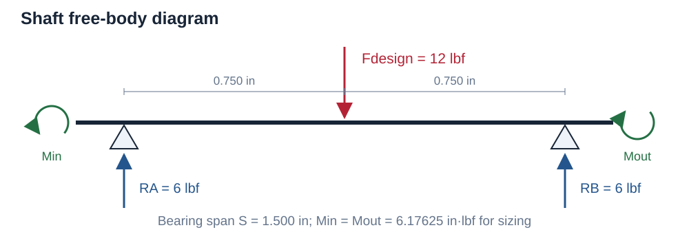</a><figcaption><strong>Figure 6.</strong> Shaft FBD with the centered 12-lbf radial design load, 1.500-in bearing span, equal 6-lbf reactions, and opposing transmitted torques. <a href="images/shaft-fbd.svg">Full size</a>.</figcaption></figure>

### Reactions and bending moment

ΣMA = 0: RBS − F(S/2) = 0 
RB = F/2 
ΣF = 0: RA + RB − F = 0 
RA = RB = <strong>6 lbf</strong> 
Mb,max = FS/4 = (12)(1.500)/4 = <strong>4.500 in·lbf</strong>

### Torsion-only minimum diameter

For a solid shaft, J = πd⁴/32 and c = d/2. I used the Tresca yield criterion, for which allowable shear stress is Sy/(2n).

ΣMshaft axis = 0: Min − Mout = 0 
τ = Mc/J = 16M/(πd³) 
τallow = Sy/(2n) = 60,000/(2 × 3) = <strong>10,000 psi</strong> 
dmin,torsion = [32nM/(πSy)]1/3 
dmin,torsion = [32(3)(6.17625)/(π × 60,000)]1/3 = <strong>0.1465 in</strong>

### Combined bending and torsion

I also checked bending because the belt applies a transverse load to the pulley. Combining the bending and torsional stresses gives:

σb = 32Mb/(πd³) 
σTresca = √(σb² + 4τ²) ≤ Sy/n 
dmin = {32n√(Mb² + M²)/(πSy)}1/3 
dmin = <strong>0.1573 in</strong> 
dmin,K=2 = 21/3(0.1573) = <strong>0.1982 in</strong>

The last line applies an assumed concentration allowance of K = 2 to both stresses. I selected **0.250-in shafts** for both pulleys. At that diameter:

| Shaft check | Result |
|---|---:|
| Cross-sectional area | 0.04909 in² |
| Nominal bending stress | 2,933.5 psi |
| Nominal torsional shear stress | 2,013.1 psi |
| Nominal Tresca equivalent stress | 4,981.6 psi |
| Static yield safety factor with K = 2 | 60,000 / [2(4,981.6)] = **6.02** |

The selected diameter meets the static strength target under these assumptions. The concentration allowance is a design estimate; the actual shaft features and heat treatment must satisfy the same basis. This calculation does not establish a rotating-bending fatigue life.

<figure class="a9-figure handwork" id="a9-figure-7"><a href="images/handwritten-04.webp" target="_blank" rel="noopener">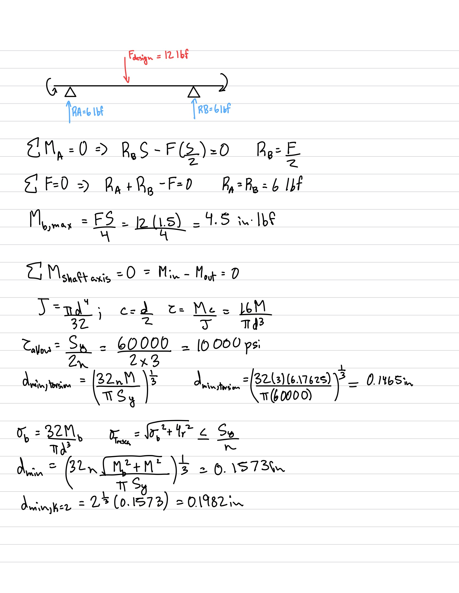</a><figcaption><strong>Figure 7.</strong> Handwritten shaft FBD, reactions, bending moment, torsion sizing, and combined bending/torsion sizing. <a href="images/handwritten-04.webp">Full size</a>.</figcaption></figure>

## Journal bearing design

### Knowns, unknowns, and bearing FBD

Each bearing supports a design load of 6 lbf on a 0.250-in journal rotating at 1,500 rpm. I solved for projected pressure, surface velocity, PV, and bearing length, then selected a sintered bronze material. The system uses **four bearings**, with two supporting each shaft.

<figure class="a9-figure diagram" id="a9-figure-8"><a href="images/bearing-fbd.svg" target="_blank" rel="noopener">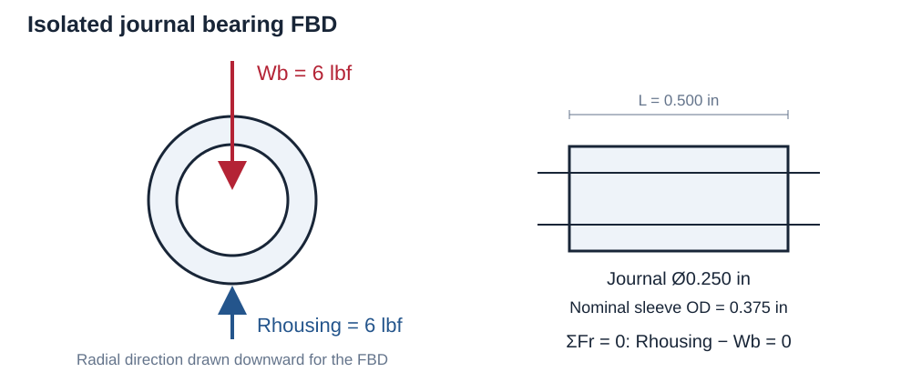</a><figcaption><strong>Figure 8.</strong> Isolated journal bearing FBD and axial view. The 6-lbf shaft load is balanced by the housing reaction. <a href="images/bearing-fbd.svg">Full size</a>.</figcaption></figure>

### Symbolic equations

The shaft load and housing reaction balance on an isolated bearing. Pressure uses the projected area dL rather than the full curved contact area.

ΣF = 0: Rhousing − Wb = 0 
Aprojected = dL 
P = Wb/(dL) 
V = πdN/12 [ft/min] 
PV = WbV/(dL) 
LP,min = mWb/(dPmax) 
LPV,min = mWbV/[d(PV)max]

I used an operating-limit margin m = 3 when comparing length requirements with the material's reference pressure and PV limits.

### Material, length, and operating results

I selected **oil-impregnated SAE 841 sintered bronze**. The manufacturer reference limits used here are Pmax = 2,000 psi, Vmax = 1,200 ft/min, and PVmax = 50,000 psi·ft/min. These limits are for the stated lubricated operating conditions. [Bunting bearing catalog, PV data chart](https://buntingbearings.com/wp-content/uploads/Product-Catalog-9-24-20.pdf).

V = π(0.250)(1,500)/12 = <strong>98.17 ft/min</strong> 
LP,min = 3(6)/[(0.250)(2,000)] = <strong>0.0360 in</strong> 
LPV,min = 3(6)(98.17)/[(0.250)(50,000)] = <strong>0.1414 in</strong> 
Select L = <strong>0.500 in</strong> 
P = 6/[(0.250)(0.500)] = <strong>48.00 psi</strong> 
PV = (48.00)(98.17) = <strong>4,712 psi·ft/min</strong>

| Operating check | Result | Reference limit | Limit / operating value |
|---|---:|---:|---:|
| Pressure | 48.00 psi | 2,000 psi | 41.67 |
| Sliding velocity | 98.17 ft/min | 1,200 ft/min | 12.22 |
| PV | 4,712 psi·ft/min | 50,000 psi·ft/min | 10.61 |

All three operating ratios exceed the chosen margin of 3. These are comparisons with empirical operating limits, rather than yield-based safety factors. A suitable catalog size is **Bunting EP040608**, nominally **1/4-in ID × 3/8-in OD × 1/2-in long**. The housing seat and installed bore follow the supplier's actual dimensional and fit requirements.

<figure class="a9-figure handwork" id="a9-figure-9"><a href="images/handwritten-05.webp" target="_blank" rel="noopener">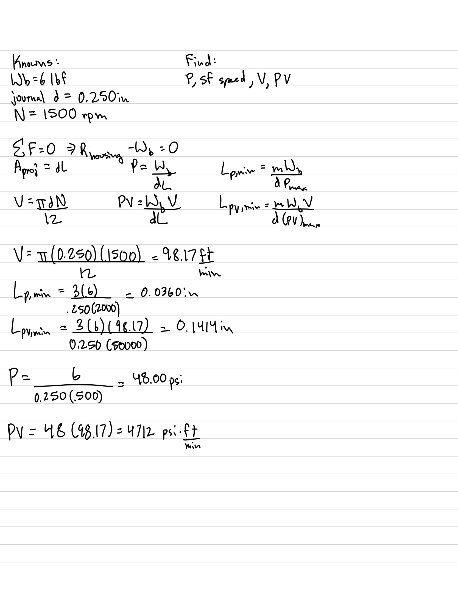</a><figcaption><strong>Figure 9.</strong> Handwritten journal-bearing knowns, pressure and velocity equations, minimum lengths, and PV results. <a href="images/handwritten-05.webp">Full size</a>.</figcaption></figure>

## Frame design

### Layout and selected dimensions

I selected a rectangular aluminum base with four bearing posts. Centering each pulley between its bearings keeps the support model consistent with the shaft calculations. The movable shaft's two bearing mounts adjust together along the belt direction to maintain parallel axes while setting tension.

| Frame feature | Selected dimension |
|---|---:|
| Base plate | 9.500 × 4.000 × 0.250 in |
| Shaft center height above base | 1.750 in |
| Nominal shaft center distance | 5.000 in |
| Bearing span along each shaft | 1.500 in |
| Post width in belt-force direction | 1.000 in |
| Post thickness along shaft axis | 0.500 in |
| Pulley width | 0.625 in |

<figure class="a9-figure diagram" id="a9-figure-10"><a href="images/frame-concept.svg" target="_blank" rel="noopener">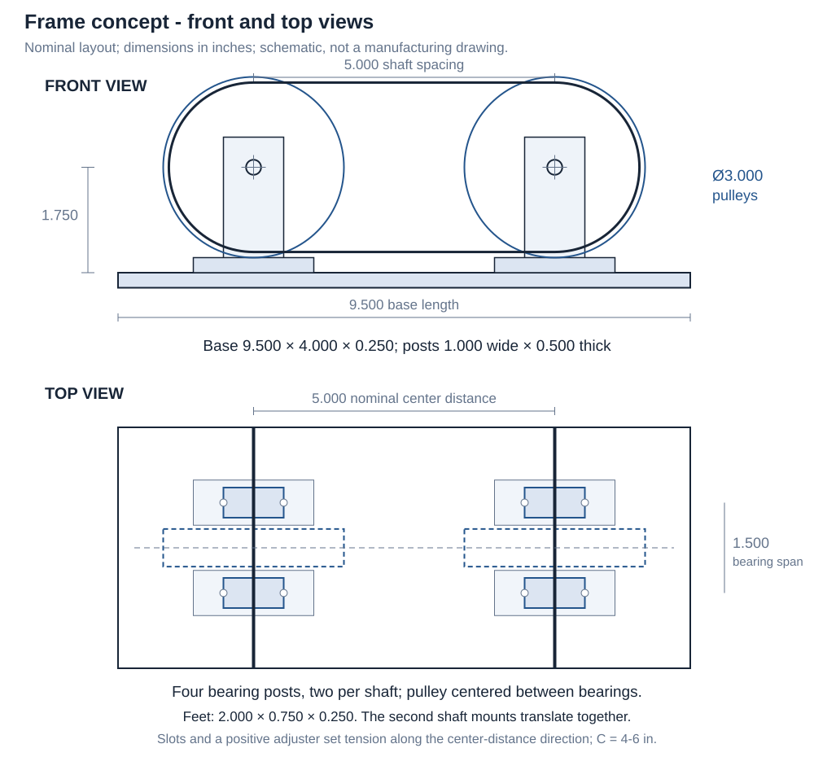</a><figcaption><strong>Figure 10.</strong> Dimensioned frame concept derived from the analysis: front and top views, four supports, nominal 5-in shaft spacing, and 1.500-in bearing spans. <a href="images/frame-concept.svg">Full size</a>.</figcaption></figure>

### Bearing-post stress and deflection

I modeled each post as a fixed cantilever under a 6-lbf horizontal load at the shaft center. For 6061-T6 aluminum, I used Sy = 35,000 psi and E = 10 × 10⁶ psi. The post's 1-in width is oriented in the force direction.

<figure class="a9-figure diagram" id="a9-figure-11"><a href="images/post-fbd.svg" target="_blank" rel="noopener">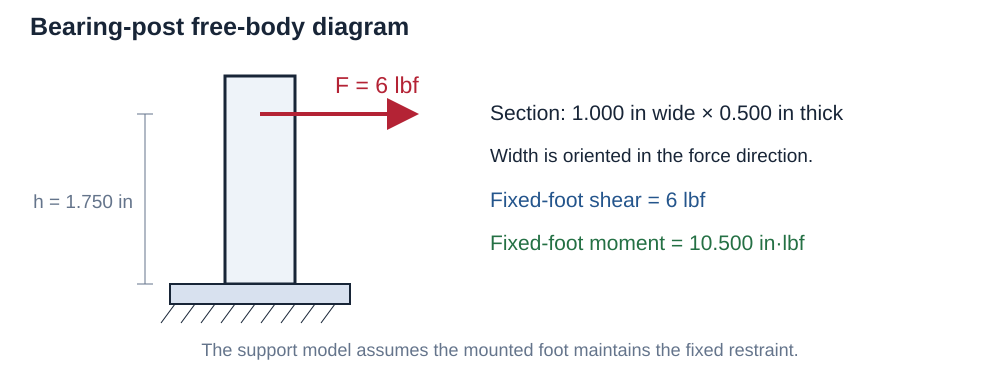</a><figcaption><strong>Figure 11.</strong> Bearing-post FBD for the cantilever model, showing the 6-lbf load at a 1.750-in height and the fixed-foot reactions. <a href="images/post-fbd.svg">Full size</a>.</figcaption></figure>

Mpost = Fh = (6)(1.750) = <strong>10.500 in·lbf</strong> 
I = tb³/12 = (0.500)(1.000)³/12 = <strong>0.041667 in⁴</strong> 
σb = Mc/I = (10.500)(0.500)/0.041667 = <strong>126.0 psi</strong> 
τmax = 1.5F/(bt) = 1.5(6)/[(1)(0.5)] = <strong>18.0 psi</strong> 
npost,bending = 35,000/126.0 = <strong>277.8</strong> 
δpost = Fh³/(3EI) = <strong>0.0000257 in</strong>

### Base-plate check and clearance

For a conservative strip model between the shaft stations, I used the 4-in base width and combined the direct load with bending from the shaft-height offset.

Abase = 4(0.250) = <strong>1.000 in²</strong> 
Ibase = 4(0.250)³/12 = <strong>0.005208 in⁴</strong> 
Mbase = (12)(1.750) = <strong>21.000 in·lbf</strong> 
σbase ≤ 12/Abase + Mbase(0.125)/Ibase 
σbase ≤ 12 + 504 = <strong>516 psi</strong> 
nbase = 35,000/516 = <strong>67.83</strong> 
δbase = MbaseC²/(8EIbase) = <strong>0.00126 in</strong>

The post and base checks have substantial margin because the required belt forces are small relative to the selected aluminum sections. Their calculated bending safety factors exceed 3. The model assumes the post feet maintain the fixed restraint; joint stiffness and local attachment details affect the actual frame behavior.

The belt's outer radius is (2.8125 + 0.3125)/2 = 1.5625 in. With a 1.750-in shaft center height, the belt clears the base by **0.1875 in**. The frame concept uses compact feet outside the pulley envelope and an adjustable mount for the second shaft.

<figure class="a9-figure handwork" id="a9-figure-12"><a href="images/handwritten-06.webp" target="_blank" rel="noopener">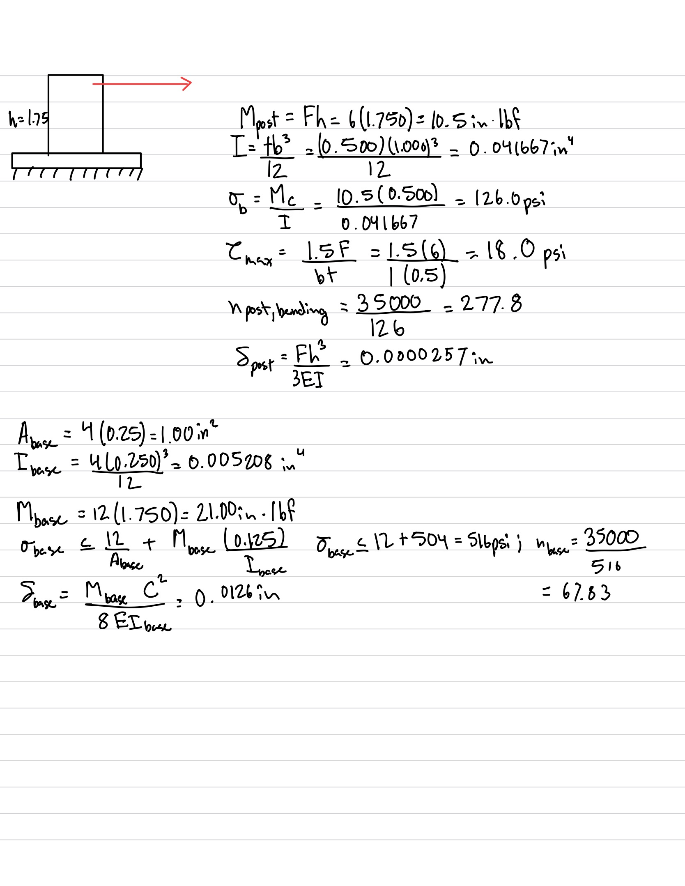</a><figcaption><strong>Figure 12.</strong> Handwritten post FBD, post stress and deflection, and base-plate checks. <a href="images/handwritten-06.webp">Full size</a>.</figcaption></figure>

## Final design results

| Design result | Value |
|---|---:|
| Pulley outside diameter / belt pitch diameter | 3.000 / 2.8125 in |
| Nominal center distance / operating speed | 5.000 in / 1,500 rpm |
| Stationary tension per span | 5.00 lbf |
| Chosen tight / loose operating tensions | 6.50 / 3.50 lbf |
| Limiting tight / loose tensions in the basic model | 7.196 / 2.804 lbf |
| Operating torque / power | 4.21875 in·lbf / 0.10041 hp |
| Required belt area with centrifugal allowance | 0.04752 in² |
| Selected belt diameter / area | 0.3125 in / 0.07670 in² |
| Belt safety factor at limiting load, with allowance | At least 4.74 |
| Installed belt outer circumference at C = 5 in | 19.8175 in |
| Minimum shaft diameter with assumed K = 2 | 0.1982 in |
| Selected shaft diameter / static safety factor | 0.250 in / 6.02 |
| Bearing size, nominal | 1/4-in ID × 3/8-in OD × 1/2-in long |
| Bearing pressure / velocity / PV | 48 psi / 98.17 ft/min / 4,712 psi·ft/min |
| Post / base bending safety factor | 277.8 / 67.83 |

The calculations support the selected belt, shaft diameters, bearings, and frame sections for the stated steady operating model. The belt operating ratio is below the assumed friction limit, and the calculated belt and shaft static strength margins exceed 3.

## Mistakes, corrections, and lessons learned

**The pulley diameter and belt pitch diameter serve different calculations.** I kept the required 3-in pulley outside diameter while using the belt centerline diameter of 2.8125 in for speed and torque. The groove geometry changes the belt's running radius.

**The difference and sum of belt tensions have different effects.** The difference produces torque. Their sum loads the shafts and bearings. Increasing stationary tension can increase the available traction while also increasing support loads.

**The slip limit is a capacity boundary.** The limiting tensions are 7.196 and 2.804 lbf. I selected the lower operating difference of 6.50 minus 3.50 lbf so the model operates below that boundary.

**Unit conversions and decimals need their own check.** The final values are 1,104.47 ft/min = 5.61069 m/s, 0.04583 in² for the initial belt-area calculation, and 0.04752 in² with the centrifugal allowance. The corresponding square-root calculation uses 0.04752 in². For the base, substituting the stated dimensions and modulus gives **0.00126 in** deflection; the handwritten final line records 0.0126 in.

**Bearing PV uses the shaft surface speed.** I used the 0.250-in journal diameter to calculate 98.17 ft/min at the bearing. Using the pulley diameter would give the wrong sliding velocity. Pressure uses the projected area dL.

**Strength margin and operating-limit margin are different checks.** I compared belt and shaft stresses with yield criteria. For the bearings, I compared pressure, velocity, and PV with the material's reference operating limits.

**Installed belt length does not directly determine purchase length.** The belt stretches to create pretension. An adjustable mount allows tension to be set without assuming the installed circumference is the belt's free circumference.

Total time spent on calculations and documentation: **3 hours**.

## Report and analysis downloads

- [Submission report with the six original handwritten pages](files/A09-submission.pdf)
- [Original handwritten pages and initial schematic](files/A09-original-work.zip)
- [Belt, shaft, bearing, and frame analysis diagrams](files/A09-analysis-diagrams.pdf)
- [Editable vector diagrams](files/A09-vector-diagrams.zip)

## References

- Course assignment: *Pulley System*, MEGR 2157. Required geometry, speed and tension ranges, safety factor, and assigned polyurethane strength.
- [D. J. Dunn, Pulley Drive Systems](https://freestudy.co.uk/dynamics/pulleys.pdf): friction, tension, speed, and power relationships.
- [McMaster-Carr polyurethane round belts](https://www.mcmaster.com/products/conveyor-roller-bands/): selected 5/16-in belt family 9462T58.
- [Bunting Bearings product catalog](https://buntingbearings.com/wp-content/uploads/Product-Catalog-9-24-20.pdf): powdered-metal bearing operating limits and EP040608 sleeve size.
- [Kaiser Aluminum 6061 technical data](https://online.kaiseraluminum.com/depot/PublicProductInformation/Document/1006/Kaiser_Aluminum_Shapes_Soft_Alloy.pdf): aluminum material reference.
- *Machinery's Handbook*, simple-stress and porous-metal journal-bearing references identified in the assignment.
- [Keegan Fine, A09 portfolio example](https://keeganfine.github.io/megr2157-portfolio/assignments/A09/): reference for the belt, shaft, bearing, and frame documentation sequence. Numerical results on this page follow my selected design and handwritten work.

