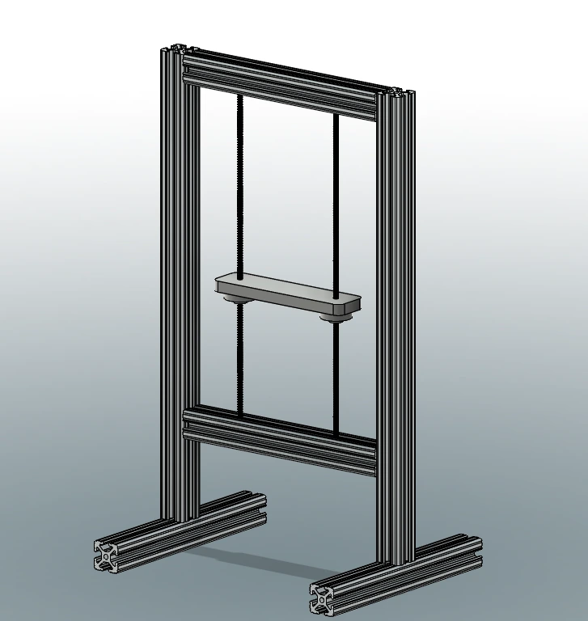
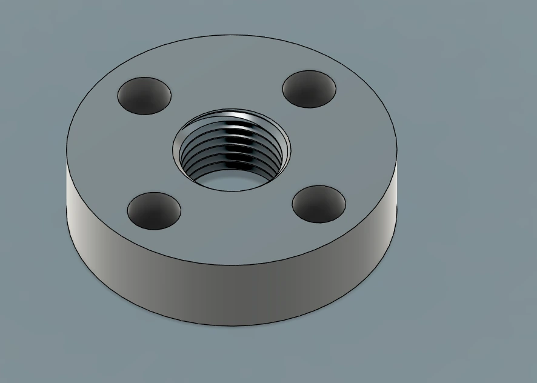
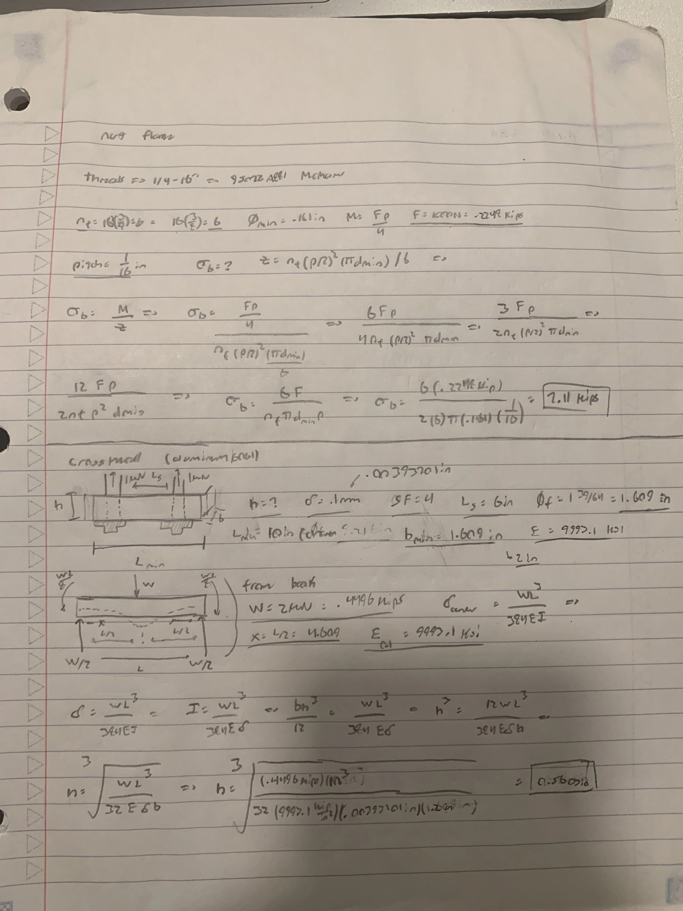
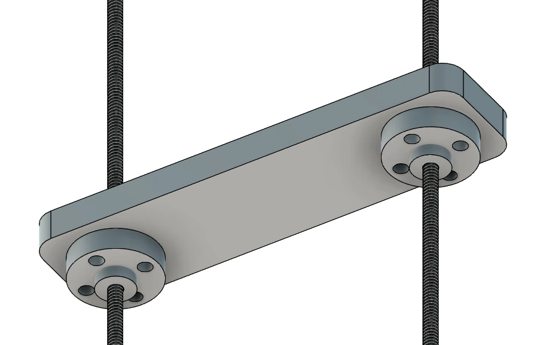
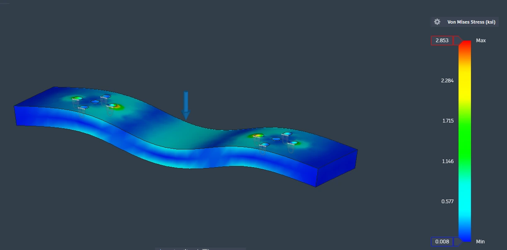
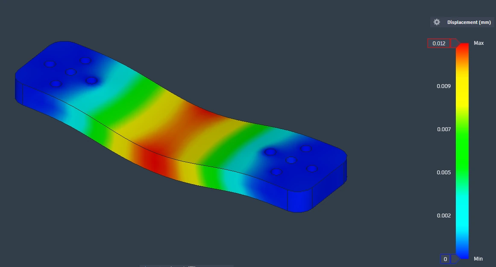
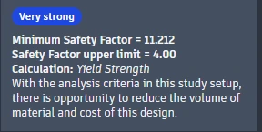

# A10 - Lead screw tensile tester

Rick Bhattacharya · Antonio Chiocca · Patrick Klauser 
MEGR 2157 · Total time spent: **10 hours**

<a href="files/A10-team-report.pdf">Submission PDF</a> · <a href="files/tensile-tester.f3z">Tester assembly</a> · <a href="files/crosshead.f3d">Crosshead CAD</a>

## Objective

We designed a benchtop tensile tester with two identical lead screws and a moving 6061 aluminum crosshead. The design requirements are a 2-kN specimen load, a crosshead speed of 1–50 mm/min, and a minimum safety factor of 4. We sized the screws and crosshead, selected matching nuts and flanges, and compared the initial and rounded-corner crossheads using FEA.

The assembly includes the frame, screws, nuts, flanges, and crosshead. The grip connection, screw end supports, and mechanical synchronization are outside the modeled assembly.

<figure class="a10-figure cad" id="a10-figure-1"><figcaption><strong>Figure 1.</strong> Tester assembly modeled by Rick Bhattacharya. The two screws and nut/flange assemblies position the moving crosshead inside the T-slot frame. <a href="images/assembly.webp" target="_blank" rel="noopener">Full size</a>.</figcaption></figure>

## Team contributions

| Team member | Contribution |
|---|---|
| Rick Bhattacharya | Modeled the tester assembly and crosshead, prepared the crosshead drawing, and completed one of the FEA studies. |
| Antonio Chiocca (AJ) | Worked through the nut-thread and crosshead calculations, checked the screw calculations, and helped with FEA. |
| Patrick Klauser | Worked through the lead screw diameter, rotational speed, and torque calculations and completed another FEA study. |

## Requirements and design inputs

| Input | Value |
|---|---|
| Maximum specimen load, W | 2,000 N |
| Number of lead screws | 2, identical |
| Nominal axial load per screw, F | 1,000 N, assuming centered loading and equal sharing |
| Required safety factor, n | 4 |
| Required crosshead speed | 1–50 mm/min |
| Minimum screw length | 18 in |
| Selected CAD screw | McMaster 99030A981, 1018 steel, 1/4″-16 Acme, right hand, single start, 18 in |
| Matching nut / flange in CAD | 95072A881 / 95082A641 |
| Screw lead, ℓ | 0.0625 in/rev = 1.5875 mm/rev |
| Assumed steel yield strength | 370 MPa; a material-condition assumption |
| Crosshead material | 6061 aluminum |
| Crosshead length / width | 8.00 in / 2.00 in |
| Crosshead thickness | 0.563 in |
| Distance between screw centers | 6.00 in |
| Maximum permitted crosshead deflection | 0.100 mm |

The screw centers are 6 in apart, leaving the specimen region between them.

## Lead screw sizing — Patrick Klauser

### Axial load and minimum root diameter

Knowns: W = 2,000 N, two screws, n = 4, and assumed steel yield strength Sᵧ = 370 MPa. Unknowns: minimum screw area and root diameter. With the specimen centered between the screws, each nut carries 1,000 N.

ΣFy = 0: RL + RR − W = 0 
RL = RR = W/2 = <strong>1,000 N</strong>  
σ = F/A ≤ Sy/n 
Amin = nF/Sy 
A = πdr²/4 
dr,min = √[4nF/(πSy)]  
σallow = 370/4 = <strong>92.5 MPa</strong> 
Amin = 4(1,000)/370 = <strong>10.81 mm²</strong> 
dr,min = √[4(4)(1,000)/(π × 370)] = <strong>3.710 mm = 0.1461 in</strong>

The minimum root diameter from axial stress is 0.1461 in. The selected screw has a nominal outside diameter of 0.250 in. We assumed a 370-MPa yield strength for cold-finished 1018 steel; the purchased screw’s material condition must meet that assumption. [Online Metals: 1018 properties](https://www.onlinemetals.com/en/product-guide/alloy/1018).

<figure class="a10-figure handwork" id="a10-figure-2"><figcaption><strong>Figure 2.</strong> Patrick Klauser: design constraints, axial screw sizing, FBD, and minimum root diameter. <a href="images/patrick-diameter.webp" target="_blank" rel="noopener">Full size</a>.</figcaption></figure>

### Rotational speed range

Knowns: single-start 1/4″-16 thread and v = 1–50 mm/min. Unknowns: screw speed N and angular velocity ω.

p = 1/16 in = 1.5875 mm 
ℓ = p × number of starts = <strong>1.5875 mm/rev</strong> 
v = Nℓ → N = v/ℓ  
Nmin = 1/1.5875 = <strong>0.6299 rpm</strong> 
Nmax = 50/1.5875 = <strong>31.496 rpm</strong> 
ω = 2πN/60 = <strong>0.0660–3.298 rad/s</strong>

The required screw speed is 0.6299–31.496 rpm. We corrected the angular-velocity units in the initial calculation: approximately 0.528 rev/s corresponds to 3.30 rad/s. Both screws must rotate together to keep the crosshead level.

### Torque at maximum specimen load

Knowns: F = 1,000 N per screw, Acme half-angle α = 14.5°, and mean thread diameter dm = d − p/2 = 5.55625 mm. Unknown: driving torque. We compared friction coefficients of 0.15 and 0.80.

T = (Fdm/2)[(ℓ cos α + πμdm)/(πdm cos α − μℓ)] 
α = 14.5°; F = 1,000 N; dm = 5.55625 mm; ℓ = 1.5875 mm  
For μ = 0.15: 
T = <strong>692.85 N·mm = 0.6929 N·m = 6.132 lbf·in per screw</strong> 
Tpair,1:1 = 2T = <strong>1.386 N·m</strong>  
For the worksheet assumption μ = 0.80: 
T = <strong>2.755 N·m per screw</strong>; Tpair,1:1 = <strong>5.511 N·m</strong>

Our initial torque calculation used μ = 0.80 and a square-thread approximation. Including the Acme flank angle gives 2.755 N·m per screw at that friction coefficient. At the preliminary assumption μ = 0.15, the result is 0.6929 N·m per screw. These values exclude bearing friction, crosshead weight, and transmission losses. [Thread angle and friction reference](https://help.solidworks.com/2022/english/solidworks/cworks/r_Friction_Factor_Coefficient.htm).

<figure class="a10-figure handwork" id="a10-figure-3"><figcaption><strong>Figure 3.</strong> Patrick Klauser: rotational speed and torque calculations. <a href="images/patrick-speed.webp" target="_blank" rel="noopener">Full size</a>.</figcaption></figure>

## Nut and flange analysis — Antonio Chiocca

We selected bronze nut 95072A881 and mounting flange 95082A641. The nut’s internal 1/4″-16 Acme thread matches the screw, and its external 9/16″-18 thread fits the flange. Four mounting bolts at each flange transfer the screw reaction into the crosshead.

<figure class="a10-figure cad" id="a10-figure-4"><figcaption><strong>Figure 4.</strong> Imported externally threaded bronze nut, McMaster 95072A881. <a href="images/nut.webp" target="_blank" rel="noopener">Full size</a>.</figcaption></figure><figure class="a10-figure cad" id="a10-figure-5"><figcaption><strong>Figure 5.</strong> Imported nut mounting flange, McMaster 95082A641. <a href="images/flange.webp" target="_blank" rel="noopener">Full size</a>.</figcaption></figure>

### Internal thread bending

Knowns: F = 224.81 lbf per nut and p = 0.0625 in. We assumed an effective engagement length Le = 0.375 in, root diameter dr = 0.161 in, and equal loading across six engaged threads. Unknowns: thread bending stress and required bronze yield strength.

Nt = Le/p = 0.375/0.0625 = <strong>6 threads</strong> 
Fthread = F/Nt 
Mthread = (F/Nt)(p/4) 
Zthread = (πdr)(p/2)²/6 
σb = M/Z = <strong>6F/(Ntπdrp)</strong>  
σb = 6(224.81)/[6π(0.161)(0.0625)] = <strong>7.111 ksi</strong> 
Required Sy,nut ≥ nσb = 4(7.111) = <strong>28.45 ksi</strong>

Using the 30-ksi reference yield strength for extruded-and-drawn C67300 bronze gives n = 30/7.111 = **4.22**. This result depends on the assumed engagement, equal thread loading, and bronze material condition. [C67300 material data](https://www.concast.com/files/C67300.pdf).

<figure class="a10-figure handwork" id="a10-figure-6"><figcaption><strong>Figure 6.</strong> Antonio Chiocca: nut-thread bending, crosshead sizing, and support sketches. <a href="images/aj-nut-crosshead.webp" target="_blank" rel="noopener">Full size</a>.</figcaption></figure>

## Crosshead beam analysis — Antonio Chiocca

We used the flange diameter to establish a minimum crosshead width. The selected flange is 1 39/64 in, or 1.6094 in, in diameter. A 2-in width gives room around that interface. The drawing places the screw centers 6 in apart within an 8-in overall length; the outer 1-in portions extend beyond the screw centers.

Knowns: W = 2,000 N, support span L = 152.4 mm, width b = 50.8 mm, and crosshead thickness h = 14.3002 mm (0.563 in). We used E = 68,900 MPa and assumed Sy = 240 MPa for 6061-T6 aluminum. Unknowns: bending stress, minimum thickness, and center deflection.

### Bending strength

For a simply supported beam with a centered point load:

RL = RR = W/2 = <strong>1,000 N</strong> 
Mmax = WL/4 = <strong>76,200 N·mm</strong> 
I = bh³/12 = <strong>12,379.7 mm⁴</strong>; c = h/2 
σmax = Mc/I = 3WL/(2bh²) 
hmin,strength = √[3nWL/(2bSy)]  
σmax = <strong>44.01 MPa</strong> 
nbeam = 240/44.01 = <strong>5.45</strong> 
hmin,strength = <strong>12.25 mm = 0.482 in</strong>

The beam calculation uses the gross cross section. We examined the mounting-hole stress concentrations separately in FEA.

### Deflection and support restraint

We checked both simply supported and fully fixed ends to show how mounting restraint affects deflection.

Simply supported: δmax = WL³/(48EI) = WL³/(4Ebh³) 
hmin,deflection = ∛[WL³/(4Ebδallow)] 
δsimple = <strong>0.1729 mm</strong> 
hmin,deflection = <strong>17.16 mm = 0.676 in</strong>  
Fully fixed ends: δmax = WL³/(192EI) 
δfixed = <strong>0.04323 mm</strong>

At a crosshead thickness of 0.563 in, the simply supported case exceeds the 0.100-mm limit; the fully fixed case meets it. The calculated deflection therefore depends on the rotational restraint provided by the flange mounts. We corrected the initial worksheet’s deflection equation to the center-point-load formulas above and used the 6-in support span.

<figure class="a10-figure handwork" id="a10-figure-7"><figcaption><strong>Figure 7.</strong> Antonio Chiocca: screw-load FBD, axial sizing, rotational speed, and torque working. <a href="images/aj-screw.webp" target="_blank" rel="noopener">Full size</a>.</figcaption></figure>

## CAD assembly and drawing — Rick Bhattacharya

We imported the McMaster screws, nuts, flanges, and T-slot framing, then modeled the crosshead around the two flange interfaces.

| Component | Source / design role |
|---|---|
| Lead screws | [99030A981](https://www.mcmaster.com/99030A981/), two 18-in precision Acme screws in CAD |
| Bronze nuts | [95072A881](https://www.mcmaster.com/95072A881/), two |
| Mounting flanges | [95082A641](https://www.mcmaster.com/95082A641/), two |
| Short framing members | [47065T414](https://www.mcmaster.com/47065T414/), imported 1-ft framing |
| Uprights | [47065T21](https://www.mcmaster.com/47065T21/), imported 2-ft framing |
| Crosshead | Custom 6061 aluminum component |

<figure class="a10-figure cad" id="a10-figure-8"><figcaption><strong>Figure 8.</strong> Underside of the crosshead showing the two nut/flange interfaces and screw-clearance locations. <a href="images/interface.webp" target="_blank" rel="noopener">Full size</a>.</figcaption></figure>

The crosshead has two Ø0.255-in screw-clearance holes and eight Ø0.26-in mounting holes. The mounting-hole groups sit around the two screw axes. The original plate had square outside corners; the revision rounds those corners while retaining the two mounting regions.

<figure class="a10-figure cad" id="a10-figure-9"><figcaption><strong>Figure 9.</strong> Initial crosshead with square outside corners and two flange-hole groups. <a href="images/original.webp" target="_blank" rel="noopener">Full size</a>.</figcaption></figure><figure class="a10-figure cad" id="a10-figure-10"><figcaption><strong>Figure 10.</strong> Revised crosshead with rounded outside corners. The mounting regions and hole groups are retained. <a href="images/revised.webp" target="_blank" rel="noopener">Full size</a>.</figcaption></figure>

### Crosshead multiview drawing

The crosshead drawing includes top, front, side, and isometric views, overall dimensions, screw spacing, and hole diameters.

<a class="a10-pdf-title" href="files/Crosshead.pdf">Crosshead drawing · PDF</a>

PDF viewer with zoom controls
<object type="application/pdf" data="files/Crosshead.pdf" aria-label="Crosshead drawing" width="100%" height="650"><a href="files/Crosshead.pdf">Open PDF</a></object>

### Parameters and interface intent

The crosshead uses a 6-in screw-center spacing and two matching flange-hole patterns. The Ø0.255-in center holes provide screw clearance; the eight Ø0.26-in holes attach the flanges. The specimen load acts midway between the screw axes.

## Crosshead FEA and geometry revision — Rick Bhattacharya, Patrick Klauser, and Antonio Chiocca

We compared the initial plate and the rounded-corner revision using static stress results in Fusion. The design load path is a centered 2-kN specimen force into the crosshead, balanced by reactions through the nut/flange mounting regions. The constraint symbols in the recorded plots are located at the mounting holes. These idealized restraints represent the local attachment regions rather than the flexibility of the entire tester frame.

### Recorded results

| Metric | Initial plate | Rounded-corner revision |
|---|---:|---:|
| Maximum von Mises stress | 2.853 ksi / 19.67 MPa | 3.557 ksi / 24.52 MPa |
| Maximum plotted resultant displacement | Approximately 0.003 mm | Approximately 0.012 mm |
| FOS information in the plots | Above the displayed scale of 8 | Minimum FOS = 11.212 |
| Critical stress region | Near the flange mounting holes | Near the flange mounting holes |
| Largest displacement region | Between the mounting regions | Between the mounting regions |
| Displacement / 0.100-mm limit | Approximately 3% | Approximately 12% |

The rounded-corner study showed **24.7% higher peak stress** and approximately four times the displacement of the initial study. Its reported minimum FOS of 11.212 exceeds the required 4, and its maximum resultant displacement of 0.012 mm is below 0.100 mm.

<figure class="a10-figure cad" id="a10-figure-11"><figcaption><strong>Figure 11.</strong> Initial study: maximum von Mises stress 2.853 ksi. The strongest stress concentrations are near mounting holes. The displayed deformation is exaggerated. <a href="images/stress-before.webp" target="_blank" rel="noopener">Full size</a>.</figcaption></figure><figure class="a10-figure cad" id="a10-figure-12"><figcaption><strong>Figure 12.</strong> Revised study: maximum von Mises stress 3.557 ksi. The critical region remains near the attachment holes. The apparent curvature is the displayed deformation. <a href="images/stress-after.webp" target="_blank" rel="noopener">Full size</a>.</figcaption></figure>

<figure class="a10-figure cad" id="a10-figure-13"><figcaption><strong>Figure 13.</strong> Initial study: maximum plotted resultant displacement approximately 0.003 mm. <a href="images/disp-before.webp" target="_blank" rel="noopener">Full size</a>.</figcaption></figure><figure class="a10-figure cad" id="a10-figure-14"><figcaption><strong>Figure 14.</strong> Revised study: maximum plotted resultant displacement approximately 0.012 mm. <a href="images/disp-after.webp" target="_blank" rel="noopener">Full size</a>.</figcaption></figure>

<figure class="a10-figure cad" id="a10-figure-15"><figcaption><strong>Figure 15.</strong> Initial safety-factor plot. Blue is above the displayed upper scale of 8; it is not an exact numerical minimum. <a href="images/fos-before.webp" target="_blank" rel="noopener">Full size</a>.</figcaption></figure><figure class="a10-figure cad" id="a10-figure-16"><figcaption><strong>Figure 16.</strong> Revised safety-factor plot. The target is 4, and the displayed blue field is above the upper scale. <a href="images/fos-after.webp" target="_blank" rel="noopener">Full size</a>.</figcaption></figure>

<figure class="a10-figure cad" id="a10-figure-17"><figcaption><strong>Figure 17.</strong> Revised study result panel: minimum safety factor 11.212, based on yield strength. <a href="images/fos-detail.webp" target="_blank" rel="noopener">Full size</a>.</figcaption></figure>

The revised stress and FOS imply a solver yield strength of approximately 275 MPa. The analytical beam check uses the more conservative 240-MPa assumption. The initial FOS plot is capped at 8; its exact minimum was not recorded.

### Estimated volume reduction

Using an estimated 0.40-in corner radius from the scaled top view, we calculated the volume removed by rounding four corners. The thickness and hole pattern remain unchanged. This is a geometric estimate; CAD mass values were not recorded.

ΔA ≈ (4 − π)r² = (4 − π)(0.40)² = <strong>0.13735 in²</strong> 
ΔV ≈ ΔA × h = 0.13735(0.563) = <strong>0.07733 in³</strong> 
Vinitial,estimated = [8(2) − (π/4)(2 × 0.255² + 8 × 0.26²)](0.563) ≈ <strong>8.711 in³</strong> 
Vrevised,estimated ≈ <strong>8.634 in³</strong> 
Estimated reduction ≈ <strong>0.89%</strong>

Rounding the corners removes approximately 0.89% of the estimated crosshead volume while preserving the mounting regions. Peak stress remains near the attachment holes, and displacement is greatest between the supports. The plots show resultant displacement; vertical grip displacement and twisting were not measured separately.

### Interpretation of the studies

Mesh-refinement results and element counts were not recorded. The response plots also do not show the applied load magnitude. These two geometry studies therefore document the recorded before-and-after response without establishing mesh convergence. [Fusion mesh convergence guidance](https://help.autodesk.com/cloudhelp/ENU/Fusion-Simulate/files/SIM-MESH-CONVERGENCE.htm).

The fixed mounting-hole restraints contribute to the lower FEA deflections compared with the simply supported beam model.

## Bill of materials

The purchased components total **$299.91**, excluding crosshead material and machining.

| Item | Quantity | Component | Cost per item | Line total | Purchase link |
|---|---:|---|---:|---:|---|
| 1 | 1 | 36-in Acme lead screw stock | $12.74 | $12.74 | [98935A803](https://www.mcmaster.com/98935A803/) |
| 2 | 2 | Nut mounting flange | $37.06 | $74.12 | [95082A641](https://www.mcmaster.com/95082A641/) |
| 3 | 2 | Bronze lead screw nut | $35.78 | $71.56 | [95072A881](https://www.mcmaster.com/95072A881/) |
| 4 | 5 | 1-ft T-slot framing member | $17.15 | $85.75 | [47065T414](https://www.mcmaster.com/47065T103-47065T414/) |
| 5 | 2 | 2-ft T-slot framing member | $27.87 | $55.74 | [T-slot framing](https://www.mcmaster.com/products/extrusions/t-slotted-framing-rails-1~~/) |
| | | **Total** | | **$299.91** | |

The BOM lists one 36-in stock screw; the CAD uses two 18-in precision screws. These are different catalog selections. Two finished 18-in screws require stock allowance for cutting.

<a class="a10-pdf-title" href="files/A10-BOM.pdf">Bill of materials · PDF</a>

PDF viewer with zoom controls
<object type="application/pdf" data="files/A10-BOM.pdf" aria-label="Bill of materials" width="100%" height="650"><a href="files/A10-BOM.pdf">Open PDF</a></object>

## Lessons learned

Splitting the specimen load between two screws simplified the axial sizing, but it did not remove the need to define the support arrangement. The root diameter carries the axial stress, and the mean thread diameter enters the torque calculation. Using the outside diameter for both would hide that difference.

The speed calculation was sensitive to units. Dividing mm/min by mm/revolution gives rpm directly. Converting that result into radians per second requires an additional factor of 2π/60. Writing the units at each step caught the mislabeled intermediate result in our first worksheet.

The crosshead work showed why support conditions belong beside the result. The same plate gives a different deflection when its ends can rotate than when its mounting regions are fixed. A small displacement in the solver does not explain that restraint by itself.

Rounding the outside corners changed the recorded response, but the peak stress stayed near the flange holes. That made the connection regions the main focus of our interpretation. We also kept the material removed separate from the stress change: a revision can remove material and still increase stress and displacement.

**Total time spent: 10 hours.**

## CAD files and supporting documents

| File | Contents |
|---|---|
| [Tester assembly — Fusion F3Z](files/tensile-tester.f3z) | Assembly archive with its referenced components |
| [Crosshead — Fusion F3D](files/crosshead.f3d) | Crosshead CAD model |
| [Original drawing export](files/Crosshead.pdf) | Original multiview drawing by Rick Bhattacharya |
| [Bill of materials](files/A10-BOM.pdf) | Original cost sheet |
| [Bill of materials CSV](files/A10-BOM.csv) | Editable, typed cost table with purchase links |
| [Submission PDF](files/A10-team-report.pdf) | Team report, calculations, figures, and original drawing |
| [Original handwritten work](files/A10-original-work.zip) | The four original calculation photographs |

## References

- MEGR 2156/2157, *Lead Screw System Design Part 1*: assignment requirements, load, speed range, safety factor, and crosshead deflection limit.
- [McMaster precision Acme screws and nuts](https://www.mcmaster.com/products/lead-screws/thread-size~1-4-16/): thread compatibility, selected screw and bronze nut.
- [McMaster nut mounting flanges](https://www.mcmaster.com/products/nonmetallic-acme-nuts/): 95082A641 mounting dimensions.
- [Roton Acme engineering data](https://www.roton.com/products/acme-lead-screws-nuts/engineering-data/): reference root diameter and screw/nut selection context. Roton values are not a certification of a different manufacturer's screw.
- [Online Metals 1018 guide](https://www.onlinemetals.com/en/product-guide/alloy/1018): reference steel properties.
- [Wieland Concast C67300 data](https://www.concast.com/files/C67300.pdf): bronze strength by material condition.
- [Aircraft Materials 6061 data](https://www.aircraftmaterials.com/data/aluminium/6061.html): reference temper-dependent aluminum strength.
- [SOLIDWORKS thread friction definitions](https://help.solidworks.com/2022/english/solidworks/cworks/r_Friction_Factor_Coefficient.htm): Acme thread angle and friction assumptions.
- [Autodesk Fusion mesh convergence](https://help.autodesk.com/cloudhelp/ENU/Fusion-Simulate/files/SIM-MESH-CONVERGENCE.htm): refinement and consistent-location stress comparison.
