

# A10 - Lead screw tensile tester

Rick Bhattacharya · Antonio Chiocca · Patrick Klauser 
MEGR 2157 · Total time spent: **10 hours**

<a href="files/A10-team-report.pdf">Submission PDF</a> · <a href="files/tensile-tester.f3z">Tester assembly</a> · <a href="files/crosshead.f3d">Crosshead CAD</a> · <a href="files/A10-team-website-package.zip">Team website package</a>

## Objective

We developed the mechanical layout of a benchtop tensile tester around two identical lead screws and a moving aluminum crosshead. The design load is 2 kN, the required crosshead speed is 1–50 mm/min, and the required safety factor is 4. We started with the screw and nut interfaces, used beam calculations to size the crosshead, and compared the crosshead geometry in static FEA before and after rounding its outside corners.

The assembly brings the frame, screws, nuts, flanges, and crosshead together. Our analysis focuses on that load-carrying structure. The CAD shown here is a mechanical concept; the grip connection, screw end supports, and synchronized mechanical input remain separate assembly details.

<figure class="a10-figure cad" id="a10-figure-1"><figcaption><strong>Figure 1.</strong> Tester assembly modeled by Rick Bhattacharya. The two screws and nut/flange assemblies position the moving crosshead inside the T-slot frame. <a href="images/assembly.webp" target="_blank" rel="noopener">Full size</a>.</figcaption></figure>

## Team contributions

| Team member | Contribution |
|---|---|
| Rick Bhattacharya | Modeled the tester assembly and crosshead, prepared the crosshead drawing, and completed one of the FEA studies. |
| Antonio Chiocca (AJ) | Worked through the nut-thread and crosshead calculations, checked the screw calculations, and helped with FEA. |
| Patrick Klauser | Worked through the lead screw diameter, rotational speed, and torque calculations and completed another FEA study. |

The analysis and CAD sections retain these names so the same team report can appear in all three portfolios.

## Requirements and design inputs

| Input | Value |
|---|---|
| Maximum specimen load, W | 2,000 N |
| Number of lead screws | 2, identical |
| Nominal axial load per screw, F | 1,000 N, assuming centered loading and equal sharing |
| Required safety factor, n | 4 |
| Required crosshead speed | 1–50 mm/min |
| Minimum screw length | 18 in |
| Selected CAD screw | McMaster 99030A981, 1018 steel, 1/4″-16 Acme, right hand, single start, 18 in |
| Matching nut / flange in CAD | 95072A881 / 95082A641 |
| Screw lead, ℓ | 0.0625 in/rev = 1.5875 mm/rev |
| Steel yield strength used in the worksheets | 370 MPa; a material-condition assumption |
| Crosshead material | 6061 aluminum |
| Crosshead overall length / analysis width | 8.00 in / 2.00 in |
| Drawing thickness | 0.563 in |
| Distance between screw centers | 6.00 in |
| Maximum permitted crosshead deflection | 0.100 mm |

The 18-in screw length is not the usable stroke. Nut engagement, end supports, and clearance at each end reduce the available travel. The frame spacing follows the 6-in screw-center distance and leaves the test region between the screws.

## Lead screw sizing — Patrick Klauser

### Axial load and minimum root diameter

The knowns are the 2,000-N specimen load, two screws, safety factor of 4, and the worksheet yield strength of 370 MPa. We solved for the minimum load-carrying area and the minimum root diameter. The specimen applies a downward force to the crosshead; the two nut interfaces provide the balancing upward reactions.

ΣFy = 0: RL + RR − W = 0 
RL = RR = W/2 = <strong>1,000 N</strong>  
σ = F/A ≤ Sy/n 
Amin = nF/Sy 
A = πdr²/4 
dr,min = √[4nF/(πSy)]  
σallow = 370/4 = <strong>92.5 MPa</strong> 
Amin = 4(1,000)/370 = <strong>10.81 mm²</strong> 
dr,min = √[4(4)(1,000)/(π × 370)] = <strong>3.710 mm = 0.1461 in</strong>

The root diameter is the metal remaining below the threads. We kept it separate from the selected 1/4-in outside diameter. This calculation checks axial stress; screw torque, local thread stresses, and compression buckling depend on the final support arrangement. The 370-MPa yield value represents cold-finished 1018 reference data, rather than a certified property of every 1018 screw. [Online Metals: 1018 properties](https://www.onlinemetals.com/en/product-guide/alloy/1018).

<figure class="a10-figure handwork" id="a10-figure-2">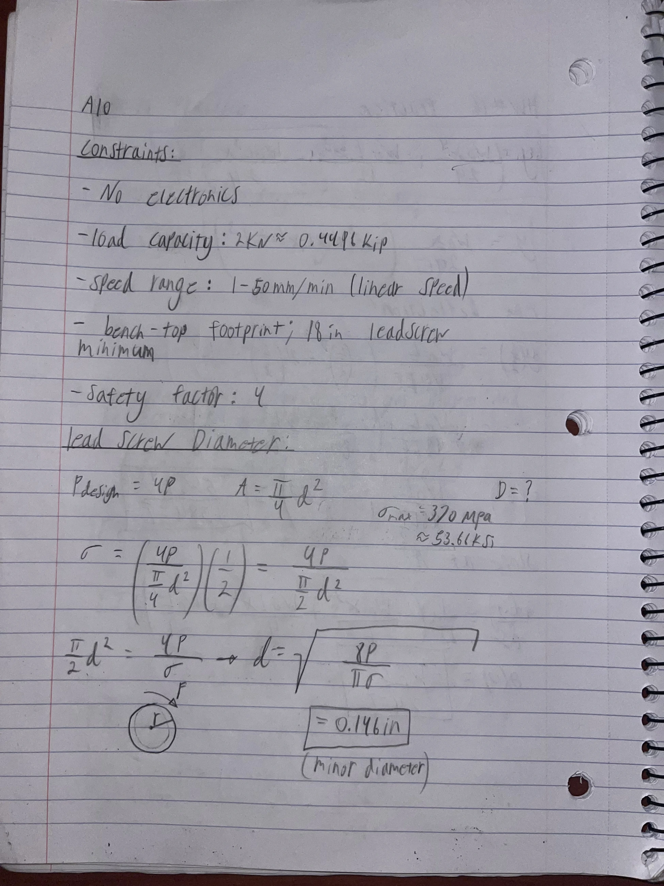<figcaption><strong>Figure 2.</strong> Patrick Klauser: design constraints, axial screw sizing, FBD, and minimum root diameter. <a href="images/patrick-diameter.webp" target="_blank" rel="noopener">Full size</a>.</figcaption></figure>

### Rotational speed range

For a single-start screw, the nut advances one pitch per revolution. We used revolutions per minute for N and reserved angular velocity, ω, for radians per second.

p = 1/16 in = 1.5875 mm 
ℓ = p × number of starts = <strong>1.5875 mm/rev</strong> 
v = Nℓ → N = v/ℓ  
Nmin = 1/1.5875 = <strong>0.6299 rpm</strong> 
Nmax = 50/1.5875 = <strong>31.496 rpm</strong> 
ω = 2πN/60 = <strong>0.0660–3.298 rad/s</strong>

The maximum-speed worksheet result is approximately 31.5 rpm. The intermediate 0.528 value is approximately revolutions per second, not radians per second. Both screws must turn at the same rate to avoid tilting the crosshead.

### Torque at maximum specimen load

We solved for the thread torque using F = 1,000 N per screw, a single-start 1/4″-16 thread, and the 14.5° Acme half-angle. The basic mean thread diameter is dm = d − p/2 = 5.55625 mm. The assumed screw/nut friction coefficient is stated explicitly because changing it changes the torque considerably.

T = (Fdm/2)[(ℓ cos α + πμdm)/(πdm cos α − μℓ)] 
α = 14.5°; F = 1,000 N; dm = 5.55625 mm; ℓ = 1.5875 mm  
For μ = 0.15: 
T = <strong>692.85 N·mm = 0.6929 N·m = 6.132 lbf·in per screw</strong> 
Tpair,1:1 = 2T = <strong>1.386 N·m</strong>  
For the worksheet assumption μ = 0.80: 
T = <strong>2.755 N·m per screw</strong>; Tpair,1:1 = <strong>5.511 N·m</strong>

Our first torque worksheets used μ = 0.80 and a square-thread approximation. We retained that calculation as part of the development record, then used the Acme flank angle and the basic mean diameter in the comparison above. The 0.15 value is a preliminary friction assumption; the 0.80 case shows the effect of the much higher worksheet assumption. Neither coefficient is a measured value for our purchased screw and bronze nut. Bearing friction, crosshead weight, starting friction, and transmission losses add to the required input torque. [Thread angle and friction reference](https://help.solidworks.com/2022/english/solidworks/cworks/r_Friction_Factor_Coefficient.htm).

<figure class="a10-figure handwork" id="a10-figure-3">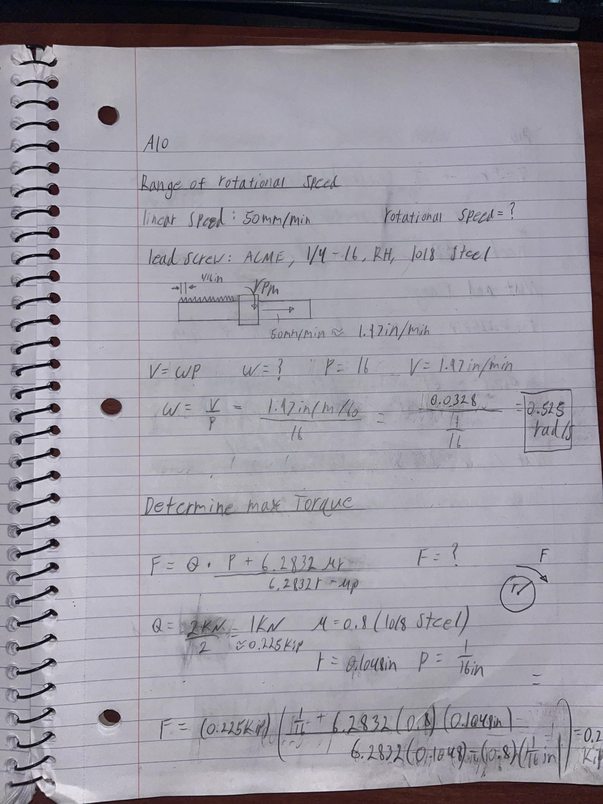<figcaption><strong>Figure 3.</strong> Patrick Klauser: screw speed and the first torque calculation. The typed analysis distinguishes rpm from rad/s and states the friction assumptions. <a href="images/patrick-speed.webp" target="_blank" rel="noopener">Full size</a>.</figcaption></figure>

## Nut and flange analysis — Antonio Chiocca

We selected the bronze, externally threaded 95072A881 nut and its 95082A641 flange. The nut has a right-hand 1/4″-16 internal Acme thread. Its external 9/16″-18 thread connects to the flange. The flange then transfers the nut reaction into the crosshead through its mounting bolts. The external mounting thread and the internal lead-screw thread perform different jobs.

<figure class="a10-figure cad" id="a10-figure-4">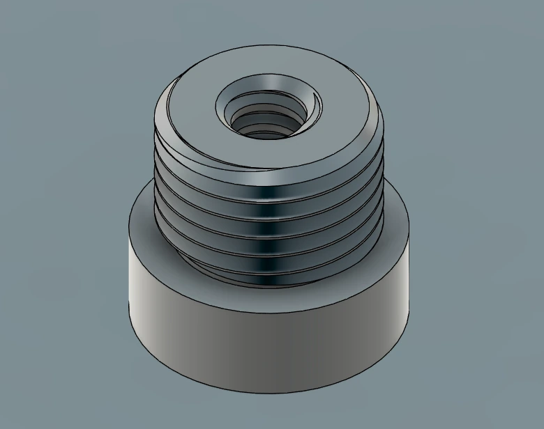<figcaption><strong>Figure 4.</strong> Imported externally threaded bronze nut, McMaster 95072A881. <a href="images/nut.webp" target="_blank" rel="noopener">Full size</a>.</figcaption></figure><figure class="a10-figure cad" id="a10-figure-5"><figcaption><strong>Figure 5.</strong> Imported nut mounting flange, McMaster 95082A641. <a href="images/flange.webp" target="_blank" rel="noopener">Full size</a>.</figcaption></figure>

### Internal thread bending

The worksheet uses F = 1,000 N = 224.81 lbf, p = 0.0625 in, an effective engagement length Le = 0.375 in, and a conservative thread-root diameter dr = 0.161 in. These engagement and root dimensions are calculation assumptions. They give six engaged threads under an equal-load-sharing approximation.

Nt = Le/p = 0.375/0.0625 = <strong>6 threads</strong> 
Fthread = F/Nt 
Mthread = (F/Nt)(p/4) 
Zthread = (πdr)(p/2)²/6 
σb = M/Z = <strong>6F/(Ntπdrp)</strong>  
σb = 6(224.81)/[6π(0.161)(0.0625)] = <strong>7.111 ksi</strong> 
Required Sy,nut ≥ nσb = 4(7.111) = <strong>28.45 ksi</strong>

For a reference C67300 bronze yield strength of 30 ksi, this model gives n = 30/7.111 = **4.22**. Wieland Concast lists 30-ksi minimum yield for an extruded-and-drawn C67300 condition. That is the material requirement used for this check, not a strength certification for the McMaster nut. Actual engagement and uneven load distribution between threads affect the result. [C67300 material data](https://www.concast.com/files/C67300.pdf).

<figure class="a10-figure handwork" id="a10-figure-6"><figcaption><strong>Figure 6.</strong> Antonio Chiocca: nut-thread bending and crosshead sizing, including the original support sketches. <a href="images/aj-nut-crosshead.webp" target="_blank" rel="noopener">Full size</a>.</figcaption></figure>

## Crosshead beam analysis — Antonio Chiocca

We used the flange diameter to establish a minimum crosshead width. The selected flange is 1 39/64 in, or 1.6094 in, in diameter. A 2-in width gives room around that interface. The drawing places the screw centers 6 in apart within an 8-in overall length; the outer 1-in portions extend beyond the screw centers.

The beam calculation uses W = 2,000 N, span L = 152.4 mm, width b = 50.8 mm, and drawing thickness h = 14.3002 mm. We used E = 68,900 MPa, consistent with the worksheet's aluminum modulus. For the strength example, Sy = 240 MPa is a stated 6061-T6 design basis; material temper controls the strength of the manufactured part. The screenshots are reported separately using their own displayed FOS values.

### Bending strength

For a simply supported beam with a centered point load:

RL = RR = W/2 = <strong>1,000 N</strong> 
Mmax = WL/4 = <strong>76,200 N·mm</strong> 
I = bh³/12 = <strong>12,379.7 mm⁴</strong>; c = h/2 
σmax = Mc/I = 3WL/(2bh²) 
hmin,strength = √[3nWL/(2bSy)]  
σmax = <strong>44.01 MPa</strong> 
nbeam = 240/44.01 = <strong>5.45</strong> 
hmin,strength = <strong>12.25 mm = 0.482 in</strong>

This gross-section calculation does not include the local stress concentration around mounting holes. That is one reason we also examined the hole regions in FEA.

### Deflection and support restraint

The support model changes the deflection substantially. A nut/flange connection may restrain rotation, but it should not automatically be treated as a perfectly fixed end. We compared the simply supported and fully fixed beam limits using the same center load and screw-center span.

Simply supported: δmax = WL³/(48EI) = WL³/(4Ebh³) 
hmin,deflection = ∛[WL³/(4Ebδallow)] 
δsimple = <strong>0.1729 mm</strong> 
hmin,deflection = <strong>17.16 mm = 0.676 in</strong>  
Fully fixed ends: δmax = WL³/(192EI) 
δfixed = <strong>0.04323 mm</strong>

At the drawing thickness, the simple-support result exceeds 0.100 mm while the fully fixed result is below it. The recorded FEA displacements are smaller still. This difference makes the load application area and rotational restraint at the mounting holes important to the interpretation; the beam check and the FEA should not be treated as identical support models. The earlier worksheet used a 384EI denominator and a longer sizing span. We replaced that expression with the center-load formulas above for the 6-in screw-center span.

<figure class="a10-figure handwork" id="a10-figure-7">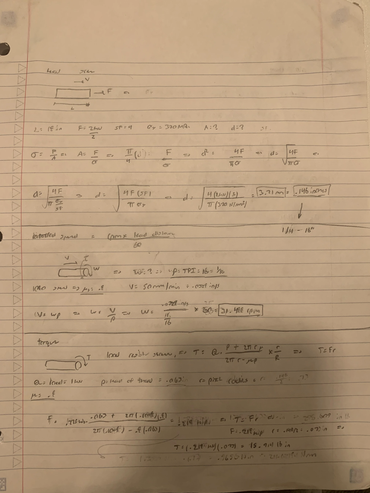<figcaption><strong>Figure 7.</strong> Antonio Chiocca: screw-load FBD, axial sizing, rotational speed, and torque working. <a href="images/aj-screw.webp" target="_blank" rel="noopener">Full size</a>.</figcaption></figure>

## CAD assembly and drawing — Rick Bhattacharya

We imported the catalog lead screws, nuts, flanges, and T-slot framing, then modeled the crosshead to suit their interfaces. Keeping those catalog parts in the assembly let us check the screw spacing and the fit between the crosshead and the two nut/flange assemblies.

| Component | Source / design role |
|---|---|
| Lead screws | [99030A981](https://www.mcmaster.com/99030A981/), two 18-in precision Acme screws in CAD |
| Bronze nuts | [95072A881](https://www.mcmaster.com/95072A881/), two |
| Mounting flanges | [95082A641](https://www.mcmaster.com/95082A641/), two |
| Short framing members | [47065T414](https://www.mcmaster.com/47065T414/), imported 1-ft framing |
| Uprights | [47065T21](https://www.mcmaster.com/47065T21/), imported 2-ft framing |
| Crosshead | Custom 6061 aluminum component, available as a Fusion archive below |

<figure class="a10-figure cad" id="a10-figure-8"><figcaption><strong>Figure 8.</strong> Underside of the crosshead showing the two nut/flange interfaces and screw-clearance locations. <a href="images/interface.webp" target="_blank" rel="noopener">Full size</a>.</figcaption></figure>

The crosshead has two Ø0.255-in screw-clearance holes and eight Ø0.26-in mounting holes. The mounting-hole groups sit around the two screw axes. The original plate had square outside corners; the revision rounds those corners while retaining the two mounting regions.

<figure class="a10-figure cad" id="a10-figure-9">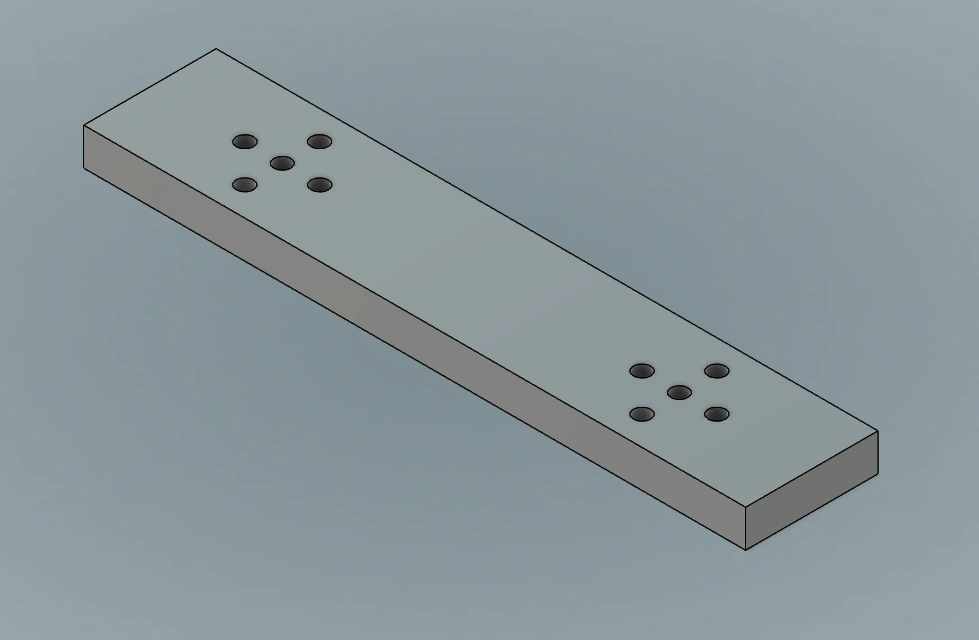<figcaption><strong>Figure 9.</strong> Initial crosshead with square outside corners and two flange-hole groups. <a href="images/original.webp" target="_blank" rel="noopener">Full size</a>.</figcaption></figure><figure class="a10-figure cad" id="a10-figure-10">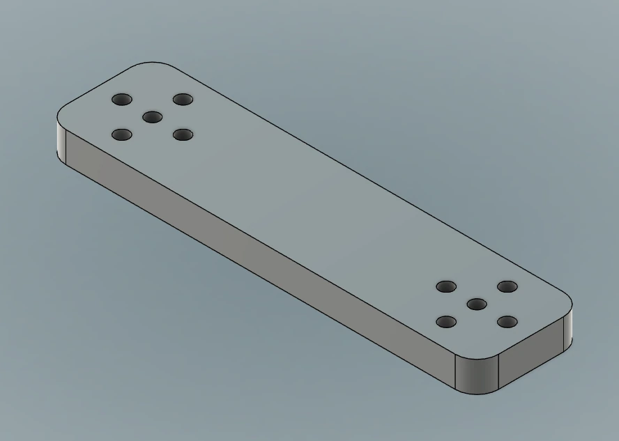<figcaption><strong>Figure 10.</strong> Revised crosshead with rounded outside corners. The mounting regions and hole groups are retained. <a href="images/revised.webp" target="_blank" rel="noopener">Full size</a>.</figcaption></figure>

### Crosshead multiview drawing

The drawing shows the top, front, side, and isometric views, the 8-in overall length, 6-in screw spacing, 0.563-in thickness, and the two hole sizes. The original CAD drawing is shown below.

<a class="a10-pdf-title" href="files/Crosshead.pdf">Crosshead drawing · PDF</a>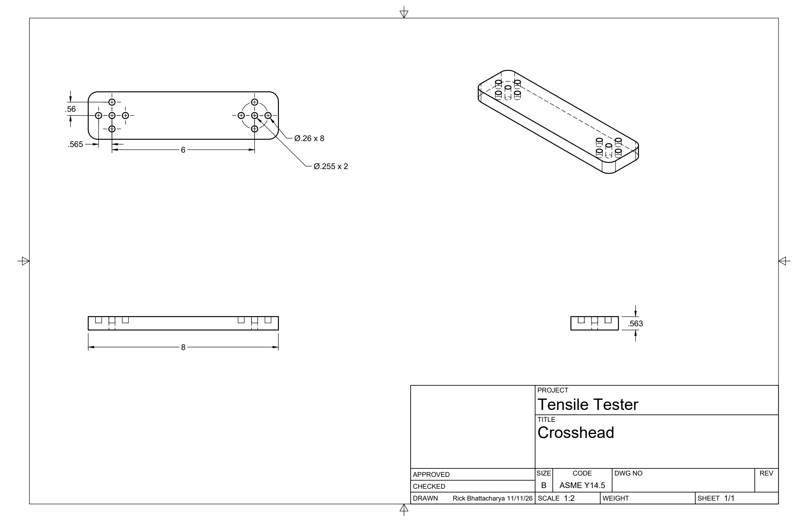

PDF viewer with zoom controls
<object type="application/pdf" data="files/Crosshead.pdf" aria-label="Crosshead drawing" width="100%" height="650"><a href="files/Crosshead.pdf">Open PDF</a></object>

### Parameters and interface intent

The dimensions that drive this layout are the crosshead length, width, thickness, screw-center spacing, screw-clearance diameter, mounting-hole diameter, and flange-hole offsets. The central specimen force acts midway between the two screw axes. The flange bolts transfer the two reactions into the plate; the center clearance holes let the screws pass through without acting as plain radial bearings.

## Crosshead FEA and geometry revision — Rick Bhattacharya, Patrick Klauser, and Antonio Chiocca

We compared the initial plate and the rounded-corner revision using static stress results in Fusion. The design load path is a centered 2-kN specimen force into the crosshead, balanced by reactions through the nut/flange mounting regions. The constraint symbols in the recorded plots are located at the mounting holes. These idealized restraints represent the local attachment regions rather than the flexibility of the entire tester frame.

### Recorded results

| Metric | Initial plate | Rounded-corner revision |
|---|---:|---:|
| Maximum von Mises stress | 2.853 ksi / 19.67 MPa | 3.557 ksi / 24.52 MPa |
| Maximum plotted resultant displacement | Approximately 0.003 mm | Approximately 0.012 mm |
| FOS information in the plots | Above the displayed scale of 8 | Minimum FOS = 11.212 |
| Critical stress region | Near the flange mounting holes | Near the flange mounting holes |
| Largest displacement region | Between the mounting regions | Between the mounting regions |
| Displacement / 0.100-mm limit | Approximately 3% | Approximately 12% |

The stress rose by **24.7%** between the recorded results. The displacement increased by roughly a factor of four using the rounded plot labels. We kept those changes in the comparison rather than describing the revision as a stress reduction. The revised study's reported FOS is above the required 4, and its plotted displacement is below 0.100 mm.

<figure class="a10-figure cad" id="a10-figure-11"><figcaption><strong>Figure 11.</strong> Initial study: maximum von Mises stress 2.853 ksi. The strongest stress concentrations are near mounting holes. The displayed deformation is exaggerated. <a href="images/stress-before.webp" target="_blank" rel="noopener">Full size</a>.</figcaption></figure><figure class="a10-figure cad" id="a10-figure-12">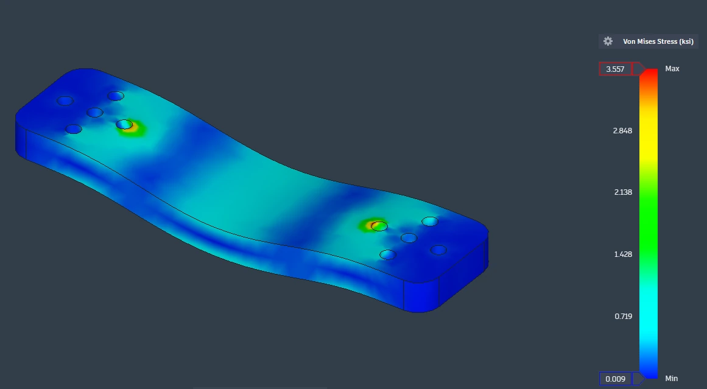<figcaption><strong>Figure 12.</strong> Revised study: maximum von Mises stress 3.557 ksi. The critical region remains near the attachment holes. The apparent curvature is the displayed deformation. <a href="images/stress-after.webp" target="_blank" rel="noopener">Full size</a>.</figcaption></figure>

<figure class="a10-figure cad" id="a10-figure-13">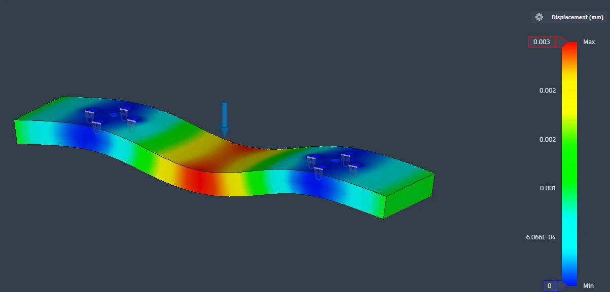<figcaption><strong>Figure 13.</strong> Initial study: maximum plotted resultant displacement approximately 0.003 mm. <a href="images/disp-before.webp" target="_blank" rel="noopener">Full size</a>.</figcaption></figure><figure class="a10-figure cad" id="a10-figure-14"><figcaption><strong>Figure 14.</strong> Revised study: maximum plotted resultant displacement approximately 0.012 mm. <a href="images/disp-after.webp" target="_blank" rel="noopener">Full size</a>.</figcaption></figure>

<figure class="a10-figure cad" id="a10-figure-15">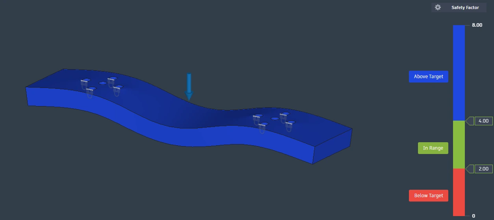<figcaption><strong>Figure 15.</strong> Initial safety-factor plot. Blue is above the displayed upper scale of 8; it is not an exact numerical minimum. <a href="images/fos-before.webp" target="_blank" rel="noopener">Full size</a>.</figcaption></figure><figure class="a10-figure cad" id="a10-figure-16">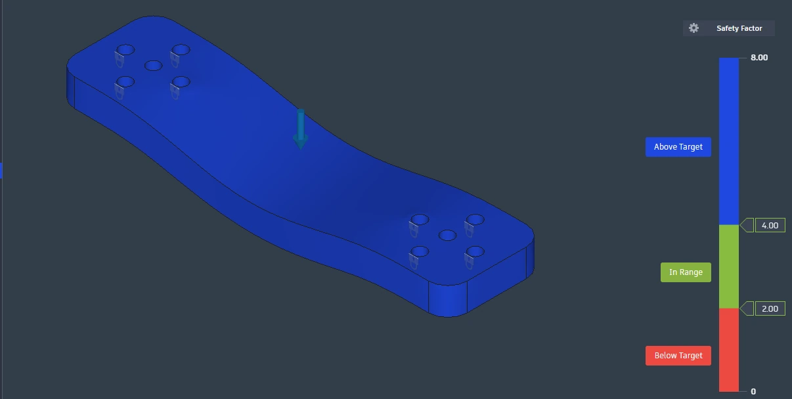<figcaption><strong>Figure 16.</strong> Revised safety-factor plot. The target is 4, and the displayed blue field is above the upper scale. <a href="images/fos-after.webp" target="_blank" rel="noopener">Full size</a>.</figcaption></figure>

<figure class="a10-figure cad" id="a10-figure-17"><figcaption><strong>Figure 17.</strong> Revised study result panel: minimum safety factor 11.212, based on yield strength. <a href="images/fos-detail.webp" target="_blank" rel="noopener">Full size</a>.</figcaption></figure>

The revised stress and FOS imply a solver yield basis of about 39.88 ksi (275 MPa): 3.557 × 11.212 ≈ 39.88. This inferred solver value is distinct from the 240-MPa beam-strength example. The safety-factor colors saturate at 8, so blue does not mean the actual minimum FOS is exactly 8.

### Volume proxy for the corner change

We estimated the corner radius at approximately 0.40 in from the scaled top view, using its 8-in overall length as the reference. This gives a geometric volume proxy for rounding four corners at constant thickness. It is not an exported CAD mass measurement. The hole volumes cancel when comparing the two outlines because the hole patterns are unchanged.

ΔA ≈ (4 − π)r² = (4 − π)(0.40)² = <strong>0.13735 in²</strong> 
ΔV ≈ ΔA × h = 0.13735(0.563) = <strong>0.07733 in³</strong> 
Vinitial,proxy = [8(2) − (π/4)(2 × 0.255² + 8 × 0.26²)](0.563) ≈ <strong>8.711 in³</strong> 
Vrevised,proxy ≈ <strong>8.634 in³</strong> 
Estimated reduction ≈ <strong>0.89%</strong>

The corner change removes a small amount of material and leaves the main bending section and mounting pads intact. The stress concentration remains at the attachment holes, which is a more useful location to examine than the blue outer corners. The broad displacement contours show bending between the supports. A separate vertical-displacement probe at the grip line is needed to distinguish that motion from any lateral displacement or twisting.

### Interpretation of the studies

These are the recorded results of two geometry studies. They do not establish mesh convergence. The load magnitude is not visible in the response plots, so the 2-kN design requirement is kept separate from the documented plot values. A geometry change and a mesh refinement answer different questions, and the two before/after pictures cannot substitute for a refinement series on the same geometry. Autodesk recommends comparing stress at a consistent location as the mesh is refined. [Fusion mesh convergence guidance](https://help.autodesk.com/cloudhelp/ENU/Fusion-Simulate/files/SIM-MESH-CONVERGENCE.htm).

The lower FEA deflections also depend on the idealized mounting restraint. We therefore treat the plotted response as the response of those local study conditions, rather than as a measured compliance of the complete tester.

## Bill of materials

The purchased-component list totals **$299.91**. Unit costs below are calculated from the recorded line totals and quantities. Custom crosshead machining and material are outside this purchased-parts total.

| Item | Quantity | Component | Cost per item | Line total | Purchase link |
|---|---:|---|---:|---:|---|
| 1 | 1 | 36-in Acme lead screw stock | $12.74 | $12.74 | [98935A803](https://www.mcmaster.com/98935A803/) |
| 2 | 2 | Nut mounting flange | $37.06 | $74.12 | [95082A641](https://www.mcmaster.com/95082A641/) |
| 3 | 2 | Bronze lead screw nut | $35.78 | $71.56 | [95072A881](https://www.mcmaster.com/95072A881/) |
| 4 | 5 | 1-ft T-slot framing member | $17.15 | $85.75 | [47065T414](https://www.mcmaster.com/47065T103-47065T414/) |
| 5 | 2 | 2-ft T-slot framing member | $27.87 | $55.74 | [T-slot framing](https://www.mcmaster.com/products/extrusions/t-slotted-framing-rails-1~~/) |
| | | **Total** | | **$299.91** | |

The cost sheet uses a 36-in stock screw, while the CAD uses two 18-in precision screws with a different catalog number. The purchased-parts total records the cost-sheet selection. Cutting one exactly 36-in bar into two finished 18-in screws also requires accounting for saw kerf; it does not provide two exact finished lengths by itself.

<a class="a10-pdf-title" href="files/A10-BOM.pdf">Bill of materials · PDF</a>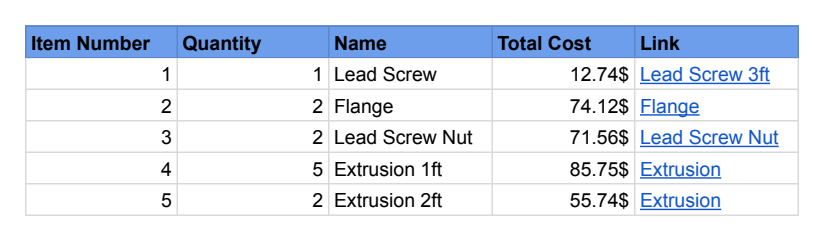

PDF viewer with zoom controls
<object type="application/pdf" data="files/A10-BOM.pdf" aria-label="Bill of materials" width="100%" height="650"><a href="files/A10-BOM.pdf">Open PDF</a></object>

## Lessons learned

Splitting the specimen load between two screws simplified the axial sizing, but it did not remove the need to define the support arrangement. The root diameter carries the axial stress, and the mean thread diameter enters the torque calculation. Using the outside diameter for both would hide that difference.

The speed calculation was sensitive to units. Dividing mm/min by mm/revolution gives rpm directly. Converting that result into radians per second requires an additional factor of 2π/60. Writing the units at each step caught the mislabeled intermediate result in our first worksheet.

The crosshead work showed why support conditions belong beside the result. The same plate gives a different deflection when its ends can rotate than when its mounting regions are fixed. A small displacement in the solver does not explain that restraint by itself.

Rounding the outside corners changed the recorded response, but the peak stress stayed near the flange holes. That made the connection regions the main focus of our interpretation. We also kept the material removed separate from the stress change: a revision can remove material and still increase stress and displacement.

**Total time spent: 10 hours.**

## CAD, drawing, and team downloads

| File | Contents |
|---|---|
| [Tester assembly — Fusion F3Z](files/tensile-tester.f3z) | Assembly archive with its referenced components |
| [Crosshead — Fusion F3D](files/crosshead.f3d) | Editable crosshead design and the saved study structure |
| [Original drawing export](files/Crosshead.pdf) | Original multiview drawing by Rick Bhattacharya |
| [Bill of materials](files/A10-BOM.pdf) | Original cost sheet |
| [Bill of materials CSV](files/A10-BOM.csv) | Editable, typed cost table with purchase links |
| [Submission PDF](files/A10-team-report.pdf) | Team report, calculations, figures, and original drawing |
| [Original handwritten work](files/A10-original-work.zip) | The four original calculation photographs |
| [Team website package](files/A10-team-website-package.zip) | Matching report content, standalone webpage, Markdown, images, CAD, PDFs, and integration notes |

## References

- MEGR 2156/2157, *Lead Screw System Design Part 1*: assignment requirements, load, speed range, safety factor, and crosshead deflection limit.
- [McMaster precision Acme screws and nuts](https://www.mcmaster.com/products/lead-screws/thread-size~1-4-16/): thread compatibility, selected screw and bronze nut.
- [McMaster nut mounting flanges](https://www.mcmaster.com/products/nonmetallic-acme-nuts/): 95082A641 mounting dimensions.
- [Roton Acme engineering data](https://www.roton.com/products/acme-lead-screws-nuts/engineering-data/): reference root diameter and screw/nut selection context. Roton values are not a certification of a different manufacturer's screw.
- [Online Metals 1018 guide](https://www.onlinemetals.com/en/product-guide/alloy/1018): reference steel properties.
- [Wieland Concast C67300 data](https://www.concast.com/files/C67300.pdf): bronze strength by material condition.
- [Aircraft Materials 6061 data](https://www.aircraftmaterials.com/data/aluminium/6061.html): reference temper-dependent aluminum strength.
- [SOLIDWORKS thread friction definitions](https://help.solidworks.com/2022/english/solidworks/cworks/r_Friction_Factor_Coefficient.htm): Acme thread angle and friction assumptions.
- [Autodesk Fusion mesh convergence](https://help.autodesk.com/cloudhelp/ENU/Fusion-Simulate/files/SIM-MESH-CONVERGENCE.htm): refinement and consistent-location stress comparison.
