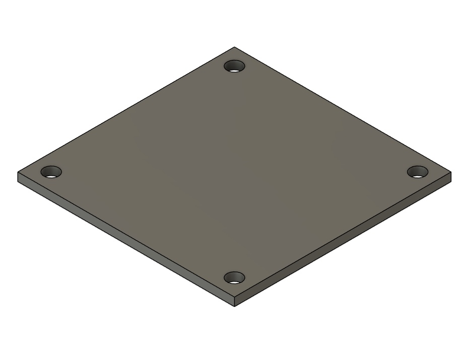
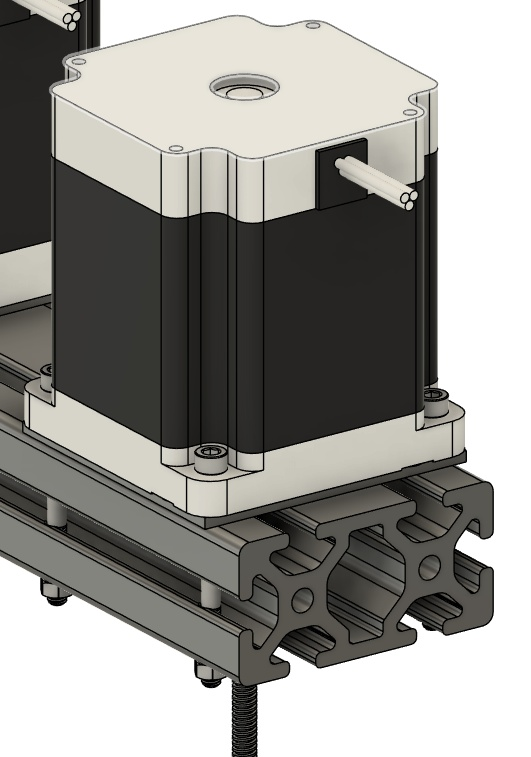
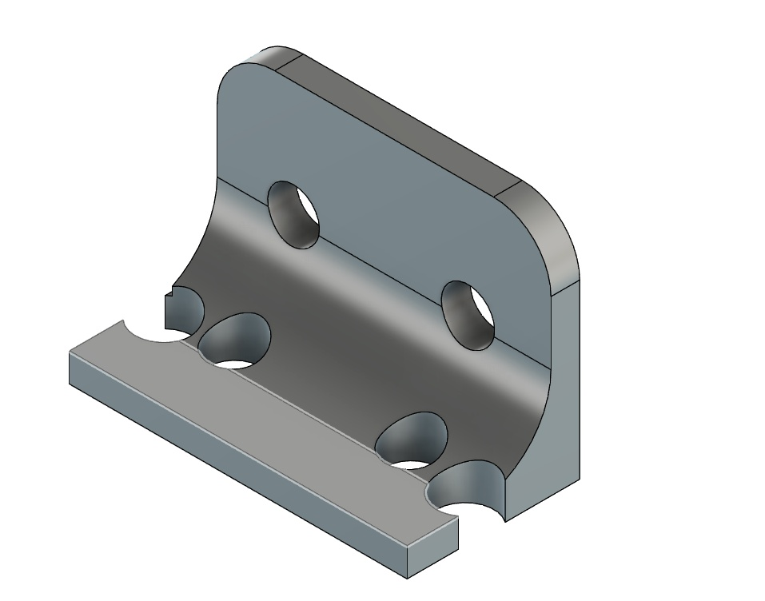
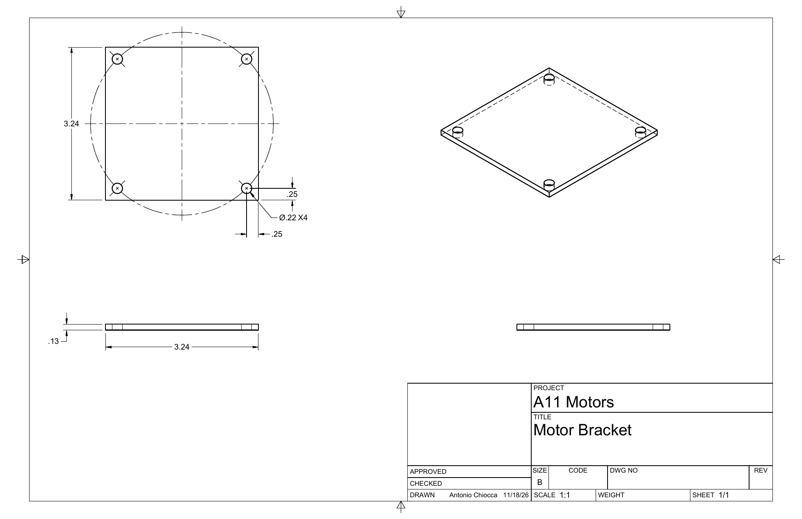

# A11 - Motor selection and frame design

Rick Bhattacharya · Antonio Chiocca · Patrick Klauser 
MEGR 2157 · Total recorded time **12 hours**

<a href="files/A11-team-report.pdf">Submission PDF</a> · <a href="files/tensile-tester.f3z" download>Tester assembly CAD</a> · <a href="#drawing-package">Drawing package</a>

## Objective

We continued the design of the benchtop tensile tester from A10. We selected motors for the two leadscrews, designed their mounts and shaft connections, and laid out the frame connections and lower bearing supports. The frame revision makes room for the drive hardware while keeping the leadscrews 6 in apart.

<figure class="a11-figure " id="a11-figure-1"><figcaption><strong>Figure 1.</strong> Isometric CAD view of the assembled tensile tester. <a href="images/assembly.jpg" target="_blank" rel="noopener">Full size</a>.</figcaption></figure>

## Requirements and design inputs

| Input | Value |
|---|---|
| Maximum specimen load | 2,000 N |
| Nominal load per screw | 1,000 N, with centered loading and equal sharing |
| Crosshead speed | 1–50 mm/min |
| Required safety factor | 4 |
| A10 leadscrew | Single-start 1/4″–16 Acme, 18 in long |
| Screw lead | 1.5875 mm/rev |
| Screw-center spacing | 6 in (152.4 mm) |
| Top frame | 12 in (304.8 mm) long, heavy 40 Series, 80 × 40 mm extrusion |

## Motor selection — Patrick Klauser

We chose two MOONS’ 34HC1308 stepper motors, one for each screw. Each turn moves the crosshead 1.5875 mm. To move at 1–50 mm/min, each motor needs to turn at about 0.63–31.50 rpm. We used 3.82 N·m per motor for the A11 design calculations, as recorded in our notes.

Motor speed = crosshead speed ÷ distance per turn = (1 to 50)/1.5875 = <strong>0.63–31.50 rpm</strong>

| Motor parameter | Value |
|---|---|
| Holding torque | 5.4 N·m |
| Rated current | 2 A |
| Drive supply used for curve comparison | 48 V DC |
| Step angle | 1.2° |
| Output shaft | 12.7 mm diameter |
| Mounting pattern | Four flange holes matched by the bracket |
| Numerical efficiency | Unpublished in the motor specifications |

Our notes estimate about 4.16 N·m at 50 rpm from the 48 V curve. This is above the 3.82 N·m used in our calculations, but 50 rpm is outside the tester’s required range. We still need to verify the torque at startup and throughout the range we plan to use. The published 5.4 N·m holding torque applies with the shaft stationary. [MOONS’ motor specifications and curve downloads](https://www.moonsindustries.com/p/nema-34-smooth-hybrid-stepper-motors/34hc1308-000004611110015035).

<figure class="a11-figure " id="a11-figure-2"><figcaption><strong>Figure 2.</strong> Motor torque and temperature rise versus speed from the team’s working report. <a href="images/motor-curve.jpg" target="_blank" rel="noopener">Full size</a>.</figcaption></figure>

## Motor mount — Patrick Klauser

The plate uses nominal 0.125-in (3.175-mm) 1018 cold-rolled steel. The drawing shows a 3.24-in square plate, four Ø0.22-in holes, and 0.25-in offsets to the hole centers. The 80 × 40 mm extrusion allowed the motor and bracket to use one four-bolt pattern after the original 1.5-in square extrusion left no material beneath the motor holes.

We checked how hard each bolt presses against its hole when the motor turns. We assumed the four M5 bolts share the torque equally and used the worksheet’s 370 MPa material strength with a safety factor of 4.

s = (3.24 − 2 × 0.25) × 25.4 = 69.596 mm 
r = s/√2 = 49.21 mm 
Fbolt = T/(4r) = 3,820/[4(49.21)] = <strong>19.4 N</strong> 
σb,allow = 370/4 = 92.5 MPa (worksheet assumption) 
tmin = Fbolt/(σb,allowd) = 19.4/[92.5(5)] = <strong>0.042 mm</strong> 
σb = 19.4/[5(3.175)] = <strong>1.22 MPa</strong> at the selected thickness

The first worksheet used the radius of a bolt hole. The distance we need is from the center of the motor shaft to the center of a bolt. With that correction, the hole bearing check gives 1.22 MPa for the selected plate. The 0.042 mm result is the minimum from that one check. It does not account for bending or keeping the motor aligned.

<figure class="a11-figure " id="a11-figure-3"><figcaption><strong>Figure 3.</strong> Motor mount plate. <a href="images/mount-plate.jpg" target="_blank" rel="noopener">Full size</a>.</figcaption></figure><figure class="a11-figure " id="a11-figure-4"><figcaption><strong>Figure 4.</strong> Motor and mount on the revised top extrusion. <a href="images/mount-installed.jpg" target="_blank" rel="noopener">Full size</a>.</figcaption></figure>

<figure class="a11-figure handwork" id="a11-figure-5"><figcaption><strong>Figure 5.</strong> Original motor mount free-body sketch and bearing-stress worksheet. <a href="images/mount-handwork.jpg" target="_blank" rel="noopener">Full size</a>.</figcaption></figure>

## Coupler selection — Patrick Klauser

The BOM lists McMaster 6446K566, a flexible clamping coupler. The clamp hubs grip the shafts and the flexible section accommodates small alignment differences. The necessary coupler opening drove the change to wider extrusion.

**Knowns and unknowns.** The motor shaft sets one 12.7-mm bore. Use 3.82 N·m of torque and the worksheet’s assumed allowable shear of 10 ksi (68.95 MPa). Solve for the outside diameter and radial wall of an ideal hollow hub.

J = (π/32)(Do4 − Di4) 
τmax = 16TDo/[π(Do4 − Di4)] 
For T = 3,820 N·mm, Di = 12.7 mm and τmax = 68.95 MPa, solve numerically: 
Do = <strong>13.13 mm</strong> and t = (Do − Di)/2 = <strong>0.215 mm</strong>

The worksheet’s first diameter result was smaller than the bore. Solving the full hollow-section equation gives a positive radial wall. The idealized hub calculation does not establish the rating of the selected flexible coupler. Its torque capacity and both stock bore sizes still need to match the assembly. [McMaster coupler listing](https://www.mcmaster.com/6446K566/).

<figure class="a11-figure " id="a11-figure-6"><figcaption><strong>Figure 6.</strong> Flexible clamp-style coupler. <a href="images/coupler.jpg" target="_blank" rel="noopener">Full size</a>.</figcaption></figure><figure class="a11-figure " id="a11-figure-7"><figcaption><strong>Figure 7.</strong> Original torsional free-body diagram and symbolic work. <a href="images/coupler-handwork.jpg" target="_blank" rel="noopener">Full size</a>.</figcaption></figure>

## Frame and motor twist — Rick Bhattacharya

We used 5.4 N·m per motor for a holding case and assumed both motors twist the top frame in the same direction. In our hand calculation, two sideways forces at the ends balance that twist. We assumed the supports are 12 in apart. The screws are 6 in apart and centered between the supports.

<figure class="a11-figure handwork" id="a11-figure-8"><figcaption><strong>Figure 8.</strong> Original top-view sketch and calculations. The center spacing label should read 6 in. The 12 in dimension is the assumed span between supports. <a href="images/frame-handwork.jpg" target="_blank" rel="noopener">Full size</a>.</figcaption></figure>

ΣFy = HA − HB = 0 
ΣMA = T1 + T2 − HBL = 0 
HA = HB = (T1 + T2)/L = (5.4 + 5.4)/0.3048 = <strong>35.43 N</strong> 
Hdesign = 4(35.43) = <strong>141.7 N</strong> at each end, opposite directions

To see what the end force means for a bracket, we checked a trial 40 Series angle with a 6 mm thick, 36 mm wide section and one M8 bolt on the loaded leg. We used the bolt’s smooth shank area and the 141.7 N load, which already includes the safety factor of 4.

τbolt = 141.7/50.27 = <strong>2.82 MPa</strong> 
σbearing = 141.7/[6(8)] = <strong>2.95 MPa</strong> 
σbending = 6(141.7e)/[36(6²)] = <strong>0.656e MPa</strong>, e in mm

These numbers apply to the trial [80/20 40-4302 angle](https://8020.net/40-4302.html). We drew a different connector for the assembly. To check that connector, we still need its loading dimensions and the capacity of the actual bolts and T-slot hardware.

<figure class="a11-figure " id="a11-figure-9"><figcaption><strong>Figure 9.</strong> CAD view of the modeled top-to-upright connector. <a href="images/frame-bracket.jpg" target="_blank" rel="noopener">Full size</a>.</figcaption></figure>

## Top frame FEA — Rick Bhattacharya

The study represents the top beam restrained at the ends and loaded at the screw locations. The intended case combines two 1,000 N axial forces and two motor reaction moments.

| Baseline result | Value |
|---|---:|
| Maximum von Mises stress shown on plot | 20.536 MPa |
| Maximum displacement magnitude shown on plot | 0.012 mm |
| Safety factor recorded in the notes | About 13; exact value not visible on the plot |

<figure class="a11-figure " id="a11-figure-10"><figcaption><strong>Figure 10.</strong> Top extrusion and the screw and bracket interface locations used in the study. <a href="images/fea-setup.jpg" target="_blank" rel="noopener">Full size</a>.</figcaption></figure>

<figure class="a11-figure " id="a11-figure-11"><figcaption><strong>Figure 11.</strong> Baseline von Mises stress contour. <a href="images/fea-stress.jpg" target="_blank" rel="noopener">Full size</a>.</figcaption></figure><figure class="a11-figure " id="a11-figure-12"><figcaption><strong>Figure 12.</strong> Baseline displacement magnitude. <a href="images/fea-displacement.jpg" target="_blank" rel="noopener">Full size</a>.</figcaption></figure>

<figure class="a11-figure " id="a11-figure-13"><figcaption><strong>Figure 13.</strong> Safety-factor contour and target band. <a href="images/fea-safety.jpg" target="_blank" rel="noopener">Full size</a>.</figcaption></figure><figure class="a11-figure " id="a11-figure-14"><figcaption><strong>Figure 14.</strong> Proposed hole in a lightly stressed region near midspan. <a href="images/fea-proposed.jpg" target="_blank" rel="noopener">Full size</a>.</figcaption></figure>

The displacement magnitude is highest near midspan. A hole in the region marked in red was proposed for weight reduction. The grip-line vertical displacement, exact peak-stress location, mesh convergence and revised simulation results were not recorded in the available study.

## Vertical frame FEA — Rick Bhattacharya

For the upright study, our hand calculations give 1,000 N downward per upright under symmetric loading. The motor twist also gives a sideways load of 35.43 N at each upright, in opposite directions, using the assumed 12 in span. We have no upright simulation results to report.

## Floating bearing mount — Antonio Chiocca

The lower mount supports the screw radially while it rotates and provides the floating support. Four fasteners attach the 1.50 × 1.50 in housing to the lower frame. The housing has raised bolt seats and rounded corners.

| Feature | Drawing dimension |
|---|---|
| Housing height | 0.3125 in |
| Housing fastener holes | Four Ø0.1969 in, with +0.0002 in shown |
| Inner bearing | Ø0.250 in bore with +0.0006 in shown, Ø0.400 in OD, 0.375 in long |
| Outer bearing | Ø0.400 in ID, Ø0.600 in OD, 0.275 in long |

### Bearing fits and bolt clearance

The Ø0.400 in outer surface of the inner bearing matches the outer bearing bore nominally. The Ø0.600 in outer surface of the outer bearing matches the housing opening nominally. Those dimensions establish where the components mate. The production fits depend on the size limits on both parts.

The design specifies RC3 at the screw journal. If the inner bearing bore is interpreted as 0.2500–0.2506 in, an exactly 0.2500 in journal would give 0–0.0006 in of diametral clearance. The journal tolerance is needed to calculate its minimum and maximum clearance and verify RC3.

Minimum running clearance = Dbore,min − djournal,max 
Maximum running clearance = Dbore,max − djournal,min 
Four housing holes, interpreting the drawing’s positive tolerance: 
0.1969–0.1971 in × 25.4 = <strong>5.001–5.006 mm</strong>

The housing hole range leaves only about 0.001–0.006 mm of diametral clearance relative to a nominal 5.000 mm bolt. Confirm the M5 clearance-hole class using *Machinery’s Handbook* and account for hole position before releasing the housing.

<figure class="a11-figure " id="a11-figure-15"><figcaption><strong>Figure 15.</strong> CAD view of the lower housing, bearing stack and four mounting locations. <a href="images/bearing-mount.jpg" target="_blank" rel="noopener">Full size</a>.</figcaption></figure>

## Drawing package — Antonio Chiocca

### Frame connector and motor bracket drawings

The frame connector sheet records the two mounting faces, the 0.25 in leg thickness and the Ø0.45 and Ø0.50 in openings. The motor bracket sheet locates the four Ø0.22 in holes on a 3.24 in square plate. The bracket hole locations supply the bolt-group radius used in the motor mount calculation.

<a class="a11-pdf-title" href="files/frame-connector.pdf">Frame connector · PDF</a>

PDF viewer with zoom controls
<object type="application/pdf" data="files/frame-connector.pdf" aria-label="Frame connector" width="100%" height="650"><a href="files/frame-connector.pdf">Open PDF</a></object>

<a class="a11-pdf-title" href="files/motor-bracket.pdf">Motor bracket · PDF</a>

PDF viewer with zoom controls
<object type="application/pdf" data="files/motor-bracket.pdf" aria-label="Motor bracket" width="100%" height="650"><a href="files/motor-bracket.pdf">Open PDF</a></object>

### Floating bearing drawings

The three bearing sheets show the housing, inner bearing and outer bearing separately. They document the mating diameters, component heights and the four fastener locations, so the bearing stack can be checked part by part.

<a class="a11-pdf-title" href="files/bearing-housing.pdf">Floating bearing housing · PDF</a>

PDF viewer with zoom controls
<object type="application/pdf" data="files/bearing-housing.pdf" aria-label="Floating bearing housing" width="100%" height="650"><a href="files/bearing-housing.pdf">Open PDF</a></object>

<a class="a11-pdf-title" href="files/inner-bearing.pdf">Inner bearing · PDF</a>

PDF viewer with zoom controls
<object type="application/pdf" data="files/inner-bearing.pdf" aria-label="Inner bearing" width="100%" height="650"><a href="files/inner-bearing.pdf">Open PDF</a></object>

<a class="a11-pdf-title" href="files/outer-bearing.pdf">Outer bearing · PDF</a>

PDF viewer with zoom controls
<object type="application/pdf" data="files/outer-bearing.pdf" aria-label="Outer bearing" width="100%" height="650"><a href="files/outer-bearing.pdf">Open PDF</a></object>

### Crosshead drawing

<a class="a11-pdf-title" href="files/crosshead.pdf">Crosshead · PDF</a>

PDF viewer with zoom controls
<object type="application/pdf" data="files/crosshead.pdf" aria-label="Crosshead" width="100%" height="650"><a href="files/crosshead.pdf">Open PDF</a></object>

The isometric assembly view is shown with the objective. The Fusion archive includes the referenced components.

## Bill of materials and labor — Antonio Chiocca

| A11 purchase | Quantity | Extended cost |
|---|---:|---:|
| MOONS’ 34HC1308 motors | 2 | $340.00 |
| McMaster 6446K566 flexible couplers | 2 | $303.42 |
| M5 bolts | 8 | $5.88 |
| **A11 listed parts** | | **$649.30** |

<a class="a11-pdf-title" href="files/a11-bom.pdf">A11 bill of materials · PDF</a>

PDF viewer with zoom controls
<object type="application/pdf" data="files/a11-bom.pdf" aria-label="A11 bill of materials" width="100%" height="650"><a href="files/a11-bom.pdf">Open PDF</a></object>

| Engineering labor | Recorded hours | Cost at $35/hr |
|---|---:|---:|
| Rick Bhattacharya | 4 | $140.00 |
| Antonio Chiocca | 3 | $105.00 |
| Patrick Klauser | 5 | $175.00 |
| **Total** | **12** | **$420.00** |

The [A10 BOM](files/a10-bom.pdf) records $299.91 in earlier parts. A11 parts and recorded labor total **$1,069.30**. Adding the prior listed parts gives **$1,369.21** before any adjustments for the revised extrusion or unpriced items.

## Lessons learned

- **Check torque at the working speed.** The 5.4 N·m holding rating applies to a stationary shaft. Comparing the curve with the required 0.630–31.496 rpm band shows where we have data and where we still need a low-speed check.
- **Lay out the drive as an assembly.** The first extrusion left too little room around the coupler and no material beneath the motor bolt pattern. Placing both components and their fasteners in the same layout earlier would have caught the interference before the frame changed.
- **Use the real moment arm.** The mounting worksheet used the hole radius to turn torque into bolt force. The drawing gave us the actual distance from the shaft axis to the bolt center. The same principle applies to the frame calculation, where the distance between supports sets the reaction force.
- **Dimension the bearing and mounting interfaces separately.** The shaft needs a running fit, the lower bearing needs room to float, and the bolts need assembly clearance. Each callout has a different job and needs its own check.
- **Compare FEA changes against a baseline.** The first contour helped us find a possible location for a weight reduction hole. Repeating the study with the same loads and comparable mesh settings would show whether the hole changes grip-line stiffness or moves the peak stress.

## CAD files and supporting documents

- [Fusion tensile tester assembly](files/tensile-tester.f3z)
- [A11 team submission PDF](files/A11-team-report.pdf)
- [Original design notes and calculations](files/a11-working-report.pdf)
- [A11 bill of materials](files/a11-bom.pdf) and [A10 bill of materials](files/a10-bom.pdf)

## References

- [MOONS’ 34HC1308 product specifications, drawings and torque curves](https://www.moonsindustries.com/p/nema-34-smooth-hybrid-stepper-motors/34hc1308-000004611110015035)
- [80/20 40 Series trial corner bracket and hardware](https://8020.net/40-4302.html)
- [McMaster flexible coupler](https://www.mcmaster.com/6446K566/)
