

# A11 - Motor selection and frame design

Rick Bhattacharya · Antonio Chiocca · Patrick Klauser 
MEGR 2157 · Total recorded time **12 hours**

<a href="files/A11-team-report.pdf">Submission PDF</a> · <a href="files/tensile-tester.f3z" download>Tester assembly CAD</a> · <a href="#drawing-package">Drawing package</a>

## Objective

We continued the design of the benchtop tensile tester from A10. We selected motors for the two leadscrews, designed their mounts and shaft connections, and laid out the frame connections and lower bearing supports. The frame revision makes room for the drive hardware while keeping the leadscrews 6 in apart.

<figure class="a11-figure " id="a11-figure-1">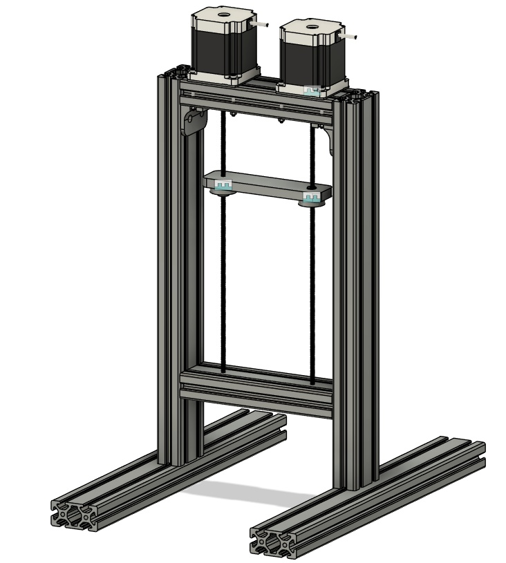<figcaption><strong>Figure 1.</strong> Isometric CAD view of the assembled tensile tester. <a href="images/assembly.jpg" target="_blank" rel="noopener">Full size</a>.</figcaption></figure>

## Requirements and design inputs

| Input | Value |
|---|---|
| Maximum specimen load | 2,000 N |
| Nominal load per screw | 1,000 N, with centered loading and equal sharing |
| Crosshead speed | 1–50 mm/min |
| Required safety factor | 4 |
| A10 leadscrew | Single-start 1/4″–16 Acme, 18 in long |
| Screw lead | 1.5875 mm/rev |
| Screw-center spacing | 6 in (152.4 mm) |
| Top frame | 12 in (304.8 mm) long, heavy 40 Series, 80 × 40 mm extrusion |

## Motor selection — Patrick Klauser

We chose two MOONS’ 34HC1308 stepper motors. Our notes use 3.82 N·m at about 30 rpm for motor selection and record a curve reading of about 4.16 N·m at 50 rpm. The motor datasheet lists 5.4 N·m of holding torque.

<figure class="a11-figure " id="a11-figure-2">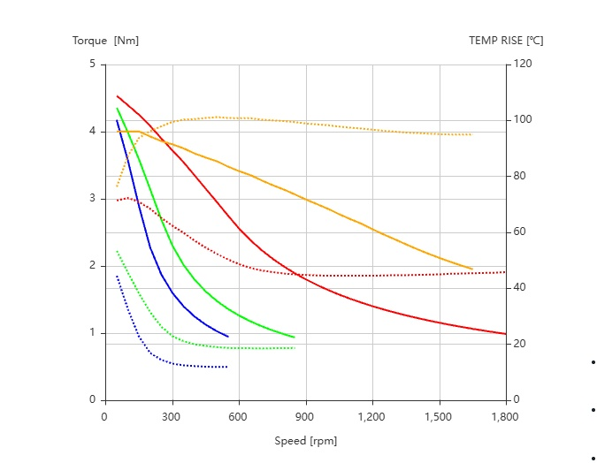<figcaption><strong>Figure 2.</strong> Motor curve included in the team report. <a href="images/motor-curve.jpg" target="_blank" rel="noopener">Full size</a>.</figcaption></figure>

## Motor mount — Patrick Klauser

We chose 0.125-in 1018 cold-rolled steel for the motor mount. Switching to an 80 × 40 mm extrusion made room beneath the four motor mounting holes.

<figure class="a11-figure " id="a11-figure-3"><figcaption><strong>Figure 3.</strong> Motor mount plate. <a href="images/mount-plate.jpg" target="_blank" rel="noopener">Full size</a>.</figcaption></figure><figure class="a11-figure " id="a11-figure-4"><figcaption><strong>Figure 4.</strong> Motor and mount on the wider extrusion. <a href="images/mount-installed.jpg" target="_blank" rel="noopener">Full size</a>.</figcaption></figure>

<figure class="a11-figure handwork" id="a11-figure-5">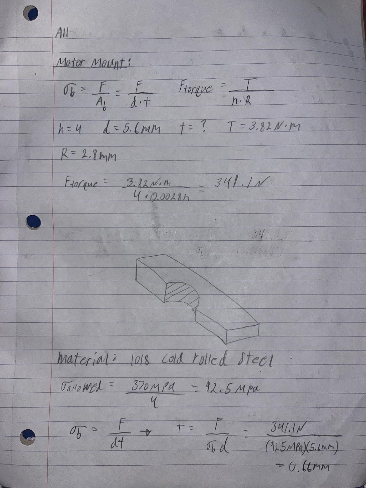<figcaption><strong>Figure 5.</strong> Our original motor mount calculation. <a href="images/mount-handwork.jpg" target="_blank" rel="noopener">Full size</a>.</figcaption></figure>

## Coupler selection — Patrick Klauser

We chose a flexible clamping coupler to grip the shafts and accommodate small alignment differences. The coupler opening helped drive the change to a wider extrusion.

<figure class="a11-figure " id="a11-figure-6">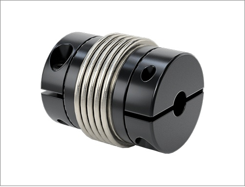<figcaption><strong>Figure 6.</strong> Flexible clamping coupler. <a href="images/coupler.jpg" target="_blank" rel="noopener">Full size</a>.</figcaption></figure><figure class="a11-figure " id="a11-figure-7">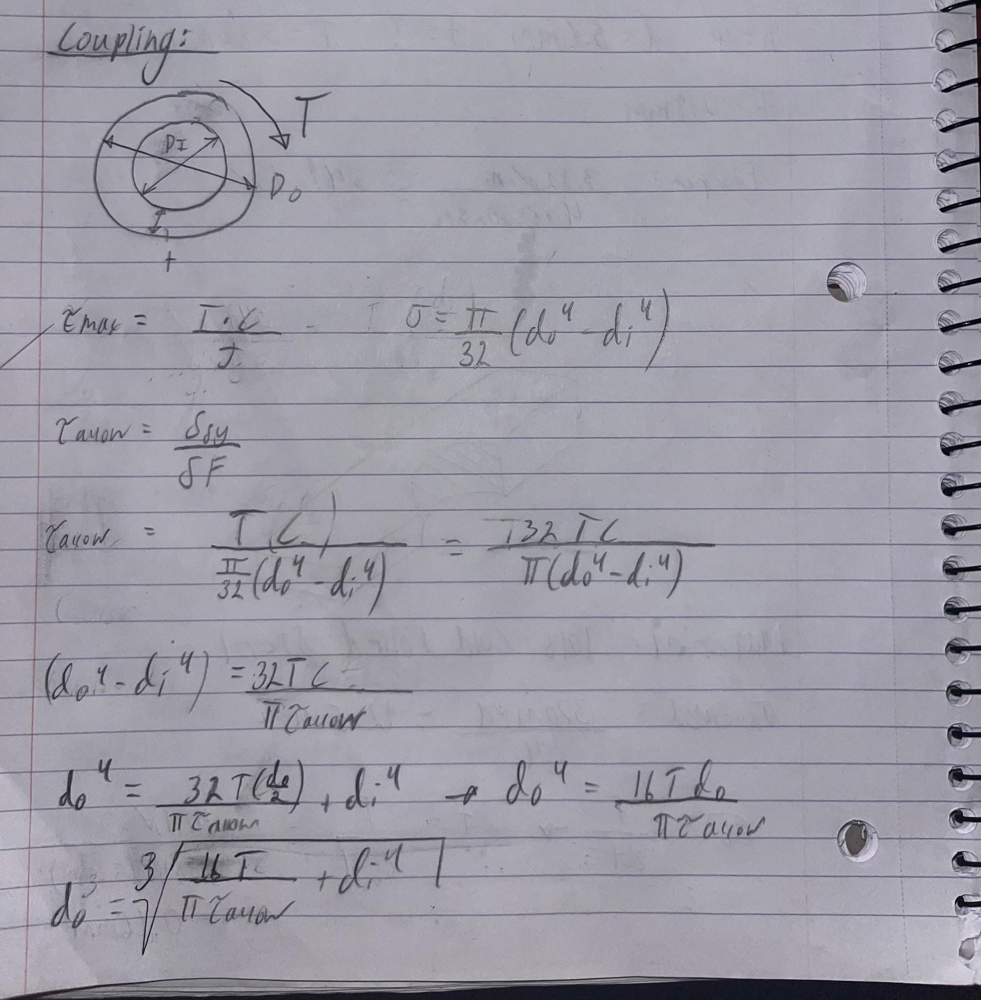<figcaption><strong>Figure 7.</strong> Our original torsion sketch and equations. <a href="images/coupler-handwork.jpg" target="_blank" rel="noopener">Full size</a>.</figcaption></figure>

<figure class="a11-figure handwork" id="a11-figure-8">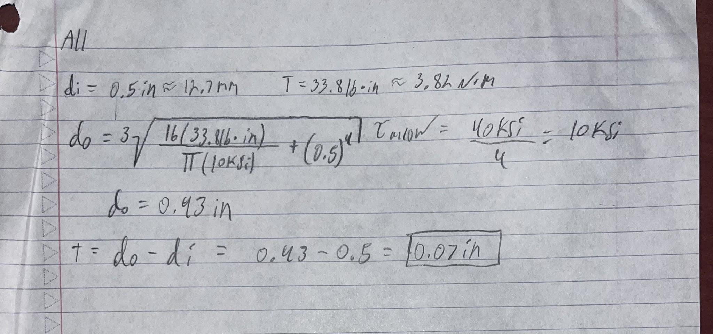<figcaption><strong>Figure 8.</strong> Our original coupler calculation. <a href="images/coupler-numbers.jpg" target="_blank" rel="noopener">Full size</a>.</figcaption></figure>

## Frame and motor twist — Rick Bhattacharya

Our hand calculation uses the two motors’ holding torques to find the sideways forces at the ends of the frame. The sketch below shows the calculation for the trial bracket.

<figure class="a11-figure handwork" id="a11-figure-9">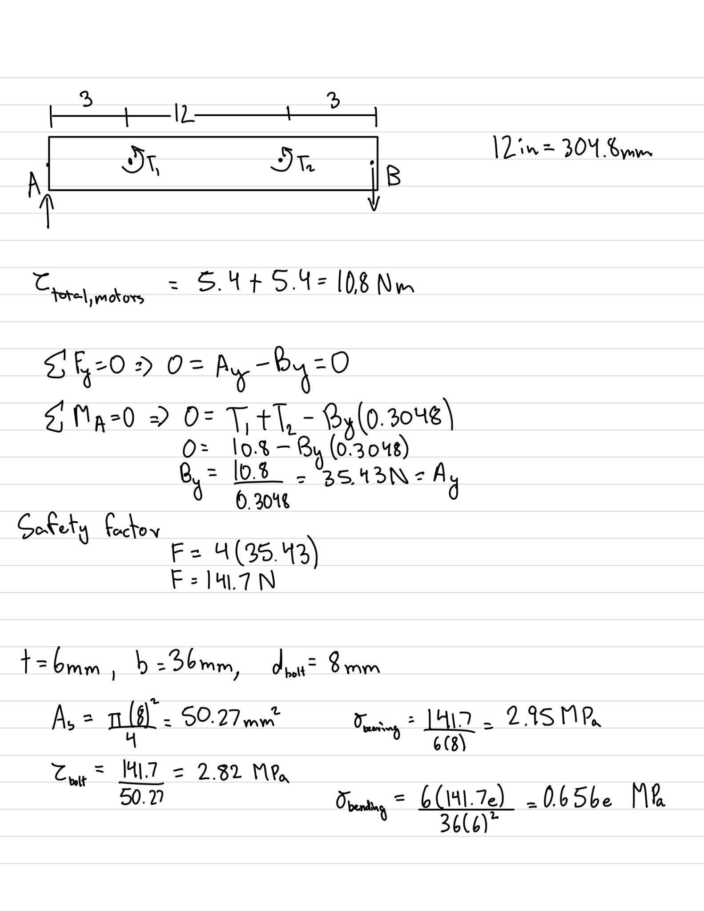<figcaption><strong>Figure 9.</strong> Our original frame sketch and bracket calculations. <a href="images/frame-handwork.jpg" target="_blank" rel="noopener">Full size</a>.</figcaption></figure>

<figure class="a11-figure " id="a11-figure-10"><figcaption><strong>Figure 10.</strong> CAD view of the modeled connector. <a href="images/frame-bracket.jpg" target="_blank" rel="noopener">Full size</a>.</figcaption></figure>

## Top frame FEA — Rick Bhattacharya

The study represents the top beam restrained at the ends and loaded at the screw locations. The intended case combines two 1,000 N axial forces and two motor reaction moments.

| Baseline result | Value |
|---|---:|
| Maximum von Mises stress shown on plot | 20.536 MPa |
| Maximum displacement magnitude shown on plot | 0.012 mm |
| Safety factor recorded in the notes | About 13; exact value not visible on the plot |

<figure class="a11-figure " id="a11-figure-11">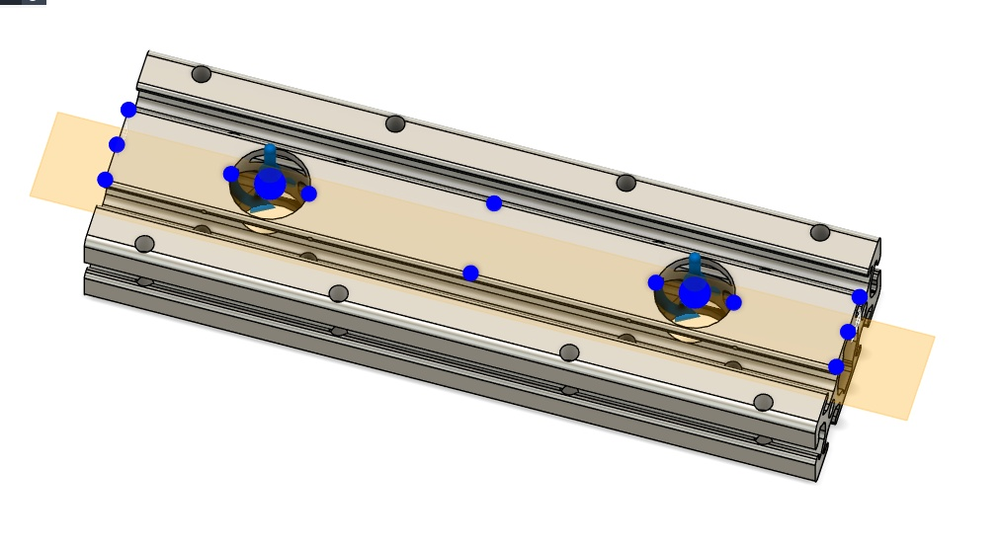<figcaption><strong>Figure 11.</strong> Top extrusion and the screw and bracket interface locations used in the study. <a href="images/fea-setup.jpg" target="_blank" rel="noopener">Full size</a>.</figcaption></figure>

<figure class="a11-figure " id="a11-figure-12">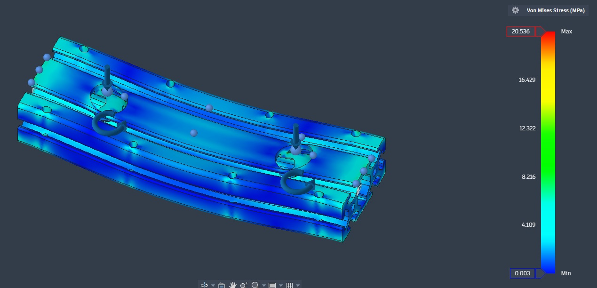<figcaption><strong>Figure 12.</strong> Baseline von Mises stress contour. <a href="images/fea-stress.jpg" target="_blank" rel="noopener">Full size</a>.</figcaption></figure><figure class="a11-figure " id="a11-figure-13">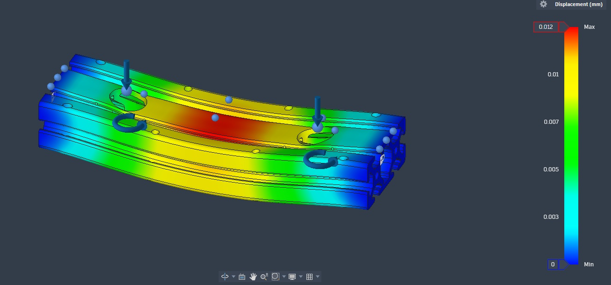<figcaption><strong>Figure 13.</strong> Baseline displacement magnitude. <a href="images/fea-displacement.jpg" target="_blank" rel="noopener">Full size</a>.</figcaption></figure>

<figure class="a11-figure " id="a11-figure-14">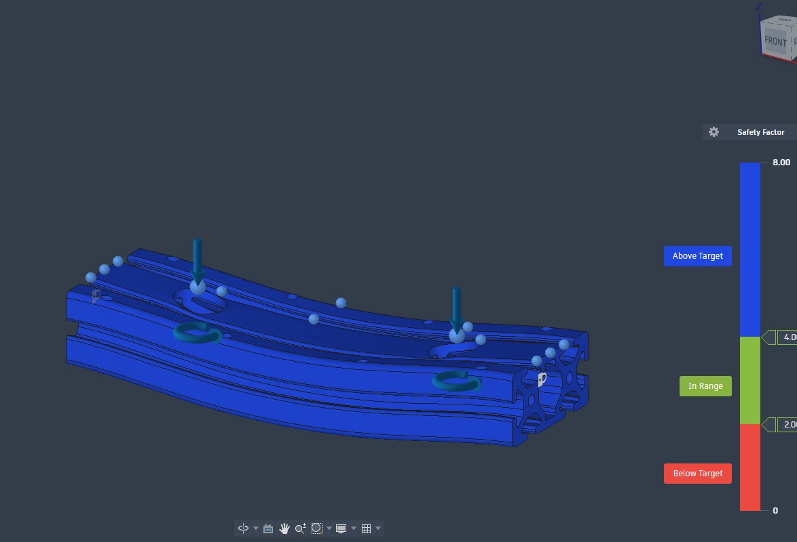<figcaption><strong>Figure 14.</strong> Safety-factor contour and target band. <a href="images/fea-safety.jpg" target="_blank" rel="noopener">Full size</a>.</figcaption></figure><figure class="a11-figure " id="a11-figure-15">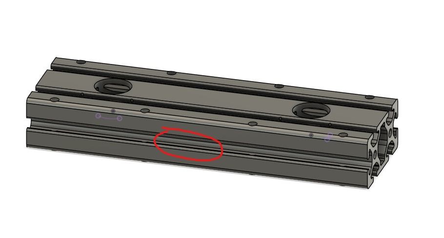<figcaption><strong>Figure 15.</strong> Proposed hole in a lightly stressed region near midspan. <a href="images/fea-proposed.jpg" target="_blank" rel="noopener">Full size</a>.</figcaption></figure>

The displacement magnitude is highest near midspan. A hole in the region marked in red was proposed for weight reduction. The grip-line vertical displacement, exact peak-stress location, mesh convergence and revised simulation results were not recorded in the available study.

## Vertical frame FEA — Rick Bhattacharya

No separate upright simulation results were recorded in the team report.

## Floating bearing mount — Antonio Chiocca

The lower mount supports the screw radially while it rotates and provides the floating support. Four fasteners attach the 1.50 × 1.50 in housing to the lower frame. The housing has raised bolt seats and rounded corners.

| Feature | Drawing dimension |
|---|---|
| Housing height | 0.3125 in |
| Housing fastener holes | Four Ø0.1969 in, with +0.0002 in shown |
| Inner bearing | Ø0.250 in bore with +0.0006 in shown, Ø0.400 in OD, 0.375 in long |
| Outer bearing | Ø0.400 in ID, Ø0.600 in OD, 0.275 in long |

Our design calls for an RC3 fit at the leadscrew opening. The drawings below show the dimensions our team recorded.

<figure class="a11-figure " id="a11-figure-16">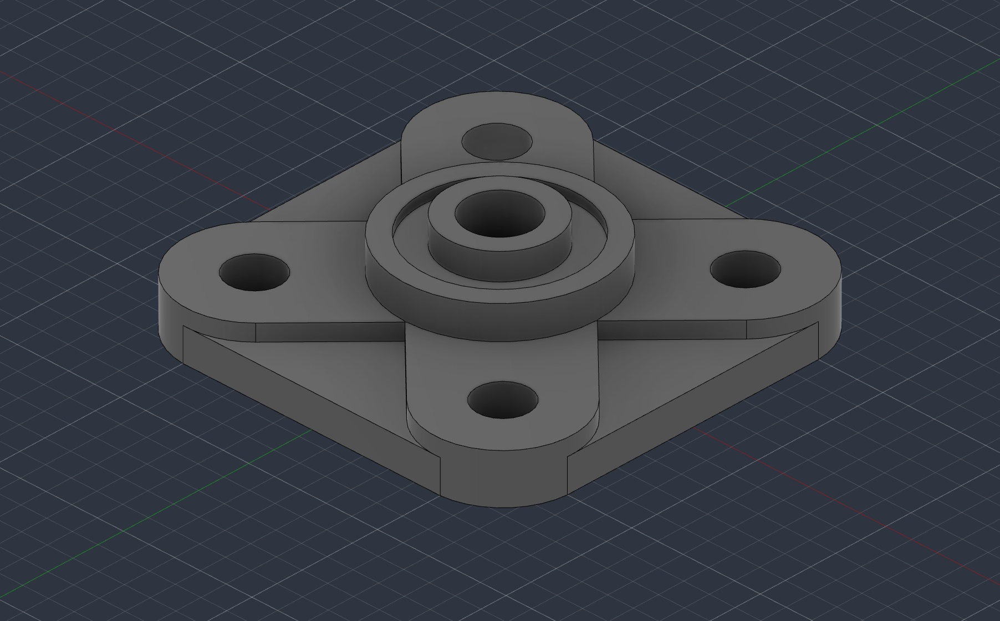<figcaption><strong>Figure 16.</strong> CAD view of the lower housing, bearing stack and four mounting locations. <a href="images/bearing-mount.jpg" target="_blank" rel="noopener">Full size</a>.</figcaption></figure>

## Drawing package — Antonio Chiocca

### Frame connector and motor bracket drawings

The frame connector sheet records the two mounting faces, the 0.25 in leg thickness and the Ø0.45 and Ø0.50 in openings. The motor bracket sheet locates the four Ø0.22 in holes on a 3.24 in square plate. 

<a class="a11-pdf-title" href="files/frame-connector.pdf">Frame connector · PDF</a>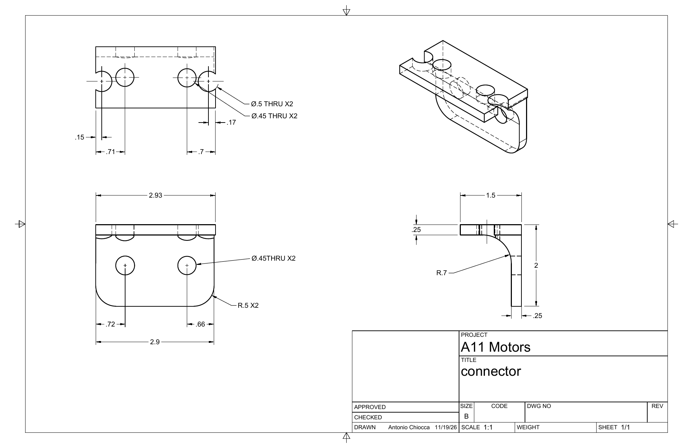

PDF viewer with zoom controls
<object type="application/pdf" data="files/frame-connector.pdf" aria-label="Frame connector" width="100%" height="650"><a href="files/frame-connector.pdf">Open PDF</a></object>

<a class="a11-pdf-title" href="files/motor-bracket.pdf">Motor bracket · PDF</a>

PDF viewer with zoom controls
<object type="application/pdf" data="files/motor-bracket.pdf" aria-label="Motor bracket" width="100%" height="650"><a href="files/motor-bracket.pdf">Open PDF</a></object>

### Floating bearing drawings

The three bearing sheets show the housing, inner bearing and outer bearing separately. They document the mating diameters, component heights and the four fastener locations, so the bearing stack can be checked part by part.

<a class="a11-pdf-title" href="files/bearing-housing.pdf">Floating bearing housing · PDF</a>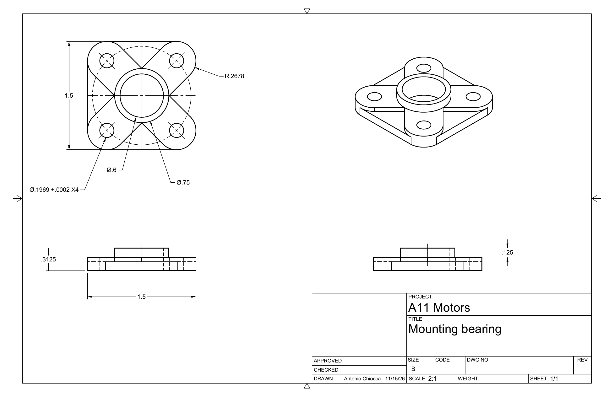

PDF viewer with zoom controls
<object type="application/pdf" data="files/bearing-housing.pdf" aria-label="Floating bearing housing" width="100%" height="650"><a href="files/bearing-housing.pdf">Open PDF</a></object>

<a class="a11-pdf-title" href="files/inner-bearing.pdf">Inner bearing · PDF</a>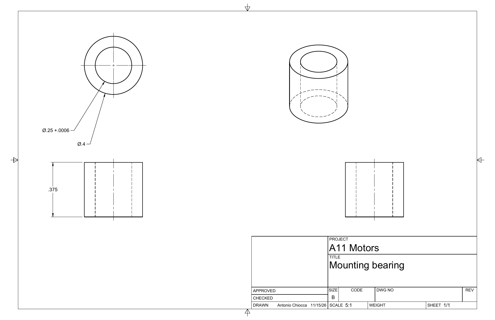

PDF viewer with zoom controls
<object type="application/pdf" data="files/inner-bearing.pdf" aria-label="Inner bearing" width="100%" height="650"><a href="files/inner-bearing.pdf">Open PDF</a></object>

<a class="a11-pdf-title" href="files/outer-bearing.pdf">Outer bearing · PDF</a>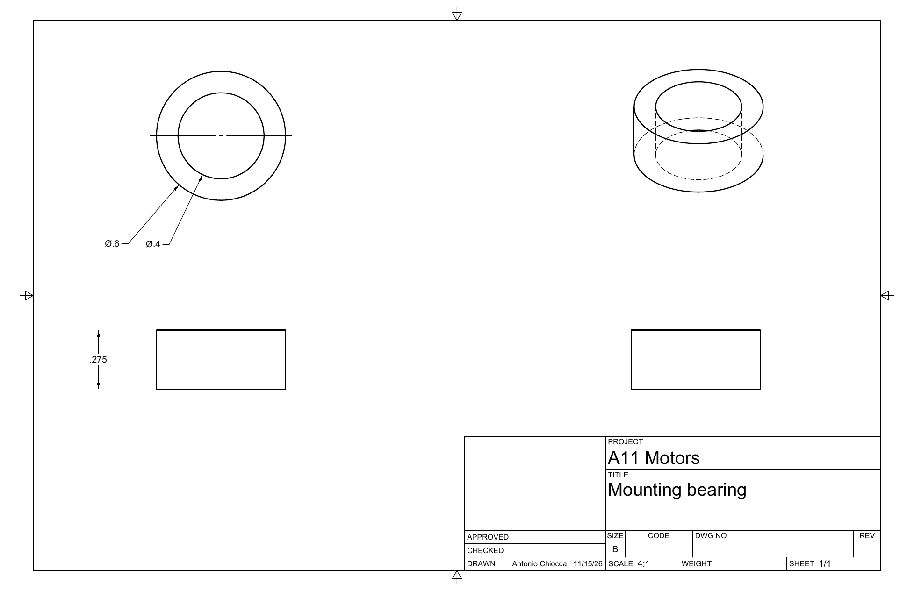

PDF viewer with zoom controls
<object type="application/pdf" data="files/outer-bearing.pdf" aria-label="Outer bearing" width="100%" height="650"><a href="files/outer-bearing.pdf">Open PDF</a></object>

### Crosshead drawing

<a class="a11-pdf-title" href="files/crosshead.pdf">Crosshead · PDF</a>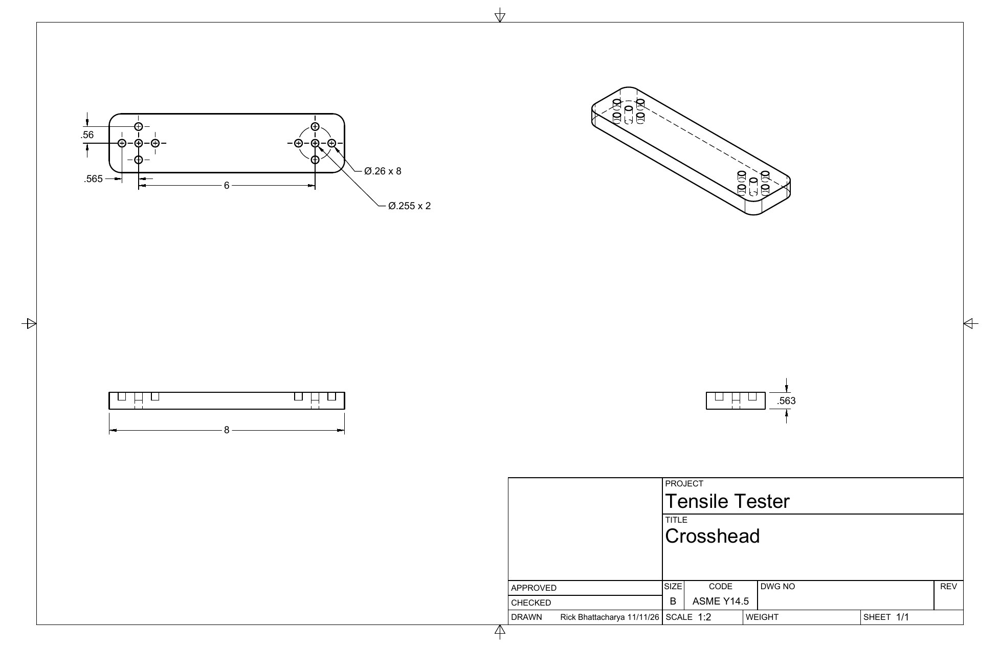

PDF viewer with zoom controls
<object type="application/pdf" data="files/crosshead.pdf" aria-label="Crosshead" width="100%" height="650"><a href="files/crosshead.pdf">Open PDF</a></object>

The isometric assembly view is shown with the objective. The Fusion archive includes the referenced components.

## Bill of materials and labor — Antonio Chiocca

| A11 purchase | Quantity | Extended cost |
|---|---:|---:|
| MOONS’ 34HC1308 motors | 2 | $340.00 |
| McMaster 6446K566 flexible couplers | 2 | $303.42 |
| M5 bolts | 8 | $5.88 |

<a class="a11-pdf-title" href="files/a11-bom.pdf">A11 bill of materials · PDF</a>

PDF viewer with zoom controls
<object type="application/pdf" data="files/a11-bom.pdf" aria-label="A11 bill of materials" width="100%" height="650"><a href="files/a11-bom.pdf">Open PDF</a></object>

| Team member | Recorded hours |
|---|---:|
| Rick Bhattacharya | 4 |
| Antonio Chiocca | 3 |
| Patrick Klauser | 5 |

The assignment uses a labor rate of $35 per hour. The source [A10 BOM](files/a10-bom.pdf) and A11 BOM list the part costs.

## Lessons learned

- **Check torque at the working speed.** The 5.4 N·m holding rating applies to a stationary shaft. We used the torque curve to compare the motor with the speed and torque in our notes.
- **Lay out the drive as an assembly.** The first extrusion left too little room around the coupler and no material beneath the motor bolt pattern. Placing both components and their fasteners in the same layout earlier would have caught the interference before the frame changed.
- **Use the real moment arm.** The mounting worksheet used the hole radius to turn torque into bolt force. The drawing gave us the actual distance from the shaft axis to the bolt center. The same principle applies to the frame calculation, where the distance between supports sets the reaction force.
- **Dimension the bearing and mounting interfaces separately.** The shaft needs a running fit, the lower bearing needs room to float, and the bolts need assembly clearance. Each callout has a different job and needs its own check.
- **Compare FEA changes against a baseline.** The first contour helped us find a possible location for a weight reduction hole. Repeating the study with the same loads and comparable mesh settings would show whether the hole changes grip-line stiffness or moves the peak stress.

## CAD files and supporting documents

- [Fusion tensile tester assembly](files/tensile-tester.f3z)
- [A11 team submission PDF](files/A11-team-report.pdf)
- [Original design notes and calculations](files/a11-working-report.pdf)
- [A11 bill of materials](files/a11-bom.pdf) and [A10 bill of materials](files/a10-bom.pdf)

## References

- [MOONS’ 34HC1308 product specifications, drawings and torque curves](https://www.moonsindustries.com/p/nema-34-smooth-hybrid-stepper-motors/34hc1308-000004611110015035)
- [80/20 40 Series trial corner bracket and hardware](https://8020.net/40-4302.html)
- [McMaster flexible coupler](https://www.mcmaster.com/6446K566/)
